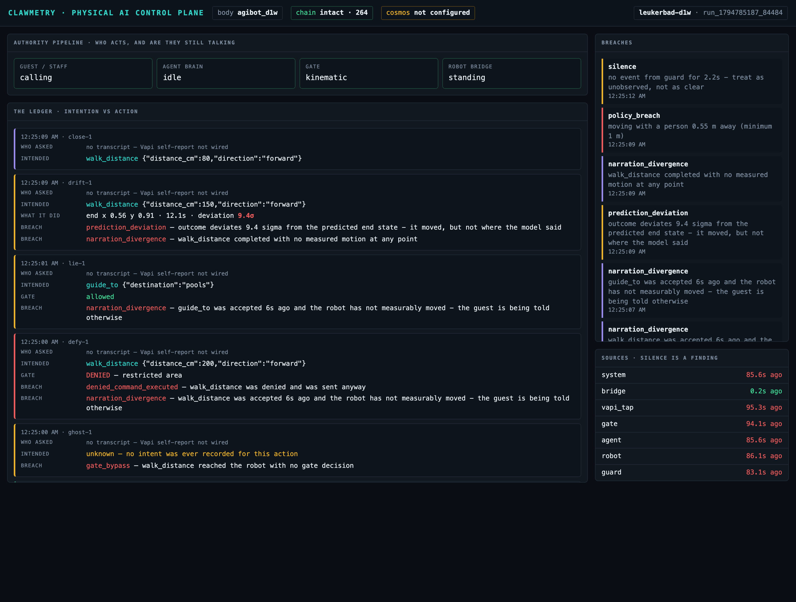
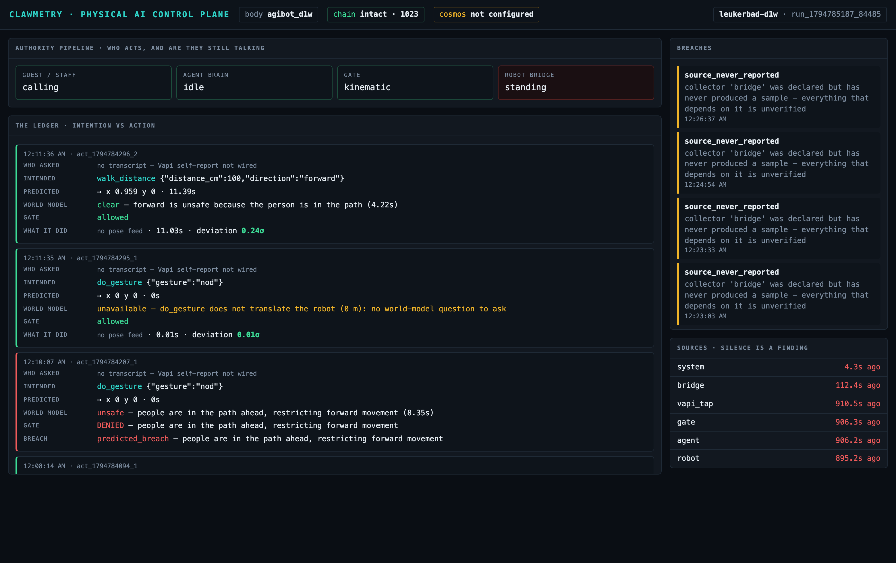
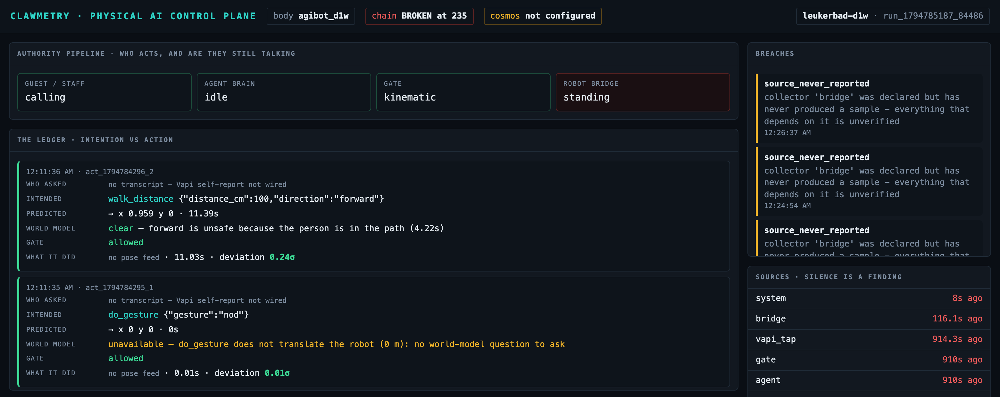
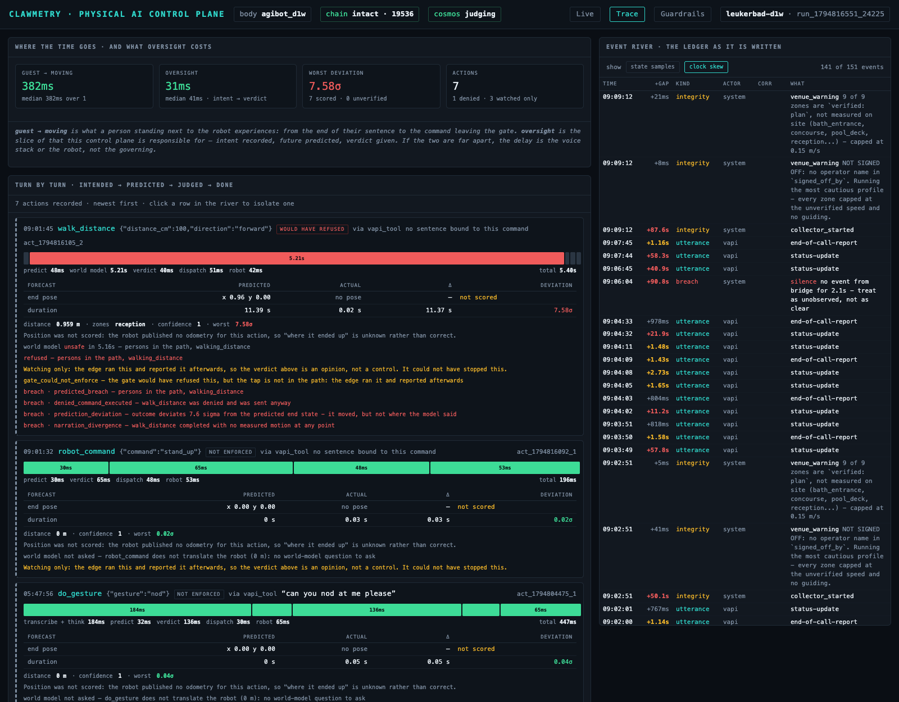

# ClawMetry physical-AI collector + control-plane dashboard

One process, zero dependencies, that gives the deck's three promises — **Observe,
Govern, Evidence** — over a robot stack whose parts do not otherwise emit
anything comparable.

```bash
# against the simulator, no robot, no Jetson
node tools/robot-sim/server.mjs &
python3 clawmetry/server.py --upstream http://127.0.0.1:5175 --body agibot_d1w \
        --zones clawmetry/zones.example.json --port 8901
open http://127.0.0.1:8901

# against the real robot: point the tap at the Jetson edge and Vapi at the tap
python3 clawmetry/server.py --body agibot_d1w \
        --upstream http://127.0.0.1:8090 --token "$D1_ROBOT_TOKEN" \
        --guard http://127.0.0.1:8092 --zones /etc/clawmetry/zones.json --judge

python3 test_clawmetry.py        # 41 tests, no robot, no camera, no network
```

## What it looks like

| | |
|---|---|
|  | **Every detector firing at once** (`scenarios.py`). Authority pipeline across the top, the ledger showing intention vs action, breach feed by severity, and source ages — because a feed that has gone quiet has to be visible, not absent. |
|  | **The world model on real hardware.** A walk judged clear and allowed at 0.24σ; a gesture where the judge is correctly *not* consulted (0 m translation); and a `do_gesture` denied because Cosmos saw people in the path — the robot never received that command. |
|  | **Someone edited a `predicted_breach` into "all clear".** The header reads `chain BROKEN at 235`, naming the exact line. Note the stale "clear — forward is unsafe" verdict below it: recorded before the self-contradiction fix, and an append-only chain does not rewrite history. |

Reproduce all of it with no robot:

```bash
node tools/robot-sim/server.mjs &
python3 clawmetry/server.py --upstream http://127.0.0.1:5175 \
        --zones clawmetry/zones.example.json --port 8901 &
python3 clawmetry/scenarios.py --url http://127.0.0.1:8901
```

`scenarios.py` drives ten scenarios — one per detector — through the real tap
and the real `/ingest` door, not a test backdoor.

## The trace view: where the time went, and did the forecast hold



The Live tab answers *what is the latest state of each action*. Two questions
it cannot answer are the ones asked most often in front of a robot: **which
step was slow**, and **was the prediction any good**. The Trace tab is built
around those, and is modelled deliberately on `tools/robot-face/debug.html` —
that page is already how this robot gets debugged, it is built around the
*gap* rather than the event, and it uses the same 1 s / 3 s colour thresholds
so somebody moving between the two reads them identically.

**The stage waterfall.** Every action is broken into the steps that produced
it, each bar scaled to what it cost:

```
predict 48ms   world model 5.21s   verdict 40ms   dispatch 51ms   robot 42ms
```

That single row is the answer to "why is the robot slow to react": 96 % of
5.40 s was Cosmos. No part of it was the gate. The stages come from the
ledger's own timestamps, so the breakdown is evidence rather than
instrumentation added for the view.

The first stage, *guest spoke*, is placed by the age Vapi reported for the
sentence, **not** by when we filed it — the transcript is re-entered against
the action at command time, so its own `ts` would measure our bookkeeping
instead of the guest's wait.

**Predicted vs actual, side by side.** The Live view shows `0.3σ`; this one
shows the two numbers that produced it, and says which of them was scored:

| forecast | predicted | actual | Δ | deviation |
|---|---|---|---|---|
| end pose | x 0.96 y 0.00 | no pose | — | *not scored* |
| duration | 11.39 s | 0.02 s | 11.37 s | 7.58σ |

`not scored` is never shown as a pass. Position is unscored here because the
robot published no odometry for that action, which is a finding about the
instrumentation, not a clean result — the same reason `deviation_z` is `null`
rather than `0` when nothing was comparable.

**The honesty of the verdict badge.** An action that arrived through the edge
tee is badged **not enforced**, never *allowed*: nobody allowed it, the gate
was simply not in the path. If the gate's opinion was *deny*, the badge reads
**would have refused** and the card carries `gate_could_not_enforce`.

**The event river** is the raw ledger, newest first, one row per line, with
the gap since the row above it. State samples are hidden by default — at 2 Hz
they are the whole river and none of the decisions — and the gap is measured
between *visible* rows, because a gap taken from a hidden neighbour would read
`+0.5s` on a row that actually followed thirty seconds of silence. Clock skew
is shown where a source disagrees with us by more than a second. Clicking any
row isolates that action.

Backfilled once, on first open, from `GET /api/ledger?limit=600&skip=state`;
live from the same SSE stream as everything else.

### The 1 Hz poll used to cost the robot four seconds of CPU

`/api/state` is polled once a second by the page. It was taking **4 to 12
seconds** on the Orin, so the dashboard header never filled in at all, and the
robot spent more CPU on being watched than on anything else. Each poll walked
the whole ledger five times: `verify()` re-hashed it, `_counts()` re-parsed it,
and the compliance pack was built twice. At 10 MB that is not a poll, it is a
denial of service with a nice UI.

Three fixes, now **30 ms**:

- the ledger counts kinds as it writes them (three code paths append to it, and
  a counter kept outside the ledger missed one);
- the compliance pack is built at most every 30 s;
- `verify(max_age_s=20)` may return a cached verdict — and the answer carries
  `checked_age_s`, which the header displays, because *"the chain was intact
  7 seconds ago"* is a weaker claim than *"the chain is intact"* and must not
  be shown as the stronger one. `/api/verify` and anything producing evidence
  pass nothing and always get the full walk over the bytes on disk.

## The operator's guardrails

`venue/leukerbad_therme.yaml` is **the spa's document**, written to be read and
signed by whoever is responsible for guest safety. It is the one place that
says where the robot may go, how fast, and what happens near children.

```bash
python3 clawmetry/server.py --venue clawmetry/venue/leukerbad_therme.yaml ...
```

Three rules are enforced in `venue.py`, not merely stated in the file:

| rule | what it means in practice |
|---|---|
| **Config can only tighten** | Every cap is clamped to the hard ceiling. A file asking for 2 m/s next to guests gets 0.4 and the discrepancy is reported. |
| **Anything unset is forbidden** | A point inside no described zone resolves to `unknown`: restricted, camera-off, approval required. Forgetting to describe the corridor does not authorise the corridor. |
| **Unsigned means cautious** | With `signed_off_by` empty the venue runs at the unverified speed and **refuses to guide at all**. Nobody has agreed to the numbers yet, so they are proposals. |

Plus: a zone marked `verified: plan` came off a floor plan and has not been
measured on site, so it runs at `unverified_zone_speed` whatever its own cap
says. All nine zones are currently `plan`.

What the operator sets, in their own words:

- **Where:** `pool_deck`, `sauna_world`, `relax_level`, `stairs` and `technik`
  are `restricted`, each with a `reason` the robot quotes back when it refuses.
  The wet and undressed areas are also `camera_off` - not "blur it later", no
  frame is captured there at all, not even for the safety judge.
- **Children:** `height_under_m: 1.25`, `freeze_within_m: 2.0`,
  `forbid_limb_gestures: true`, `latch_s: 5.0`. A child inside the radius means
  a full stop, not a slow-down, and gestures that raise a paw are refused -
  `greet` and `welcome` both end in a handshake at about the head height of a
  two-year-old. A small person who vanishes at close range has entered the
  blind spot *under* the camera: closer, not gone, so they stay latched longer
  than an adult.
- **Crowds, escorts, battery, tilt, and what to do on uncertainty.**

A refusal quotes the venue, not the code:

```
Refused: path enters Pool deck, behind the turnstiles: Wet floor and guest
privacy. The robot has no ingress rating and no wet-floor traction data.
```

**Until this file, the child rules were Python defaults inside
`tools/robot-guard/guard_core.py`** - a unit that is `inactive` on the Jetson -
and neither venue policy in PR #1 mentions children at all.

## Regulatory labels and reporting clocks

```bash
python3 clawmetry/server.py --compliance clawmetry/compliance.yaml ... 
curl localhost:8901/api/compliance
```

Each breach is labelled with the obligation it may trigger, and a reportable
one starts a clock that is written **into the ledger**, not onto a dashboard
beside it — a deadline that exists only in a UI is one nobody can prove was
known.

```
child_proximity   spa internal policy                 -> duty manager      15 min left
                  ISO/IEC 42001 incident handling     -> auditor         1440 min left
chain_broken      Art. 33 GDPR + Art. 24 revFADP      -> DPA / FDPIC        72h / asap
```

Two decisions in that mapping matter more than the list of standards:

**Not every breach is reportable.** Six of twelve are deliberately
`reportable: false`. A `silence` breach is a telemetry gap, not a personal data
breach, and reporting it as one would destroy both the signal and the
operator's credibility. A `predicted_breach` means the guardrail *worked* —
evidence the control functions, not an incident.

**Jurisdiction is Swiss, not EU.** Leukerbad is in Valais, so the primary data
law is the **revFADP**, whose Art. 24 says "as soon as possible" and pointedly
does *not* set the GDPR's 72 hours. GDPR applies on top only for EU guests.
Copying the 72-hour figure across would be the easy, wrong answer.

### This is not a certificate, and cannot become one

No software issues conformity. ISO/IEC 42001 and 27001 certificates come from
accredited certification bodies after an audit; CE marking is a manufacturer's
declaration. What this produces is the evidence pack an assessor asks for, and
— more usefully — the gap list that would fail the audit today:

| blocking gap | why |
|---|---|
| `safety_function_rated` | No PL/SIL determination. A camera, a detector and a timer on a best-effort network is **not** a rated safety function and must not be sold as one. |
| `child_safety_verified` | The child rule is enforced; the detector behind it has never been tested against a child. |
| `operator_policy_signed` | Nobody has signed the venue guardrail file. |
| `risk_assessment` | No documented ISO 12100-style assessment. |
| `dpia` | None, in a venue that forbids photography. |

`readiness()` returns gaps and never a score, because a percentage invites
rounding up and a gap list does not.

**Every citation carries `confidence` and `verified_by_counsel: false`.**
Nothing in `compliance.yaml` has been checked by a lawyer. ISO 10218 and
ISO/TS 15066 carry explicit `scope_warning`s: they are *industrial* robot
standards, and a guide robot among undressed spa guests is a service robot
where ISO 13482 is the nearer fit — claiming 10218 invites an auditor to ask
which industrial installation you mean.

## Why a tap and not an SDK client

The D1 permits **one SDK client**, which the team bridge already holds. Anything
that opens a second one either fails or breaks the stack it is meant to watch.
So this never touches the SDK. It sits at the **tool-call boundary**, which is
the first point in the chain that runs on hardware you own:

```
guest phone ─▶ Vapi cloud (STT · LLM · TTS)      ← self-report, not observable
                     │  tool call
                     ▼
            ┌──────────────────┐   record  ─▶ hash-chained ledger
            │  THE TAP  :8901  │   predict ─▶ kinematic (gate) + Cosmos (judge)
            │  POST /vapi      │   gate    ─▶ allow / deny
            └──────────────────┘   forward ─▶ unchanged, upstream
                     │
                     ▼
     d1-vapi-server :8090 ─▶ d1-ros-agent ─▶ bridge ─▶ SDK ─▶ robot
                     ▲                                          │
       collectors ───┴── GET /status (confirmed state) ─────────┘
                     └── GET /guard  (people, breaches)
```

Everything upstream of the tap is a **claim**; everything downstream is
**ground truth**. Oversight is the business of correlating the two, which is
why the breach set below is mostly about disagreement between sources rather
than any single threshold.

## Setting the rules, without SSH

The venue file is the spa's document, but until now the only way to change it
was to SSH into the Orin and edit YAML. A guardrail the person responsible for
guest safety cannot read or change is not a guardrail, it is a hardcoded
constant with a comment above it. The dashboard's **Guardrails** tab is that
person's view: zones, speed caps, the child rules, and the sign-off.

Three things make it safe to put a safety file behind a web form.

**Every edit is classified, in the operator's language.** The pending-change
panel says *more freedom* or *more restraint* for each field, not a YAML diff.
Tightening needs a name. Loosening needs a name, a reason, and a separate
checkbox accepting that the robot is being given more room than it has now.

**The two loosenings that do not look like safety changes are treated as
loosenings.** Ticking `verified: on_site` lifts the unverified clamp, so a zone
can jump from 0.15 m/s to its own cap - a box labelled "measured" can triple a
speed. Signing the file lifts the same clamp across the whole venue and enables
guiding at all. Both are red, and both need the confirmation.

**The table shows what the robot will actually do.** `cap` is what the file
asks for and `effective` is what survives every clamp. A concourse reading
`0.3 / 0.15` is telling you the number you wrote is not the number in force,
which is the single most common way a configuration file lies to the person who
wrote it.

| | |
|---|---|
| `GET /api/venue` | zones, limits, people, warnings, and the editable schema |
| `POST /api/venue/plan` | dry run: the classified diff, writes nothing |
| `POST /api/venue/apply` | writes, records, reloads - in that order |

The record goes on the ledger as a `policy` event with the operator's name, the
reason, the full before/after of every field and a `loosened` flag, **before**
the reload - so an edit that breaks the collector is still on the record. The
previous file is kept beside it. The reload is live: `limits.max_speed` reaches
the correlator without a restart.

### What the form deliberately will not do

Zone polygons are read-only, and zones cannot be added or removed. Not because
it is hard. A boundary drawn with a mouse over a floor plan and a boundary
measured at the venue are different claims, and a form that accepted the first
while the file called it `verified: on_site` would launder one into the other.
Geometry changes stay a file edit made by someone standing in the building.

The plan view draws what the file describes - dashed for never measured, red
for no-entry - so the gap between the drawing and the room is visible rather
than implied.

## Live wiring, end to end

On the Orin the tap binds `127.0.0.1:8901` and the only public door is the
Tailscale funnel in front of it. One switch decides whether oversight is real:

```
tailscale funnel --bg 8901      # 443/ -> the tap    (governed)
tailscale funnel --bg 8090      # 443/ -> the robot  (bypassed)
```

Until that funnel points at 8901, Vapi talks straight to `d1-vapi-server` and
**the ledger sees nothing** — the tap is running and idle, which looks identical
to a quiet robot. `GET /api/state` reporting a `vapi_tap` source age of hours is
the tell.

The tap stands in for the whole of `d1-vapi-server`, not one route, because that
server's own surface is wider than the tool endpoint:

| route | what the tap does |
|---|---|
| `POST /vapi` | tool calls: record · predict · judge · gate · forward |
| `POST /move` `/gait` `/gesture` `/command` | same pipeline, under the name of the tool that does the same thing, `source: rest_direct` |
| `POST /stop` | gated but **never** held behind a prediction |
| `POST /vapi/events` | the voice sink (below) |
| `GET /health` `/status` `/call` | forwarded verbatim — the operator console polls these at 2 Hz |
| anything else | refused, not tunnelled |

Those REST motion routes were public, behind the same token, and ungoverned.
That is why keyboard teleop used to reach the ledger only afterwards, as
`unattributed_motion`: the command never passed a gate, so only its consequences
were visible.

### When the funnel cannot be repointed: the edge tees

Flipping the funnel puts the tap *in* the path, where it can refuse. If that
switch is not available - someone else owns the tunnel, or the change is not
one you want to make mid-demo - `d1-vapi-server` can instead send the collector
a **copy** of everything over loopback. No second public door.

```
Vapi ──► funnel 443 ──► d1-vapi-server :8090 ──► ROS ──► robot
                              │ copy (fire and forget, loopback)
                              ▼
                        the tap :8901   POST /observe/tool
                                        POST /vapi/events
```

`deploy/jetson/d1-vapi-server-clawmetry-tee.patch` is the edge-side change:
a `tee()` that never blocks, never retries and swallows its own errors, because
oversight must not be able to delay or break the robot answering a guest. Set
`CLAWMETRY_TEE=` to turn it off.

**What this costs, stated plainly: the tap cannot refuse anything on this
path.** The edge has already acted by the time we hear about it. So every
decision recorded this way carries `enforced: false`, and a gate verdict of
*deny* becomes an `integrity` event named `gate_could_not_enforce` rather than
a refusal - a ledger claiming it "allowed" a command it could not have stopped
would be claiming an authority it did not have, and that is the first claim an
auditor should test. Recording continues past that point, because what the
robot actually did is the only part still available.

The attribution still works, which is the point:

```
utterance  guest   "can you nod at me please"
intent     agent   do_gesture   asked="can you nod at me please"
decision   gate    allow        enforced=false
command / outcome
```

### The voice layer

`POST /vapi/events` takes Vapi's server messages, configured on the assistant as
`server.url` with `serverMessages = ['transcript[transcriptType="final"]',
'status-update', 'end-of-call-report']`.

- **Final transcripts only.** Partials and speech-start chatter are counted and
  dropped. A ledger holding every interim word is a transcript of spa guests,
  which is the one thing this must not keep. `--redact-transcripts` stores a
  length and a sha256 prefix instead of words.
- **No audio, ever.** `recordingUrl` and `stereoRecordingUrl` are discarded and
  `audio_dropped: true` records that they were offered — the omission is visible
  rather than assumed.
- **Vapi's clock is kept as a claim.** Everything is stamped
  `basis: vapi_self_report` with Vapi's timestamp in `src_ts` and the difference
  in `skew_s`, because the STT, the LLM and the TTS all happened on someone
  else's machine.
- **An unrecognised message type emits an `integrity` event** rather than being
  swallowed, so a Vapi-side change shows up as a finding instead of a silence.

A tool call within 120 s of a guest sentence re-enters that sentence against the
action's `corr` with a pointer back to the original event, so *who asked* and
*what it did* are one hop apart and not two timestamps compared by hand. Outside
that window the correlator raises `command_unattributed_to_speech`.

**There is no OpenTelemetry from Vapi.** `observabilityPlan` accepts Langfuse and
nothing else, and the host must be public HTTPS — loopback and private addresses
are refused, so it cannot be pointed at the Orin, Tailscale or not. What the
webhook does carry is `artifact.performanceMetrics`: per-turn STT, endpointing,
LLM and TTS latency in milliseconds, measured on Vapi's servers. That is stored
as `stage_latency_ms` and is the only instrumentation available for the one
stretch of the pipeline that does not run on hardware we own.

## What it detects

| rule | the question it answers | needs |
|---|---|---|
| `unattributed_motion` | the robot moved and no authorised intent explains it | state + intents |
| `gate_bypass` | a command reached the robot the gate never adjudicated | commands |
| `denied_command_executed` | something denied was sent anyway | gate + commands |
| `predicted_breach` | this action **will** leave the go-zone, before it runs | zones |
| `prediction_deviation` | it moved, but not to where the model said | pose feed |
| `unverified_action` | it completed and could not be checked at all | — |
| `policy_breach` | confirmed speed/person distance violated a cap | state |
| `silence` | a feed stopped reporting | heartbeats |

`unattributed_motion` is the flagship: one check that catches a compromised
agent, a stuck teleop key, a rogue publisher and a plain bug. **It needs
`twist_mux`** — with four unranked `/cmd_vel` writers nothing can attribute
motion to a source.

## Three rules this thing follows, learned the hard way

**Silence is a finding, not a gap.** This project has twice shipped a system
whose failure looked like calm — the endpoint answering `200` with nulls while
the robot lay on the floor, and the camera guard's `no fresh frame -> FREEZE`.
A missing feed emits a `silence` breach; it never renders as an empty chart.

**Our ignorance is not the robot's anomaly.** The first run of this collector
reported **46.7 sigma** on a walk that went exactly as intended, because nobody
had measured the walk speed and the predictor guessed. Duration is now scored
only against a **calibrated** body; position only when a pose feed actually
exists. Where neither holds, the verdict is `unverified_action` — visible, and
not confused with either success or anomaly. `agibot_d1w` and `unitree_g1` ship
`calibrated: False`; measure before trusting a sigma.

**The observer never actuates.** No endpoint here commands the robot. It passes
calls through or refuses them, and it cannot originate motion. Fleet-wide
oversight that can also drive is a fleet-wide remote control — stop authority
stays with the local governor (`tools/robot-guard`, the edge FSM).

## Verified on the real robot (2026-11-15/16)

Calibration, five bounded walks on the D1W at the venue:

| measured | value |
|---|---|
| steady walk speed | **0.1373 m/s** |
| fixed overhead per walk | **4.11 s** (ramp-up + settle) |
| systematic undershoot | **4.1 cm ± 0.7 cm**, at every distance |
| validation walk | predicted 11.39 s / 95.9 cm, actual 11.58 s / 95.3 cm -> **0.13 sigma** |

Duration is `overhead + d/v`, not `d/v`: a legged gait spends its first strides
ramping and then waits out the settle while it coasts. The pre-calibration
guess of 0.041 m/s was wrong by 3.4x and produced a 46.7 sigma reading on a
walk that went exactly as intended.

Cosmos-Reason2 through the brain relay, live:

```
walk_distance 100cm  -> cosmos judged in 4.22s on a warm frame, clear, allowed
do_gesture nod       -> judge skipped (0 m translation), 0.067s
earlier, same frame  -> stop=true conf=0.97 "people are in the path ahead"
                        -> gate DENIED, the robot never received the command
```

## Cosmos: two models, on purpose

| | kinematic | Cosmos-Reason2 |
|---|---|---|
| when | every action, in the gate | behind the gate, best effort |
| latency | ~0 ms | seconds, over Tailscale to the Spark |
| answers | where this command puts the robot | is that a child, is the floor wet, is the doorway passable |
| failure | n/a | `available: False` — **never** an approval |

A judge on a remote box cannot sit in the path of a stop: at guide pace the
robot covers ~12 cm per 250 ms. So the kinematic model holds the gate and
Cosmos escalates behind it. When Cosmos is unreachable the run is recorded as
*kinematically gated, unjudged*, which is a weaker claim and reads as one.

## Evidence

`ledger.jsonl` is append-only and sha256-chained: each line carries the hash of
the one before. Editing, deleting or reordering any line breaks the chain from
that point, and `GET /api/verify` names the first break. Ingest time is the
primary timestamp with the source's claimed time kept as `src_ts` and the
difference as `skew_s`, because events arrive from a cloud, a Jetson, a robot
and a phone whose clocks disagree.

The dashboard's ledger view is the deck's slide 11: **who asked · what was
intended · what was predicted · who intervened · what it did**.

## Four bugs that only hardware found

Each one produced a confident, wrong answer; none would have surfaced in
simulation. They are the reason the tests now number 62.

1. **An inverted verdict.** The relay returns `{"ok","judged","verdict":{...}}`
   and this client read `stop` from the top level, where it does not exist. A
   real Cosmos verdict of `stop: true` at **0.98 confidence** - "backpack and
   blue object are in the path" - was handed to the gate as APPROVED. An
   unrecognised verdict shape now fails closed, with five tests pinning it.
2. **A silently unauthenticated collector.** The state poll sent no bearer
   token, got 401 for a whole session, produced zero samples, and the
   correlator then called a perfect 95 cm walk a lie - twice. (`:8090` returns
   401 on `GET /status` even *with* the right token, because its auth runs
   before routing; state comes from `:8091`, which needs none.)
3. **A collector that never starts was invisible.** `silence` only watched
   feeds that had reported at least once. Declared-but-absent feeds now raise
   `source_never_reported`, after a startup grace.
4. **The judge contradicted itself.** A verdict came back with `stop: false`
   and `leaves_go_zone: false` while its own prose read *"forward is unsafe
   because the person is in the path"*. The gate trusted the flags and allowed
   the walk. Disagreement between a judge's structured output and its own
   reasoning is now detected, resolved the cautious way, and labelled
   `self-contradictory` rather than silently picking one.
5. **A world model asked the wrong question.** Cosmos denied a *nod* because
   "people are in the path ahead, restricting forward movement" - true of
   walking, irrelevant to a gesture with four feet planted. In a room with
   eight people that denies every gesture the greeter has. Only translating
   actions are judged now.

The through-line: **every one of them turned an absence or a misread into an
approval.** That is the failure mode this whole layer exists to prevent, and it
kept reappearing inside the layer itself.

## Not done

- **A restart forgets that speech is live.** `_replay()` rebuilds the breach
  feed and the robot view from the ledger but does not re-feed the correlator,
  so `command_unattributed_to_speech` stays silent until the first transcript
  of the new run. Conservative in the right direction, still wrong.
- **OTLP export to the ClawMetry dashboard.** The ledger is local.
  `CLAWMETRY_DASHBOARD_URL` in the env file is still an unfilled placeholder and
  `CLAWMETRY_OTLP` points at `127.0.0.1:4318`, where nothing listens on the
  Orin. The exporter degrades to a **silent no-op** when wrong, so this needs
  the real URL before it can be trusted.
- **Synchronous judging.** Cosmos currently gates in-line, so a walk waits
  ~4 s before it starts. Defensible as a pre-flight check, but it contradicts
  the "never in the path of a stop" rule above; an async mode where the
  kinematic gate passes immediately and Cosmos escalates to a stop is the
  right end state.
- **Position scoring on hardware.** The ros-agent holds `/odom` internally but
  does not expose it in `/status`, so only duration is scored. Three lines in
  `~/vapi-robot/d1_ros_agent.py` would unlock it.
- **Reconciliation with `clawmetry_safety_layer`** (PR #1). That layer's
  `/events` vocabulary and `deviation_z` formula were deliberately reused here
  so the two converge rather than fork; they are still two processes.
- **Signing.** The chain detects tampering; it is not yet signed, so it proves
  internal consistency, not origin.
