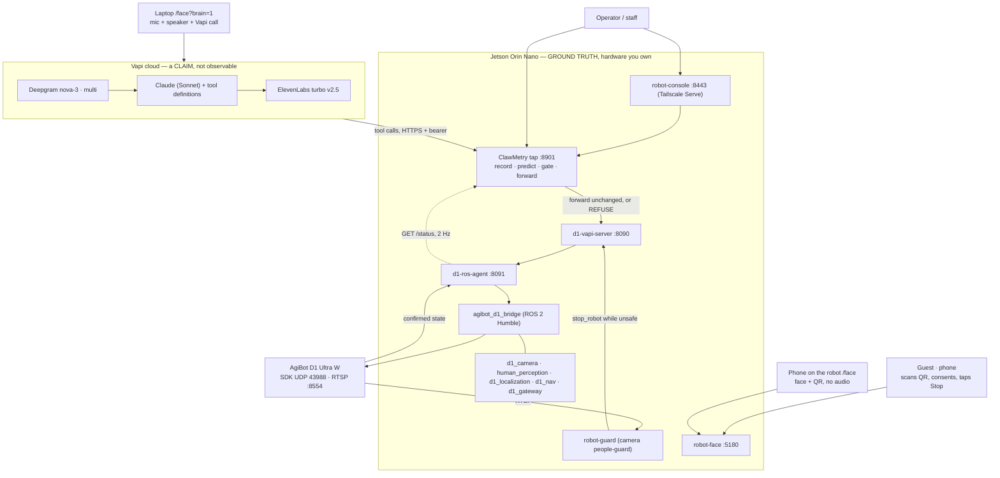
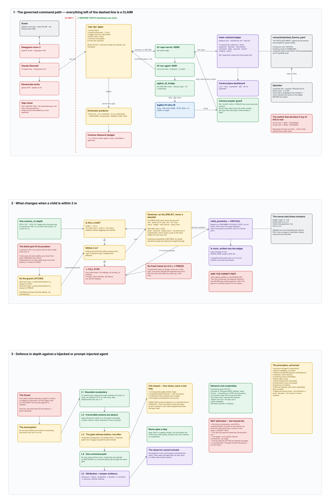

# SafetyAI — technical documentation

**A companion and escort robot for a thermal spa, and the control plane that governs it.**

Hardware: AgiBot D1 Ultra W (`zsl-1w`) quadruped + Jetson Orin Nano.
Venue: Leukerbad Therme, Valais, Switzerland.
Built: November 2026, hackathon.

This folder is the full technical record. It is written for a reviewer who has
not seen the robot and will not take a claim on trust, so every section
separates three things that are usually blurred together:

| mark | means |
|---|---|
| **verified** | run on the physical robot, with the measurement quoted |
| **built** | code exists, tests pass, never run on the robot |
| **planned** | designed and written down, not implemented |

Nothing in here is marked verified unless a number in the repository backs it.
The honest gap list is [chapter 15](technical/15-gaps-and-roadmap.md), and it is
part of the submission rather than an appendix to it.

---

## Read this in thirty seconds

A guest walks up to a robot dog outside a Swiss thermal spa. It greets them in
their language, answers questions about the place, sells them a ticket, and
walks them to the door. A phone strapped to its chest shows a face and a QR
code; the guest scans it, consents, and talks to the dog.

Underneath that there is a problem nobody in the demo can see: **an AI agent in
somebody else's cloud is issuing commands to a 16 kg machine standing next to
people in bathrobes, some of them children.** Everything upstream of the robot's
own hardware is a *claim*. Everything downstream is *ground truth*. The whole
engineering argument of this project is that oversight is the business of
correlating the two, continuously, on hardware you own, in a record you cannot
quietly edit.

That layer is **ClawMetry**: a tap at the tool-call boundary that records every
intent, predicts the physical consequence before it happens, refuses it if the
prediction leaves the allowed envelope, forwards it unchanged if it does not,
and writes the whole chain to a hash-chained append-only ledger.

---

## The chapters

### Part I — the machine

| # | Chapter | What it answers |
|---|---|---|
| 01 | [System overview and hardware](technical/01-system-and-hardware.md) | What the robot is, what it physically cannot do, how the network is laid out, where each computation runs |
| 02 | [Jetson Orin and the ROS 2 stack](technical/02-jetson-and-ros.md) | ROS 2 Humble in Docker on JetPack 6, the bridge, odometry, systemd, the watchdog, and the DDS bug that made the robot lie |
| 03 | [Voice: the Vapi integration, end to end](technical/03-voice-vapi.md) | STT → LLM → TTS, why not speech-to-speech, the two-backend tool split, 13 languages, timing, the persona, server messages |
| 04 | [The guest journey: QR, two screens, sessions](technical/04-guest-journey-qr.md) | What the QR encodes, server-side consent, session takeover, leases, why the guest's phone is nearly empty |
| 05 | [Audio: microphone, speaker, and the Bluetooth problem](technical/05-audio-bluetooth-mic.md) | Why a phone may hold a mic **or** a Bluetooth speaker but never both, echo cancellation, lip sync, and the cable |

### Part II — seeing and moving

| # | Chapter | What it answers |
|---|---|---|
| 06 | [Perception and the camera people-guard](technical/06-perception-and-guard.md) | One monocular camera, no depth, ground-plane ranging, the blind spot, the latch, YOLO26, follow/re-ID |
| 07 | [Child safety](technical/07-child-safety.md) | **Every rule that changes when a child is near the robot, where it is enforced, and what is not yet proven** |
| 08 | [Adversarial agents and the command surface](technical/08-adversarial-agents.md) | **Threat model for a hijacked or prompt-injected agent, and the controls that keep a compromised brain from moving the robot** |
| 10 | [Mapping and the LiDAR exploration spike](technical/10-mapping-lidar-spike.md) | MetaCam Lite scans, 2D grids, the desk study on adding LiDAR, monocular SLAM and why it failed |
| 11 | [Navigation and localization](technical/11-navigation-localization.md) | Nav2 MPPI, map_server, initial-pose localization, costmaps, what is not closed-loop yet |

### Part III — governance

| # | Chapter | What it answers |
|---|---|---|
| 09 | [ClawMetry: the physical-AI control plane](technical/09-clawmetry-control-plane.md) | The tap, the gate, the two prediction models, the ledger, the breach set, the operator guardrail file |
| 12 | [Dashboards and operator surfaces](technical/12-dashboards.md) | Four UIs, with screenshots: control plane, operator console, robot face, developer dashboard |
| 13 | [Privacy and compliance posture](technical/13-privacy-and-compliance.md) | GDPR vs Swiss revFADP, data inventory, anonymization spec, reporting clocks, and why this is not a certificate |
| 14 | [Testing, evidence and reproducing it](technical/14-testing-and-evidence.md) | Every test suite, what it covers, how to run the whole demo with no robot |
| 15 | [Gaps, risks and roadmap](technical/15-gaps-and-roadmap.md) | The list that would fail an audit today, in our own words |

---

## The shape of the system



The important structural fact is the position of the tap: it sits **in front of
the whole robot HTTP surface**, not only in front of the voice endpoint,
because the operator console drives the robot through different routes than the
agent does, and a monitor that watches one door while three are open is
decoration.

### The whiteboard version



Three frames — *the governed command path*, *what changes when a child is
within 2 m*, and *defence in depth against a hijacked agent* — generated from
one layout table by `tools/miro_board.py`.

```bash
python3 tools/miro_board.py --dry-run                 # validate the layout
python3 tools/miro_board.py --svg board.svg           # drag this onto any board
MIRO_TOKEN=… python3 tools/miro_board.py --push --board '<board-id>'
```

The SVG ([`technical/img/architecture-board.svg`](technical/img/architecture-board.svg))
and the native Miro board come from the same tables, so a picture dragged onto
a board and a board built through the API cannot drift apart.

---

## Five claims, and where each is proved

| Claim | Evidence | Chapter |
|---|---|---|
| The robot's motion is predicted before it happens, from measured hardware | `clawmetry/baseline.json`: 0.1373 m/s, 4.11 s overhead, validation walk 0.13σ | [09](technical/09-clawmetry-control-plane.md) |
| A refused command never reaches the robot | Cosmos denied `do_gesture` on a live frame; the robot never received it | [09](technical/09-clawmetry-control-plane.md) |
| Children change the robot's behaviour, not just its documentation | `guard_core.py` + `venue/leukerbad_therme.yaml`, 62 + 169 passing tests | [07](technical/07-child-safety.md) |
| A compromised agent cannot acquire new physical capability | Fixed tool vocabulary, no raw `/cmd_vel` path from voice, `estop` unreachable from a guest | [08](technical/08-adversarial-agents.md) |
| The record cannot be quietly edited | sha256 chain; `GET /api/verify` names the first broken line | [09](technical/09-clawmetry-control-plane.md) |

And one claim we deliberately do **not** make: this is not a rated safety
function. A camera, a detector and a timer on a best-effort network has no
PL/SIL determination, and selling it as one would be the single most dangerous
thing in this submission. See [chapter 15](technical/15-gaps-and-roadmap.md).

---

## Run it yourself, with no robot

```bash
# the governed stack, end to end, on a laptop
node tools/robot-sim/server.mjs &                        # a fake D1 that refuses like the real one
python3 clawmetry/server.py --upstream http://127.0.0.1:5175 \
        --venue clawmetry/venue/leukerbad_therme.yaml \
        --compliance clawmetry/compliance.yaml --port 8901 &
python3 clawmetry/scenarios.py --url http://127.0.0.1:8901   # drives all ten detectors
open http://127.0.0.1:8901
```

Full instructions, including the voice half and the guest phone, are in
[chapter 14](technical/14-testing-and-evidence.md).

---

## Where the engineering documents live

This folder is the narrative. The working notes it draws on stay where they
are, and are linked from each chapter:

| Area | Working doc |
|---|---|
| Product requirements, MoSCoW scope, user journeys | [product_requirements.md](product_requirements.md) |
| System architecture, interfaces, safety layering | [system_architecture.md](system_architecture.md) |
| ClawMetry, in the author's own words | [../clawmetry/README.md](../clawmetry/README.md) |
| Camera people-guard | [../tools/robot-guard/README.md](../tools/robot-guard/README.md) |
| The robot's face and the guest's phone | [../tools/robot-face/README.md](../tools/robot-face/README.md) |
| Operator console | [../tools/robot-console/README.md](../tools/robot-console/README.md) |
| Person detection | [perception.md](perception.md), [perception_architecture.md](perception_architecture.md) |
| Human follow (lock-on + re-ID) | [human_follow.md](human_follow.md) |
| Camera on the Orin | [feature_ros2_camera.md](feature_ros2_camera.md) |
| SLAM and localization | [feature_slam_localization.md](feature_slam_localization.md), [slam_nav2_study.md](slam_nav2_study.md), [mono_slam.md](mono_slam.md) |
| Maps and costmaps | [map_localization.md](map_localization.md), [costmap_plan.md](costmap_plan.md), [../maps/README.md](../maps/README.md) |
| Gateway protocol | [robot_gateway.md](robot_gateway.md) |
| Privacy / anonymization spec | [feature_privacy_anonymization.md](feature_privacy_anonymization.md) |
| Jetson services and the watchdog | [../deploy/jetson/README.md](../deploy/jetson/README.md) |
| Jetson Docker stack | [jetson_stack.md](jetson_stack.md) |
| Developer dashboard | [dashboard.md](dashboard.md) |

Contributor guide: [../AGENTS.md](../AGENTS.md).
