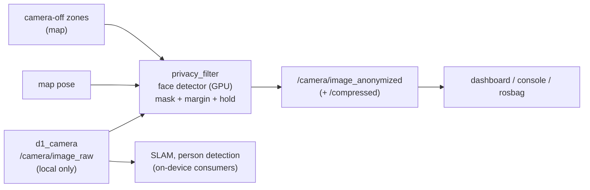

# Feature: privacy and GDPR face anonymization

Requirement: FR-P4, NFR-3 in [product_requirements.md](product_requirements.md). Status: **spec**. Depends on the ROS 2
camera feature ([feature_ros2_camera.md](feature_ros2_camera.md)).

> These are engineering requirements derived from GDPR principles (data minimization, privacy by design, storage
> limitation). They are not legal advice; the deployment must be reviewed with the spa (data controller) and, if needed,
> their data protection officer.

## 1. Why this matters more in a spa

- Guests are in swimwear or bathrobes. Images of them are highly sensitive even without a name attached.
- Changing rooms, showers and sauna interiors must never be filmed.
- A camera moving through a publicly accessible area is systematic monitoring; the spa will likely need a DPIA (Art. 35).
- Face images processed to **identify** people are biometric special-category data (Art. 9). We only **detect** faces to
  hide them and never identify anyone.

## 2. Data inventory

| Data | Source | Where processed | Leaves the Orin? | Kept? |
|---|---|---|---|---|
| Raw camera frames | D1 camera | Orin RAM only (SLAM, detection, anonymization) | **no** | no |
| Anonymized frames | privacy filter | Orin | yes (dashboard, console) | only if recording is enabled, see PRIV-8 |
| Person detections (boxes, counts) | `human_perception` | Orin | yes (aggregated state) | no |
| Maps (LiDAR clouds, occupancy) | MetaCam | Orin / laptop | yes | yes; scan when the area is closed to guests |
| Voice audio + transcript | guest phone -> Vapi | Vapi cloud | yes (third party, outside EU) | per Vapi settings: **open question** |
| Session (nickname, requests) | frontend | phone memory | no | deleted on end/expiry |
| Robot logs | all nodes | Orin | via SSH only | rotated; no images, no transcripts |

## 3. Requirements

| ID | Requirement |
|---|---|
| PRIV-1 | A `privacy_filter` node on the Orin subscribes to `/camera/image_raw` and publishes `/camera/image_anonymized` with every detected face irreversibly blurred or filled (solid fill or strong pixelation; reversible-looking light blur is not enough). |
| PRIV-2 | Mode `face` (default) or `person` (whole-body mask, for sensitive zones or when configured by the spa). |
| PRIV-3 | **Fail closed**: if the detector is not running, too slow, or a frame cannot be processed in time, publish nothing or a fully masked frame. Never pass a raw frame through. |
| PRIV-4 | Raw `/camera/image_raw` is never sent off the Orin, never recorded, never logged. Enforce by: localhost-only DDS for raw topics, dashboard/console/rosbag configs that only reference anonymized topics, and a test that fails if a bag profile includes `image_raw`. |
| PRIV-5 | **Camera-off zones**: when the robot's pose is inside a zone marked in the map (changing rooms, sauna entrances, showers), the anonymized output is fully masked and recording is paused. Zones are stored with the map like keepout zones. |
| PRIV-6 | No face recognition, no re-identification, no face embeddings stored. Tracking IDs (if any) are short-lived and in memory only. |
| PRIV-7 | Detection quality: face recall ≥ 95 % on a spa-like test set (frontal + profile, 0.5–5 m, wet hair, steam, glasses) at the publish rate. Measure and report recall; miss = privacy incident. Expand masks by a margin (e.g. 20 %) and hold them for a few frames to cover detector flicker. |
| PRIV-8 | Recording is **off by default**. If enabled (mapping, debugging), only anonymized topics, with an operator-visible indicator, and automatic deletion after a short retention period agreed with the spa (e.g. 7 days). |
| PRIV-9 | Transparency: signage at the spa, privacy page in the frontend describing what the robot sees and keeps, a visible "camera active" indicator on the robot or screen. |
| PRIV-10 | Voice: document what Vapi stores; configure the shortest retention; inform guests before the call starts; offer the text path. EU-hosted alternative is an open decision. |
| PRIV-11 | Performance: anonymized topic at ≥ 10 Hz at 960x540 on the Orin Nano GPU while detection and Nav2 run. |

## 4. Design

- Detector candidates: OpenCV YuNet (tiny, CPU/GPU), SCRFD, or a YOLO face model exported to TensorRT FP16. Pick by recall on
  our test set at the Orin budget, not by benchmark claims. The existing YOLO26 person detector can provide a coarse
  head-region fallback (top part of each person box) when no face is found inside a person box.
- Keep detection logic ROS-free (same pattern as `human_perception`: plain modules + thin node) so it is unit-testable on a PC.
- The compressed anonymized topic is JPEG-encoded on the CPU (Orin Nano has no hardware video encoder); throttle it (e.g. 5 Hz)
  for remote viewers.
- `/diagnostics`: detector up, latency, frames masked fully (fail-closed count), faces per frame.

## 5. Work plan

| Step | Deliverable |
|---|---|
| 1 | Data inventory above confirmed with the team; DPIA inputs sent to the spa |
| 2 | `privacy_filter` package: face mode, fail-closed, diagnostics, unit tests with synthetic frames |
| 3 | Test set (team members, consenting volunteers only, never real guests) + recall measurement script |
| 4 | Dashboard/console switched to `/camera/image_anonymized`; rosbag profiles restricted (PRIV-4 test) |
| 5 | Camera-off zones from the map |
| 6 | Person mode, retention job, frontend privacy page update |

## 6. Open questions

- Who is controller/processor; does the spa have a DPO and existing camera policy?
- Is any recording needed for the hackathon at all (prefer: no)?
- Should the robot use `person` mode by default in the spa context?
