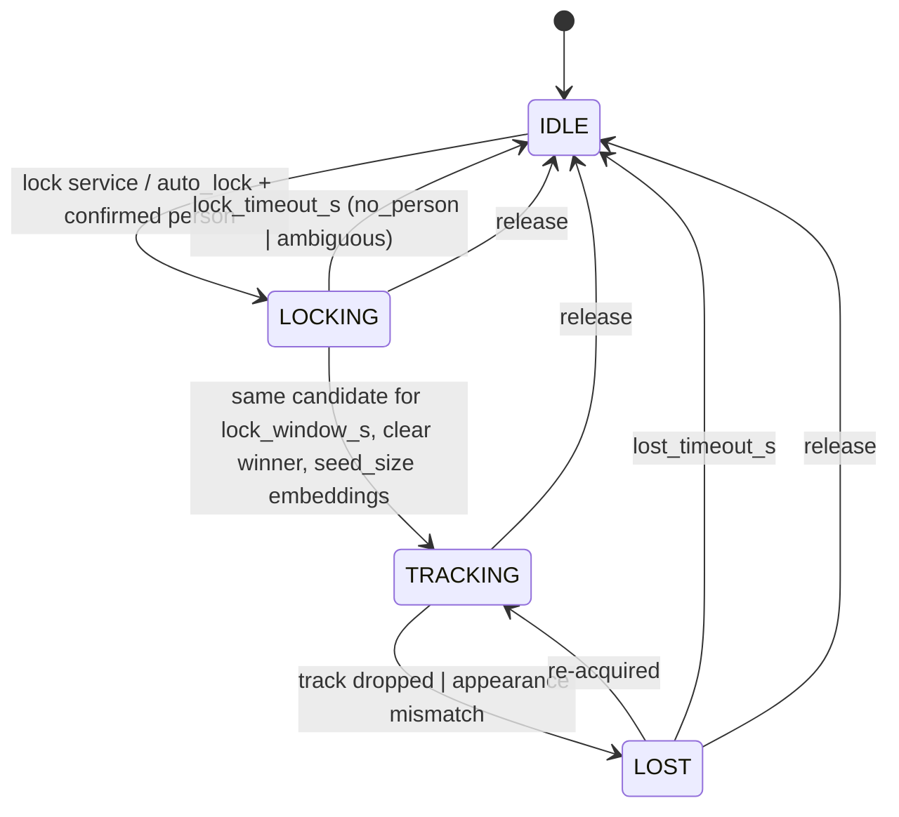

# d1_follow — lock onto one guest and follow (dry run)

When a guest connects, the robot should lock onto **that guest** in its camera view and follow them. Everyone else in
view is labelled `unknown` and never steers the robot. `d1_follow` consumes the person detections from
[human_perception](perception.md), tracks people frame to frame, identifies the locked guest by appearance (person
re-ID), and publishes a follow velocity.

> **Status: dry run, unverified on the robot.** `/follow/cmd_vel` is **not** wired to `/cmd_vel`; nothing in this
> package publishes `/cmd_vel`. It has only been developed against unit tests and the laptop webcam path (see
> [Run on the laptop](#run-on-the-laptop-wsl-webcam)); the live laptop test is still pending. Design:
> [superpowers/specs/2026-11-15-human-follow-design.md](superpowers/specs/2026-11-15-human-follow-design.md).
> Not a safety system (same caveats as [perception.md](perception.md)).

## How it works

```
/camera/image_raw ──► human_detector ──► /perception/humans/detections
        │                                          │
        └─────────────────────────► d1_follow/target_follower ◄── /d1_follow/lock, /d1_follow/release
                                            │                          ▲
                                            ├─► /follow/cmd_vel        └── gateway intents follow_lock / follow_release
                                            ├─► /follow/state
                                            ├─► /follow/target
                                            └─► /follow/annotated_image
```

Per detection array the node: pairs it with its frame by exact header stamp (ring buffer of `image_buffer` recent
images; unpaired arrays still run the tracker but cannot be embedded) → `IouTracker` → `TargetLock` → `FollowController`.

| Module | Role |
|---|---|
| `tracker.py` | Greedy IoU tracker with constant-velocity prediction. A track is *confirmed* after `min_hits` hits, dropped after `max_misses` missed frames. Ids are monotonic and never reused. |
| `embedder.py` | Appearance vector per person crop, L2-normalised. `osnet` (boxmot `ReID`, OSNet x0_25 MSMT17, 512-d) or `histogram` (HSV hue/saturation of upper and lower body). Falls back to `histogram` with a warning if boxmot or weights are unavailable. |
| `target_lock.py` | State machine below. ROS-free. |
| `follow_controller.py` | P controller, box -> `(vx, wz)`. |
| `annotate.py` | Draws the RViz image. |

### State machine



| State | Behaviour |
|---|---|
| **IDLE** | No target, every person `unknown`, velocity 0. `auto_lock` starts LOCKING when the first confirmed person appears (only until the first lock; `release` disables it). |
| **LOCKING** | Each confirmed, visible person is scored `area_frac × (1 − 2·|cx − 0.5|)` (big and centred). The top scorer is the candidate only if it beats the runner-up by `lock_margin` (1.3×); if the candidate changes the window restarts. The candidate is embedded every `lock_window_s / seed_size` s to seed the gallery. After `lock_window_s` with `seed_size` embeddings -> TRACKING. If nothing resolves within `lock_timeout_s` -> IDLE, reason `no_person` (nobody seen) or `ambiguous` (people seen but never a clear winner). |
| **TRACKING** | Target = the track with `target_id`. Every `verify_period_s` its crop is embedded and compared with the gallery (max cosine similarity). `sim ≥ sim_accept`: counter reset, and if the box overlaps nobody else (IoU ≤ `overlap_iou`) the embedding joins the gallery. `sim < sim_reject` for `reject_checks` checks in a row -> LOST (`appearance_mismatch`). In between: counter reset, no learning. Track dropped by the tracker -> LOST (`track_lost`). A briefly missed (occluded) target keeps its state until the tracker drops it. |
| **LOST** | Velocity 0. Every `reacquire_period_s`, all confirmed visible tracks are embedded in one call and compared with the gallery. A track is re-acquired when `sim ≥ sim_accept` for `reacquire_hits` consecutive checks **and** it beats the second-best candidate by `reacquire_margin`. -> TRACKING with the new track id. After `lost_timeout_s` -> IDLE (`lost_timeout`). |

`release` from any state -> IDLE and clears the gallery. A new `lock` while LOCKING or TRACKING restarts from scratch.

### Why a bystander cannot become the target

- **Lock needs a clear winner** (`lock_margin`), stable for the whole window; two guests side by side give `ambiguous`, not a coin flip.
- **The first `seed_size` embeddings are never evicted** from the gallery (FIFO only removes later ones), so the gallery cannot drift onto someone else.
- **No learning from overlapped crops**: a box overlapping another person is not added to the gallery.
- **Appearance is checked continuously**: an ID swap (e.g. two people crossing) shows as low similarity and drops to LOST.
- **Re-acquisition is strict**: several consecutive matches plus a margin over the second-best person, so a look-alike alone is not enough.
- **Velocity is exactly 0 unless TRACKING with a fresh detection**; `unknown` people never produce a command.
- Track ids are never reused, so a new person cannot inherit the target id.

Residual risk: between two verify checks the tracker alone decides identity, so after a swap the robot could briefly
steer toward the wrong person (up to about `verify_period_s × reject_checks`) before LOST. Unverified with real
crowds; one more reason this is dry-run only.

### Follow controller

- `wz = −k_yaw · ex`, `ex = (cx − W/2)/(W/2)`; 0 inside `yaw_deadband`. Positive `wz` turns left, so a guest on the right gives `wz < 0`.
- `vx = k_x · (target_height_frac − h/H)`; 0 inside `x_deadband`, **clamped to `[0, max_vx]`** (never reverses toward a guest).
- The node clamps `max_vx ≤ 0.5 m/s` and `max_wz ≤ 0.8 rad/s` whatever the YAML says (warning logged).
- Distance is a monocular proxy (bbox height), no depth.

## Topics and services

| Name | Type | Direction | QoS | Notes |
|---|---|---|---|---|
| `/camera/image_raw` | `sensor_msgs/Image` | in | BEST_EFFORT, KEEP_LAST 5 | `image_topic` |
| `/perception/humans/detections` | `vision_msgs/Detection2DArray` | in | RELIABLE, KEEP_LAST 10 | `detections_topic`; header must carry the source image stamp |
| `/follow/cmd_vel` | `geometry_msgs/Twist` | out | RELIABLE, KEEP_LAST 10 | **Dry run.** At the detection rate, plus zero from a 10 Hz timer when detections are older than `stale_s` |
| `/follow/state` | `std_msgs/String` (JSON) | out | RELIABLE, KEEP_LAST 10 | 2 Hz and on events: `{state, target_id, similarity, n_people, event, reason, embedder}` |
| `/follow/target` | `vision_msgs/Detection2D` | out | RELIABLE, KEEP_LAST 10 | Target box only, `id` = track id; only while TRACKING |
| `/follow/annotated_image` | `sensor_msgs/Image` | out | RELIABLE, KEEP_LAST 1 | Only produced while someone subscribes |
| `/d1_follow/lock` | `std_srvs/Trigger` | service | default | Returns when LOCKING resolves: success `locked target #N`, or failure with reason `no_person` / `ambiguous` / `timeout: no detections` |
| `/d1_follow/release` | `std_srvs/Trigger` | service | default | Always succeeds, `released` |

`event` in the state JSON is one of `locked`, `lock_failed`, `lost`, `reacquired`, `lost_timeout`, `released`, or null.

## Parameters

Node `d1_follow`, defaults from [config/follow.yaml](../ros2_ws/src/d1_follow/config/follow.yaml).

| Parameter | Default | Meaning |
|---|---|---|
| `image_topic` | `/camera/image_raw` | Frames to embed and annotate |
| `detections_topic` | `/perception/humans/detections` | Person detections |
| `embedder` | `osnet` | `osnet` or `histogram` (automatic fallback) |
| `device` | `cpu` | Device for OSNet |
| `auto_lock` | `false` | Lock onto the first confirmed person without a service call |
| `stale_s` | `0.5` | Publish zero velocity when detections are older |
| `image_buffer` | `15` | Frames kept to pair with slow detections by stamp |
| `iou_min` | `0.3` | Minimum IoU to associate a detection with a track |
| `min_hits` | `3` | Hits before a track counts as confirmed |
| `max_misses` | `15` | Missed frames before a track is dropped |
| `lock_window_s` | `0.5` | Candidate must stay the clear winner this long |
| `lock_margin` | `1.3` | Winner's score must be at least this multiple of the runner-up |
| `lock_timeout_s` | `5.0` | Give up locking (`no_person` / `ambiguous`) |
| `seed_size` | `3` | Embeddings taken during LOCKING; never evicted |
| `gallery_size` | `10` | Max gallery embeddings |
| `verify_period_s` | `1.0` | Time between appearance checks of the target |
| `sim_accept` | `0.70` | Cosine similarity to accept / re-acquire |
| `sim_reject` | `0.50` | Similarity below this counts as a mismatch |
| `reject_checks` | `2` | Consecutive mismatches before LOST |
| `reacquire_period_s` | `0.3` | Minimum time between re-acquire embeddings in LOST |
| `reacquire_hits` | `3` | Consecutive matching checks to re-acquire |
| `reacquire_margin` | `0.10` | Required similarity lead over the second-best candidate |
| `lost_timeout_s` | `30.0` | LOST -> IDLE |
| `overlap_iou` | `0.1` | Crops overlapping another person above this are not learned |
| `target_height_frac` | `0.6` | Desired bbox height / image height (follow distance) |
| `k_yaw` | `1.0` | Yaw gain |
| `k_x` | `1.2` | Forward gain |
| `yaw_deadband` | `0.08` | Normalised horizontal error ignored |
| `x_deadband` | `0.05` | Height-fraction error ignored |
| `max_vx` | `0.5` | m/s, clamped to 0.5 by the node |
| `max_wz` | `0.8` | rad/s, clamped to 0.8 by the node |

Launch arguments of [follow.launch.py](../ros2_ws/src/d1_follow/launch/follow.launch.py): `with_perception` (default
`true`: also starts video source and detector), the perception source arguments (`source_type`, `webcam_device`,
`rtsp_url`, `file_path`, `source_params`, `detector_params`, `model_name`, `device`), `auto_lock`, `embedder`, `params`,
`rviz`.

## Run on the laptop (WSL webcam)

```bash
make build                    # once; installs boxmot and bakes the OSNet weights
make up source=wsl-webcam follow=true auto_lock=true rviz=true display=localhost:0.0
make logs
```

`follow=true` makes the container run `follow.launch.py` (which starts perception and owns RViz) instead of
`human_perception.launch.py`. `auto_lock=true` locks onto the first person who appears; without it, lock by hand:

```bash
docker exec -it human_perception bash -lc 'ros2 run d1_follow lock'
docker exec -it human_perception bash -lc 'ros2 run d1_follow release'

docker exec -it human_perception bash -lc 'ros2 topic echo /follow/state'
docker exec -it human_perception bash -lc 'ros2 topic echo /follow/cmd_vel'
```

`make up` variables: `follow`, `auto_lock`, `embedder` (see the Makefile header). `make test` also runs the `d1_follow` unit tests.

### What you should see in RViz

The image panel shows `/follow/annotated_image`:

| Element | Meaning |
|---|---|
| Thick **green** box `TARGET #id sim 0.82` | The locked guest and the latest appearance similarity |
| Thin **grey** box `unknown #id` | Any other person; never steers |
| **Yellow** box `LOCKING #id` | The candidate being locked |
| Top banner | State, target id, dry-run `vx / wz`; a green arrow shows the commanded motion |

Expected: sit in front of the camera -> yellow, then green TARGET. Others walking past stay grey. If someone fully
covers you the state goes to LOST with `vx = wz = 0`; when you reappear you become TARGET again and the other person
does not. `release` -> IDLE, `lock` locks again. (Not yet run end to end.)

## Gateway

`d1_gateway` exposes the two services as intents `follow_lock` and `follow_release` (see [robot_gateway.md](robot_gateway.md)).
`follow_lock` answers `intent_started` immediately and `intent_done` / `intent_failed` (reason from the service, e.g.
`no_person`) when the lock resolves, which can take a few seconds. If the node is down: `intent_failed` with
"follow node not running". The gateway still never sends velocities.

## Tuning

- **`sim_accept` / `sim_reject` depend on the embedder.** The defaults (0.70 / 0.50) are for OSNet. The `histogram` fallback is a weaker identity cue (clothing colour only; similar clothing scores high): check `embedder` in `/follow/state`, and expect more false accepts and rejects. Tune on live `similarity` values, not by guesswork.
- `target_height_frac` sets the follow distance: larger = closer. Webcam framing differs from the robot camera, so retune on the robot.
- Gains and deadbands only matter once the output is wired to the robot; keep `max_vx` / `max_wz` at or below the caps.
- `image_buffer` costs memory (full frames; at 1080p about 6 MB each). It must cover the detector latency in frames, otherwise detections are unpaired and cannot be embedded.

## Privacy

Frames, crops and embeddings live in memory only: nothing is written to disk or logged. The annotated image is a live
topic produced only while subscribed, never recorded. Do not record it or `/camera/image_raw` rosbags of real guests
(see [feature_privacy_anonymization.md](feature_privacy_anonymization.md)).

## Limitations and next steps

- Dry run: `/follow/cmd_vel` -> `/cmd_vel` needs the `/cmd_vel` arbitration from [system_architecture.md](system_architecture.md#safety-architecture) first; there is no arbiter yet.
- Not yet integrated with the spa state machine (greet / chat / escort / refuse), and not driven by the frontend beyond the two intents.
- `source=d1-camera` + `follow=true` is not supported by `make up` yet (the entrypoint starts without `d1_follow`).
- OSNet takes about 300 ms per call on CPU (measured in WSL Docker, 3 crops), hence the 1 Hz verify and `reacquire_period_s` budget; unverified on the Orin.
- Monocular distance proxy only; no obstacle awareness. Following a person through a spa needs Nav2/costmap input before it moves the robot.
- Not tested with a real robot, wet floors, crowds or similar clothing.
