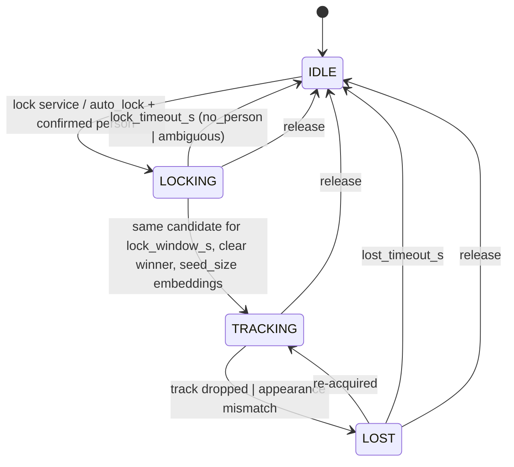

# d1_follow — lock onto one guest and follow (dry run)

When a guest connects, the robot should lock onto **that guest** in its camera view and follow them. Everyone else in
view is labelled `unknown` and never steers the robot. `d1_follow` consumes the person detections from
[human_perception](perception.md), tracks people frame to frame, identifies the locked guest by appearance (person
re-ID), and publishes a follow velocity.

> **Status: dry run, unverified on the robot.** `/follow/cmd_vel` is **not** wired to `/cmd_vel`; nothing in this
> package publishes `/cmd_vel`. It has only been developed against unit tests and the laptop webcam path (see
> [Run on the laptop](#run-on-the-laptop-wsl-webcam)); the live laptop test is still pending. Design:
> [superpowers/specs/2026-11-15-human-follow-design.md](superpowers/specs/2026-11-15-human-follow-design.md).
> Not a safety system (same caveats as [perception.md](perception.md)).

## How it works

```
/camera/image_raw ──► human_detector ──► /perception/humans/detections
        │                                          │
        └─────────────────────────► d1_follow/target_follower ◄── /d1_follow/lock, /d1_follow/release
                                            │                          ▲
                                            ├─► /follow/cmd_vel        └── gateway intents follow_lock / follow_release
                                            ├─► /follow/state
                                            ├─► /follow/target
                                            └─► /follow/annotated_image
```

Per detection array the node: drops the array if it is older than `stale_s` (age from its header stamp) → pairs it
with its frame by exact header stamp (ring buffer of `image_buffer` recent images; unpaired arrays still run the
tracker but cannot be embedded, and are counted as `unpaired`) → `IouTracker` → `TargetLock` → `FollowController`.
Until the first image is paired the frame size is unknown, so the lock update is skipped entirely and the velocity
stays zero.

| Module | Role |
|---|---|
| `tracker.py` | Greedy IoU tracker with constant-velocity prediction. A track is *confirmed* after `min_hits` hits, dropped after `max_misses` missed frames. Ids are monotonic and never reused. |
| `embedder.py` | Appearance vector per person crop, L2-normalised. `osnet` (boxmot `ReID`, OSNet x0_25 MSMT17, 512-d) or `histogram` (HSV hue/saturation of upper and lower body). Falls back to `histogram` with a warning if boxmot or weights are unavailable. |
| `target_lock.py` | State machine below. ROS-free. |
| `follow_controller.py` | P controller, box -> `(vx, wz)`. |
| `annotate.py` | Draws the RViz image. |

### State machine



| State | Behaviour |
|---|---|
| **IDLE** | No target, every person `unknown`, velocity 0. `auto_lock` starts LOCKING when a confirmed person appears: until the first lock, and again after each `lost_timeout` (`release` disables it). |
| **LOCKING** | Each confirmed, visible person is scored `area_frac × (1 − 2·|cx − 0.5|)` (big and centred). The top scorer is the candidate only if it beats the runner-up by `lock_margin` (1.3×); if the candidate changes the window restarts. The candidate is embedded every `lock_window_s / seed_size` s to seed the gallery. After `lock_window_s` with `seed_size` embeddings -> TRACKING. If nothing resolves within `lock_timeout_s` -> IDLE, reason `no_person` (nobody seen) or `ambiguous` (people seen but never a clear winner). |
| **TRACKING** | Target = the track with `target_id`. **Suspect**: while the target box overlaps another track (IoU > `overlap_iou`), or the target is missed for a frame (a gap lets someone else inherit the track at the same spot), nothing is embedded or learned and the target is marked *suspect*. **Suspect check**: on the first clean view the target is embedded immediately (ignoring `verify_period_s`) and compared with the gallery; `sim ≥ sim_accept` clears the suspicion, otherwise a fail is counted and the check repeats every `reacquire_period_s` — `reject_checks` fails → LOST (`appearance_mismatch`). **Periodic check** (not suspect): every `verify_period_s` the target crop is compared with the gallery; `sim < sim_reject` for `reject_checks` checks in a row → LOST (`appearance_mismatch`); otherwise, if `sim_learn ≤ sim < learn_max_sim`, the view is **learned**. Track dropped by the tracker → LOST (`track_lost`). |
| **LOST** | Velocity 0. Every `reacquire_period_s`, the confirmed visible tracks that are not known to be someone else are embedded in one call (at most `reacquire_max_candidates`, the biggest boxes first) and compared with the gallery. A track is re-acquired when `sim ≥ sim_accept` for `reacquire_hits` consecutive checks **and** it beats the second-best candidate by `reacquire_margin`. → TRACKING with the new track id. After `lost_timeout_s` → IDLE (`lost_timeout`). |

`release` from any state -> IDLE and clears the gallery (and resolves a pending `lock` call with `released`). A new
`lock` while LOCKING or TRACKING restarts from scratch.

### Identity rules: learning from track continuity

The gallery holds the `seed_size` embeddings taken during LOCKING (never evicted) plus views learned while tracking
(FIFO up to `gallery_size`). Every decision compares against the whole gallery (maximum cosine similarity).

What keeps the gallery clean is **when** it learns, not which rows a decision uses: a view is learned only from the
target's own track while it is **unbroken and unoccluded** (not suspect). An identity swap needs either an overlap or a
gap in the track, and both make the target suspect until a clean view matches the gallery at `sim_accept` again, so
another person's crops never reach the gallery through the tracker.

Why not seeds only (the previous rule): in the first live webcam test the guest's own similarity to the close-up
seeds fell to 0.54–0.75 when they moved back and forth, so the seeds-only rule refused to learn the new distances,
raised false `appearance_mismatch` LOSTs after crossings, and needed 8–24 s or more to re-acquire (then `lost_timeout`).
Learning distinct views (`sim_learn ≤ sim < learn_max_sim`) while tracked alone covers distance and pose changes.

LOST also keeps a set of **known-not-target** track ids: every track seen beside the target (visible at the same time,
not overlapping it) is provably a different person, so it is excluded from re-acquisition and costs no embedding. The
set is dropped on `release`, `lock` and `lost_timeout`. After an `appearance_mismatch` it is reset to the mismatching
id alone, because after a swap the tracker's ids say nothing about who is who.

### Why a bystander cannot become the target

- **Lock needs a clear winner** (`lock_margin`), stable for the whole window; two guests side by side give `ambiguous`, not a coin flip.
- **Learning only from clean, unbroken tracking** (see [Identity rules](#identity-rules-learning-from-track-continuity)); the seeds taken while the guest was the unambiguous winner are never evicted.
- **No learning from overlapped crops**: a box overlapping another person is not added to the gallery, and no identity decision is taken from it.
- **Crossings and gaps are re-checked immediately**: after an overlap or a missed frame, the next clear view is verified against the gallery right away, so an ID swap is caught within `reject_checks` checks instead of waiting for `verify_period_s`.
- **Appearance is checked continuously**: an ID swap (e.g. two people crossing) shows as low similarity and drops to LOST.
- **Re-acquisition is strict**: several consecutive matches at `sim_accept` plus a margin over the second-best person, and people already seen next to the guest are not candidates at all.
- **Velocity is exactly 0 unless TRACKING with a fresh detection**; `unknown` people never produce a command.
- Track ids are never reused, so a new person cannot inherit the target id.

Residual risk: while the target overlaps someone else the tracker alone decides identity, so after a swap the robot can
briefly steer toward the wrong person (until they separate, plus up to `reacquire_period_s × reject_checks`) before
LOST. All thresholds above are untested against real OSNet similarities; see [Tuning](#tuning). Unverified with real
crowds; one more reason this is dry-run only.

### Follow controller

- `wz = −k_yaw · ex`, `ex = (cx − W/2)/(W/2)`; 0 inside `yaw_deadband`. Positive `wz` turns left, so a guest on the right gives `wz < 0`.
- `vx = k_x · (target_height_frac − h/H)`; 0 inside `x_deadband`, **clamped to `[0, max_vx]`** (never reverses toward a guest).
- The node clamps `max_vx ≤ 0.5 m/s` and `max_wz ≤ 0.8 rad/s` whatever the YAML says (warning logged).
- Distance is a monocular proxy (bbox height), no depth.

## Topics and services

| Name | Type | Direction | QoS | Notes |
|---|---|---|---|---|
| `/camera/image_raw` | `sensor_msgs/Image` | in | RELIABLE, KEEP_LAST 5 | `image_topic`; parameter `image_reliability: best_effort` switches it. Reliable by default: a best-effort subscriber was measured to receive **0** of ~1 MB frames here ([perception.md](perception.md)) |
| `/perception/humans/detections` | `vision_msgs/Detection2DArray` | in | RELIABLE, KEEP_LAST 1 | `detections_topic`; header must carry the source image stamp. Newest only (no backlog behind a slow embed). Arrays older than `stale_s` are dropped |
| `/follow/cmd_vel` | `geometry_msgs/Twist` | out | RELIABLE, KEEP_LAST 10 | **Dry run.** At the detection rate, plus zero from a 10 Hz timer when the last processed detection stamp is older than `stale_s` |
| `/follow/state` | `std_msgs/String` (JSON) | out | RELIABLE, KEEP_LAST 10 | 2 Hz and on events: `{state, target_id, similarity, n_people, unpaired, event, reason, embedder}` |
| `/follow/target` | `vision_msgs/Detection2D` | out | RELIABLE, KEEP_LAST 10 | Target box only, `id` = track id; only while TRACKING |
| `/follow/annotated_image` | `sensor_msgs/Image` | out | RELIABLE, KEEP_LAST 1 | Only produced while someone subscribes |
| `/d1_follow/lock` | `std_srvs/Trigger` | service | default | Returns when LOCKING resolves: success `locked target #N`, or failure with reason `no_person` / `ambiguous` / `timeout: no detections` |
| `/d1_follow/release` | `std_srvs/Trigger` | service | default | Always succeeds, `released`; a `lock` call still waiting is answered `released` |

`event` in the state JSON is one of `locked`, `lock_failed`, `lost`, `reacquired`, `lost_timeout`, `released`, or null.
`unpaired` counts detection arrays that found no image for their stamp (a warning naming the image topic and its QoS
is logged at most once per 10 s). Every appearance check also logs one INFO line with the similarity value (numbers
only, at most 1/s): `verify sim=0.812 state=TRACKING`, `suspect ...`, `reacquire ...`.

## Parameters

Node `d1_follow`, defaults from [config/follow.yaml](../ros2_ws/src/d1_follow/config/follow.yaml).

| Parameter | Default | Meaning |
|---|---|---|
| `image_topic` | `/camera/image_raw` | Frames to embed and annotate |
| `image_reliability` | `reliable` | `reliable` or `best_effort` QoS for the image subscription. Use `best_effort` with `d1_camera`'s `rtsp_camera` (it publishes BEST_EFFORT; a reliable subscriber gets nothing and the node warns about unpaired detections) |
| `detections_topic` | `/perception/humans/detections` | Person detections |
| `embedder` | `osnet` | `osnet` or `histogram` (automatic fallback) |
| `device` | `cpu` | Device for OSNet |
| `embed_threads` | `2` | torch CPU threads for OSNet. With all 20 cores next to YOLO and software RViz one embed took ~6 s (measured live); with 2 threads ~20 ms |
| `auto_lock` | `false` | Lock onto a confirmed person without a service call; retries after `lock_failed`, re-arms after `lost_timeout`, disabled by `release`. Dev/test only: in the spa a lock must come from the connected guest |
| `stale_s` | `0.8` | Detection arrays older than this (by header stamp) are dropped and the velocity is zeroed. Covers detector latency (~0.2 s) plus one OSNet call |
| `image_buffer` | `15` | Frames kept to pair with slow detections by stamp |
| `iou_min` | `0.3` | Minimum IoU to associate a detection with a track |
| `min_hits` | `3` | Hits before a track counts as confirmed |
| `max_misses` | `15` | Missed frames before a track is dropped |
| `lock_window_s` | `0.5` | Candidate must stay the clear winner this long |
| `lock_margin` | `1.3` | Winner's score must be at least this multiple of the runner-up |
| `lock_timeout_s` | `5.0` | Give up locking (`no_person` / `ambiguous`) |
| `seed_size` | `3` | Embeddings taken during LOCKING; never evicted |
| `gallery_size` | `30` | Max gallery embeddings (seeds + learned views) |
| `verify_period_s` | `0.5` | Time between appearance checks of the target |
| `sim_accept` | `0.70` | Similarity needed to re-acquire or to clear a suspect |
| `sim_reject` | `0.50` | Similarity below this counts as a mismatch in the periodic check |
| `sim_learn` | `0.60` | A clean, unbroken view at or above this is learned ... |
| `learn_max_sim` | `0.95` | ... if it is new (below this), so the gallery holds distinct views |
| `reject_checks` | `2` | Consecutive mismatches (periodic or suspect) before LOST |
| `reacquire_period_s` | `0.5` | Minimum time between re-acquire embeddings in LOST, and between repeated suspect checks |
| `reacquire_max_candidates` | `3` | People embedded per re-acquire check (biggest boxes first) |
| `reacquire_hits` | `3` | Consecutive matching checks to re-acquire |
| `reacquire_margin` | `0.10` | Required similarity lead over the second-best candidate |
| `lost_timeout_s` | `30.0` | LOST -> IDLE |
| `overlap_iou` | `0.1` | Above this IoU with another person the crop is not used (no learning, no check) and the target becomes *suspect* |
| `target_height_frac` | `0.6` | Desired bbox height / image height (follow distance) |
| `k_yaw` | `1.0` | Yaw gain |
| `k_x` | `1.2` | Forward gain |
| `yaw_deadband` | `0.08` | Normalised horizontal error ignored |
| `x_deadband` | `0.05` | Height-fraction error ignored |
| `max_vx` | `0.5` | m/s, clamped to 0.5 by the node |
| `max_wz` | `0.8` | rad/s, clamped to 0.8 by the node |

Launch arguments of [follow.launch.py](../ros2_ws/src/d1_follow/launch/follow.launch.py): `with_perception` (default
`true`: also starts video source and detector), the perception source arguments (`source_type`, `webcam_device`,
`rtsp_url`, `file_path`, `source_params`, `detector_params`, `model_name`, `device`), `auto_lock`, `embedder`, `params`,
`rviz`.

## Run on the laptop (WSL webcam)

```bash
make build                    # once; installs boxmot and bakes the OSNet weights
make up source=wsl-webcam follow=true auto_lock=true rviz=true display=localhost:0.0
make logs
```

`follow=true` makes the container run `follow.launch.py` (which starts perception and owns RViz) instead of
`human_perception.launch.py`. `auto_lock=true` locks onto the first person who appears; without it, lock by hand:

```bash
docker exec -it human_perception bash -lc 'ros2 run d1_follow lock'
docker exec -it human_perception bash -lc 'ros2 run d1_follow release'

docker exec -it human_perception bash -lc 'ros2 topic echo /follow/state'
docker exec -it human_perception bash -lc 'ros2 topic echo /follow/cmd_vel'
```

`make up` variables: `follow`, `auto_lock`, `embedder` (see the Makefile header). `make test` also runs the `d1_follow` unit tests.

### What you should see in RViz

The image panel shows `/follow/annotated_image`:

| Element | Meaning |
|---|---|
| Thick **green** box `TARGET #id sim 0.82` | The locked guest and the latest appearance similarity |
| Thin **grey** box `unknown #id` | Any other person; never steers |
| **Yellow** box `LOCKING #id` | The candidate being locked |
| Top banner | State, target id, dry-run `vx / wz`; a green arrow shows the commanded motion |

Expected: sit in front of the camera -> yellow, then green TARGET. Others walking past stay grey. If someone fully
covers you the state goes to LOST with `vx = wz = 0`; when you reappear you become TARGET again and the other person
does not. `release` -> IDLE, `lock` locks again. (Not yet run end to end.)

## Gateway

`d1_gateway` exposes the two services as intents `follow_lock` and `follow_release` (see [robot_gateway.md](robot_gateway.md)).
`follow_lock` answers `intent_started` immediately and `intent_done` / `intent_failed` (reason from the service, e.g.
`no_person`) when the lock resolves, which can take a few seconds. If the node is down: `intent_failed` with
"follow node not running". The gateway still never sends velocities.

## Tuning

- **`sim_accept` / `sim_reject` must be set from the first live session.** The defaults (0.70 / 0.50) are guesses for
  OSNet x0_25, taken from the literature and never measured here; different people in similar clothing are commonly
  reported around 0.5–0.7, which overlaps the "same person" range, and webcam upper-body crops are far from the
  full-body pedestrians the model was trained on. Procedure: run the session, watch the throttled
  `verify/suspect/reacquire sim=...` INFO lines and `similarity` in `/follow/state` while (a) the guest changes pose
  and comes back after an occlusion and (b) teammates stand in front of the camera; set `sim_accept` below the
  observed same-person range and `sim_reject` above the observed different-person range. **Log the numbers only**
  — never a crop, a frame or an embedding (see [Privacy](#privacy)).
  First session (laptop webcam, guest alone): 0.95–0.99 while seated still; 0.54–0.75 against the close-up seeds
  after moving back and forth; 0.78–0.93 against a gallery that had learned those views. Teammate (impostor)
  values are not measured yet: that is the next number to collect before trusting `sim_accept`.
- The `histogram` fallback is a much weaker identity cue (clothing colour only; similar clothing scores high), so its
  thresholds are not the OSNet ones: check `embedder` in `/follow/state` and expect both false accepts and false
  rejects until they are retuned separately.
- `auto_lock` keeps retrying after a `lock_failed`: with two people side by side it logs `lock_failed (ambiguous)`
  about every `lock_timeout_s` until somebody is the clear winner. It also re-arms after `lost_timeout`, so in a test
  you are locked again when you come back; without `auto_lock` call the `lock` service.
- `target_height_frac` sets the follow distance: larger = closer. Webcam framing differs from the robot camera, so retune on the robot.
- Gains and deadbands only matter once the output is wired to the robot; keep `max_vx` / `max_wz` at or below the caps.
- `image_buffer` costs memory (full frames; at 1080p about 6 MB each). It must cover the detector latency in frames, otherwise detections are unpaired and cannot be embedded.

## Privacy

Frames, crops and embeddings live in memory only: nothing is written to disk or logged. The annotated image is a live
topic produced only while subscribed, never recorded. Do not record it or `/camera/image_raw` rosbags of real guests
(see [feature_privacy_anonymization.md](feature_privacy_anonymization.md)).

## Limitations and next steps

- Dry run: `/follow/cmd_vel` -> `/cmd_vel` needs the `/cmd_vel` arbitration from [system_architecture.md](system_architecture.md#safety-architecture) first; there is no arbiter yet.
- Not yet integrated with the spa state machine (greet / chat / escort / refuse), and not driven by the frontend beyond the two intents.
- `source=d1-camera` + `follow=true` is not supported by `make up` yet (the entrypoint starts without `d1_follow`).
- OSNet takes about 300 ms per call on CPU (measured in WSL Docker, 3 crops), hence the 1 Hz verify and, in LOST, one
  call of at most `reacquire_max_candidates` crops every `reacquire_period_s` (worst case ~60% of one core for up to
  `lost_timeout_s`); unverified on the Orin.
- Monocular distance proxy only; no obstacle awareness. Following a person through a spa needs Nav2/costmap input before it moves the robot.
- Not tested with a real robot, wet floors, crowds or similar clothing.
