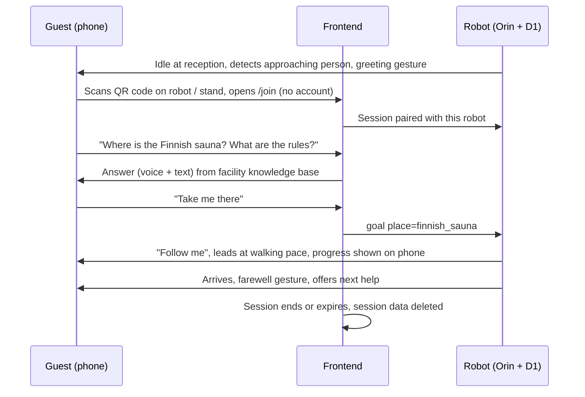

# Product requirements — D1 spa companion robot

Status: draft for the hackathon (2026-11). Partner: a thermal spa (name and site details to be confirmed).
Requirement IDs are stable; reference them in PRs and tests. Priorities use MoSCoW (M = must for the hackathon demo,
S = should, C = could, W = won't now).

## 1. Problem and goal

Visitors to a thermal spa (often tourists, often first-time, often not speaking the local language) need to find their
way around a facility with many similar areas (pools, saunas, changing rooms, rest areas, restaurant) and want to know
the rules and offers. Staff time at reception is limited.

**Goal:** a friendly robot companion that a guest pairs with by scanning a QR code. It greets them, answers questions
about the facility, and walks them to where they want to go.

## 2. Users

| Persona | Needs |
|---|---|
| **Guest** (tourist, any age, possibly in bathrobe, phone in hand) | No app install, no account, own language, quick answers, being led to a place, feeling safe and private |
| **Spa staff / operator** | Start/stop the robot, see where it is, stop it instantly, define places and no-go zones, no extra workload |
| **Spa management (data controller)** | GDPR compliance, no recordings of guests, brand-appropriate behaviour |
| **Developer / team** | Reproducible bring-up on the Jetson, mock modes, logs |

## 3. User journey (target)

## 4. Functional requirements

### Engagement
| ID | Requirement | Prio | Current status |
|---|---|---|---|
| FR-E1 | Robot detects a person approaching within ~3 m and performs a greeting (gesture + optional speech) | M | person detection exists (`human_perception`); gestures exist (`d1w_gestures`, `shake_hand`); trigger logic missing |
| FR-E2 | Library of engagement gestures (wave, nod, shake hand, bow, idle "breathing") callable by name | M | `d1w_gestures` + gateway intents `say_hi`, `shake_hand` |
| FR-E3 | Robot speaks short phrases (TTS) | S | gateway publishes `/say`; no TTS node on the robot yet |
| FR-E4 | Greeting is rate-limited (not every passer-by, not the same person repeatedly) | S | missing |

### Pairing and session
| ID | Requirement | Prio | Current status |
|---|---|---|---|
| FR-S1 | QR code on/near the robot opens the frontend `/join`, no app install, no account, guest or nickname | M | done in frontend (demo mode) |
| FR-S2 | A session is bound to one robot; only one active escort per robot at a time | M | missing (frontend not connected to robot) |
| FR-S3 | Session expires (default 10 min idle / end of escort); no session data kept afterwards | M | frontend: memory-only, 600 s |
| FR-S4 | Staff can end any session from the operator console | S | missing |

### Information
| ID | Requirement | Prio | Current status |
|---|---|---|---|
| FR-I1 | Answer questions about the facility (areas, opening hours, rules, offers) from a curated knowledge base, not invented | M | Vapi assistant exists; facility knowledge base missing |
| FR-I2 | Multilingual (at least DE + EN; tourist languages C) | S | depends on voice provider config |
| FR-I3 | Text input as an alternative to voice | M | done in frontend |
| FR-I4 | Show a simple map / list of places on the phone | C | missing |

### Escort
| ID | Requirement | Prio | Current status |
|---|---|---|---|
| FR-X1 | Guest selects a named place (voice or tap); robot navigates there via Nav2 | M | gateway `goal` with `place` + Nav2 on MetaCam map works; frontend not wired |
| FR-X2 | Named places and no-go zones are configured by staff in map coordinates | M | `places.yaml` exists; no-go zones (keepout filter) missing |
| FR-X3 | Robot moves at guest walking pace, max 0.5 m/s, slower near people | M | Nav2 limits to be set for this use case |
| FR-X4 | Robot checks the guest is still following; pauses and asks if lost | S | missing; front camera cannot see behind (open question) |
| FR-X5 | Progress and arrival shown on the phone (`goal_progress`, `goal_reached`) | M | gateway emits them; frontend not wired |
| FR-X6 | On failure (blocked, lost localization) robot stops, says so, and offers directions instead | M | gateway emits `goal_failed`; behaviour missing |
| FR-X7 | Robot returns to its home position (reception) after escort | S | possible via gateway goal; missing |

### Operations
| ID | Requirement | Prio | Current status |
|---|---|---|---|
| FR-O1 | Staff E-STOP available at all times (console + dashboard) | M | done (needs SDK link; see safety NFR) |
| FR-O2 | Robot state (pose on map, battery, mode, link) visible to staff | M | dashboard + gateway `state` |
| FR-O3 | Stack comes back after a power cycle without a developer | M | bridge systemd + watchdog done; camera/nav/gateway not yet |
| FR-O4 | Low battery: robot refuses new escorts below threshold and returns home | S | SDK refuses commands < 20 %; behaviour missing |

### Perception and mapping (enablers)
| ID | Requirement | Prio | Doc |
|---|---|---|---|
| FR-P1 | Robot camera published as a ROS 2 topic on the Orin, reliable, ≥ 15 fps, low latency | M | [feature_ros2_camera.md](feature_ros2_camera.md) |
| FR-P2 | Robot localizes on a prebuilt map of the spa's operating area | M | [feature_slam_localization.md](feature_slam_localization.md) |
| FR-P3 | Visual (monocular) SLAM as research track / relocalization aid | C | [feature_slam_localization.md](feature_slam_localization.md) |
| FR-P4 | Faces (or whole persons) anonymized before any image leaves the Orin or is stored | M (before any deployment with guests) | [feature_privacy_anonymization.md](feature_privacy_anonymization.md) |

## 5. Non-functional requirements

| ID | Area | Requirement |
|---|---|---|
| NFR-1 | Safety | Max speed 0.5 m/s with guests (0.3 m/s default), keep ≥ 0.5 m from people, stop on lost localization, lost SDK link or lost operator heartbeat. One `/cmd_vel` source at a time (arbitration). |
| NFR-2 | Safety | Operate only in **dry areas** (reception, corridors, rest areas). Pool decks, showers, saunas, steam rooms are no-go zones (heat, humidity, wet floors; D1 ingress protection unknown). |
| NFR-3 | Privacy | GDPR by design: no recording of guests, edge anonymization, no biometric identification, data minimization, transparency signage. Changing rooms and sauna interiors: camera must not capture (no-go + camera masking). |
| NFR-4 | Latency | Voice answer starts within ~2 s of end of speech; robot reacts to a goal within 3 s (the D1 needs ~2 s from stand to move). |
| NFR-5 | Reliability | Demo runs 30 min unattended; every node auto-restarts; `/connected` and diagnostics are truthful (no stale "OK"). |
| NFR-6 | Network | Venue Wi-Fi is assumed poor. Robot <-> Orin over Ethernet; nothing latency-critical crosses Wi-Fi; remote access via Tailscale. |
| NFR-7 | Compute | Everything for one robot runs on one Jetson Orin Nano (8 GB shared RAM). GPU work (detection, depth, anonymization) must fit together; budget in [system_architecture.md](system_architecture.md#compute-budget-orin-nano). |
| NFR-8 | Battery | D1 runtime 1–2 h; the Orin is powered from the robot battery. Plan demos and charging around this. |
| NFR-9 | Accessibility | Frontend usable one-handed on small phones (320 px), high contrast, text alternative to voice. |
| NFR-10 | Security | All exposed endpoints need a token; tokens never in browser/DOM; services bind to loopback by default. |

## 6. Hackathon MVP scope

**In:** greeting on person detection, QR join, voice/text Q&A from a small knowledge base, escort to 3–5 named places
on a MetaCam map of one dry area, progress on the phone, operator E-STOP, ROS 2 camera on the Orin, face blurring on any
image shown off-device.

**Out (W):** wet areas, stairs/elevators, multi-floor, multiple robots, guest identification, payments/bookings,
following a guest from behind, outdoor use.

## 7. Open questions

1. Spa name, floor plan, which areas we may use, and opening hours for a site scan with the MetaCam.
2. Who is the GDPR controller (spa) and processor (us, Vapi, hosting)? Is a DPIA required by the spa (likely yes)?
3. Voice provider: Vapi processes guest audio outside the EU. Acceptable for the demo, or EU-hosted alternative?
4. Does the D1 Ultra W expose more than the front camera (`stream_4cams_rtsp.sh` suggests up to 4)? A rear view would enable FR-X4.
5. Ingress protection / temperature limits of the D1 and the Orin for humid areas.
6. How is the robot paired to a phone: QR printed on the robot (static) or shown on a screen (rotating, per-session)?
7. Languages required by the spa's guest mix.
