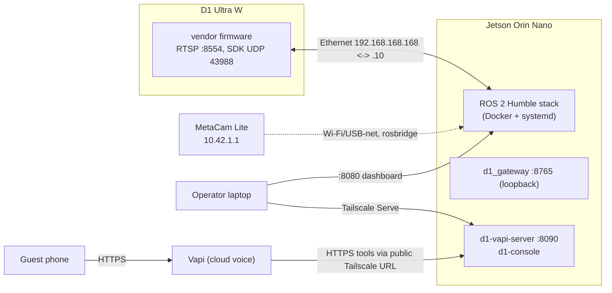
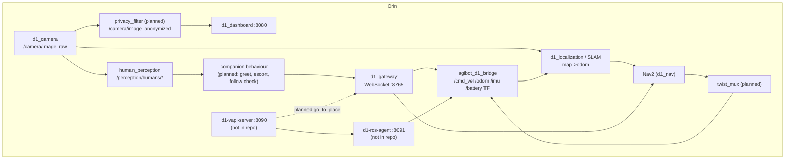

# System architecture

How the pieces fit: hardware, network, compute placement, ROS graph, external interfaces, safety and deployment.
Requirements: [product_requirements.md](product_requirements.md). Status marks: **done** (ran on the robot),
**built** (code + offline tests, not on robot), **planned**.

## Hardware

| Item | Role | Key facts |
|---|---|---|
| AgiBot D1 Ultra W (`zsl-1w`) | Mobile base, gestures | 630x360x420 mm, ~16 kg, 5 kg payload, 1–2 h runtime. Onboard RK3588-class aarch64 runs vendor firmware (motion control, RTSP camera stream). SDK over UDP `43988`, one client. Front camera 1920x1080, lens-corrected, H.264 over RTSP. Ports: GbE, 2x USB-A, 12 V / battery power out. **No LiDAR, no depth camera.** |
| Jetson Orin Nano (JetPack 6, L4T r36.4) | All ROS compute next to the robot | 6-core Arm A78AE, Ampere GPU, 8 GB RAM shared CPU/GPU. Hardware video **decode** (NVDEC). **No hardware video encoder (NVENC)** on Orin Nano: any re-encode is CPU. Powered from the robot battery. |
| SkylandX MetaCam Lite | LiDAR scanner for mapping (handheld today; possibly mounted later) | Runs ROS 1 on-device, rosbridge `ws://10.42.1.1:9089`, publishes `/mapping/odom`, `/colorizer/cloud`. Device clock is wrong. Recordings are MCAP (~1 GB/scan, not in git). |
| Guest phone | Frontend | Any modern browser, HTTPS required for microphone |
| Operator laptop | Dashboard, console, RViz | Over Tailscale or local Wi-Fi |

## Network

- Robot <-> Orin: direct Ethernet. Measured 15 fps, 0 read failures (Wi-Fi to a PC dropped frames, ~1.35 s video latency).
- Orin uplink: venue Wi-Fi; treat it as unreliable. Nothing safety- or latency-critical crosses it.
- Robot IPs elsewhere: own AP `192.168.234.1`, event Wi-Fi e.g. `172.24.1.41`.

## Compute placement

| Function | Where | Why |
|---|---|---|
| Motion control, balance, camera ISP + H.264 encode | D1 firmware | vendor, closed |
| SDK bridge, odometry, gestures | Orin | one SDK client, low latency over Ethernet |
| Camera decode -> ROS image | Orin | HW decode, no video over Wi-Fi ([feature_ros2_camera.md](feature_ros2_camera.md)) |
| Person detection, face anonymization, depth | Orin GPU | privacy: raw frames never leave the Orin |
| Localization, Nav2 | Orin | closed loop with the robot |
| Voice (STT/LLM/TTS) | Vapi cloud | demo choice; GDPR open question |
| Visitor UI | Static hosting / Orin | phone only talks HTTPS |

## Software components

| Component | Status |
|---|---|
| `agibot_d1_bridge` (+ heading-bias comp, `d1w_gestures`) | done (heading-bias comp built, not verified live) |
| `d1_camera` (OpenCV/FFmpeg CPU decode) | done; HW-decode rework planned |
| `human_perception` (YOLO26) | done on PC; Orin deployment planned |
| Privacy filter | planned |
| `d1_localization` (static MetaCam map + initial pose, odometry only) | done |
| Live LiDAR localization (`lidar-live` branch) | built, not merged |
| Monocular RTAB-Map + `d1_depth` | built, off by default |
| `d1_nav` (Nav2 MPPI) | built, not run with guests |
| `d1_gateway` | built + tests, mock robot |
| Companion behaviour (greet trigger, escort flow, follow-check) | planned |
| Frontend -> robot integration | planned (frontend is demo-only) |
| `d1-ros-agent`, `d1-vapi-server` | run on the Jetson, **source not in this repo** |

## ROS interface contract

| Topic / service | Type | Producer | QoS |
|---|---|---|---|
| `/camera/image_raw` | `sensor_msgs/Image` bgr8 | `d1_camera` | BEST_EFFORT, KEEP_LAST 2 |
| `/camera/camera_info` | `sensor_msgs/CameraInfo` | `d1_camera` | BEST_EFFORT |
| `/camera/image_anonymized` (+ `/compressed`) | `sensor_msgs/Image` | privacy filter (planned) | BEST_EFFORT |
| `/perception/humans/detections` | `vision_msgs/Detection2DArray` | `human_perception` | RELIABLE 10 |
| `/perception/humans/present`, `/count` | `std_msgs/Bool`, `Int32` | `human_perception` | RELIABLE 10 |
| `/cmd_vel` | `geometry_msgs/Twist` | Nav2 / teleop / agent (needs mux) | — |
| `/odom`, `/imu`, `/battery`, `/connected`, `/ctrl_mode` | std types | bridge | — |
| `/d1_cmd_vel_bridge/{stand_up,lie_down,damp,shake_hand}` | `std_srvs/Trigger` | bridge | — |
| `/say` | `std_msgs/String` | gateway | for a TTS node |
| `/map` | `nav_msgs/OccupancyGrid` | `map_server` | transient local |
| `navigate_to_pose` | `nav2_msgs/action/NavigateToPose` | Nav2 | — |
| `/diagnostics` | `diagnostic_msgs/DiagnosticArray` | all nodes (target) | — |

TF: `map -> odom` (localization) `-> base_link` / `base_footprint` (bridge) `-> camera_link -> camera_optical_frame`
(static, estimated mount: x 0.28 m, z 0.02 m, pitch -0.28 rad). MetaCam: `map -> mapping_init` (identity; map origin = scan start).

## External interfaces

| Interface | Doc | Notes |
|---|---|---|
| Gateway WebSocket v1 (goals, places, intents, state) | [robot_gateway.md](robot_gateway.md) | the only path for frontends/behaviours to command the robot |
| Vapi tools -> Jetson edge | [frontend_robot_integration.md](frontend_robot_integration.md) | 7 tools today; `go_to_place` planned via gateway |
| Operator console | [../tools/robot-console/README.md](../tools/robot-console/README.md) | Tailscale Serve only |
| Developer dashboard | [dashboard.md](dashboard.md) | HTTP + SSE `:8080` |

## Safety architecture

Layers, from hardest to softest:
1. **Vendor firmware**: balance, joint limits, SDK refuses commands < 20 % battery.
2. **Bridge**: per-axis velocity cap, exits and respawns if the SDK link dies; robot damps ~3 s after link loss while standing.
3. **Velocity arbitration (planned)**: `twist_mux` in front of the bridge with priorities `estop/stop > operator teleop > Nav2 > behaviours`, each input with a timeout. Today several nodes can write `/cmd_vel` with no arbitration.
4. **Nav2**: speed limits, costmap inflation, keepout zones (planned: wet areas, changing rooms), collision monitor (planned; needs a range sensor or reliable depth).
5. **Gateway**: goals and named intents only; goals refused while lying/damped/link down/no Nav2.
6. **Humans**: operator E-STOP (damp) on console and dashboard. Depends on the SDK link; a hardware stop is the robot's own remote.

## Compute budget (Orin Nano)

Targets to measure, not yet verified:

| Workload | Budget |
|---|---|
| Camera decode 1080p30 H.264 | NVDEC, < 10 % of one CPU core |
| Person detection (YOLO26n, TensorRT FP16, 640 px) | ≥ 15 Hz |
| Face anonymization | ≥ camera publish rate of the anonymized topic (≥ 10 Hz) |
| Depth Anything V2 small (if used) | 3–5 Hz, runs only when visual SLAM track is enabled |
| Nav2 + localization | ≤ 2 CPU cores |
| RAM total | ≤ 6 GB (leave headroom; 8 GB shared with GPU) |

## Deployment

- **systemd on the host**: `d1-bridge` (+ watchdog), `d1-ros-agent`, `d1-vapi-server`, `d1-console` ([deploy/jetson/README.md](../deploy/jetson/README.md)).
- **Docker** `d1-stack:humble-jp6` for camera, depth, SLAM, Nav2, dashboard ([jetson_stack.md](jetson_stack.md)), host network, private `ROS_DOMAIN_ID`.
- Target: one boot-time unit set that brings up bridge + camera + localization + Nav2 + gateway (FR-O3).

## Known risks

See [frontend_robot_integration.md](frontend_robot_integration.md#risks-to-settle-before-running-both-on-the-robot): single SDK client,
multiple `/cmd_vel` writers, `connected` latch fix only on the Jetson, untested heading-bias compensation, robot must be placed on
the map before goals, battery threshold. Plus: robot firmware updates may reset the camera stream settings.
