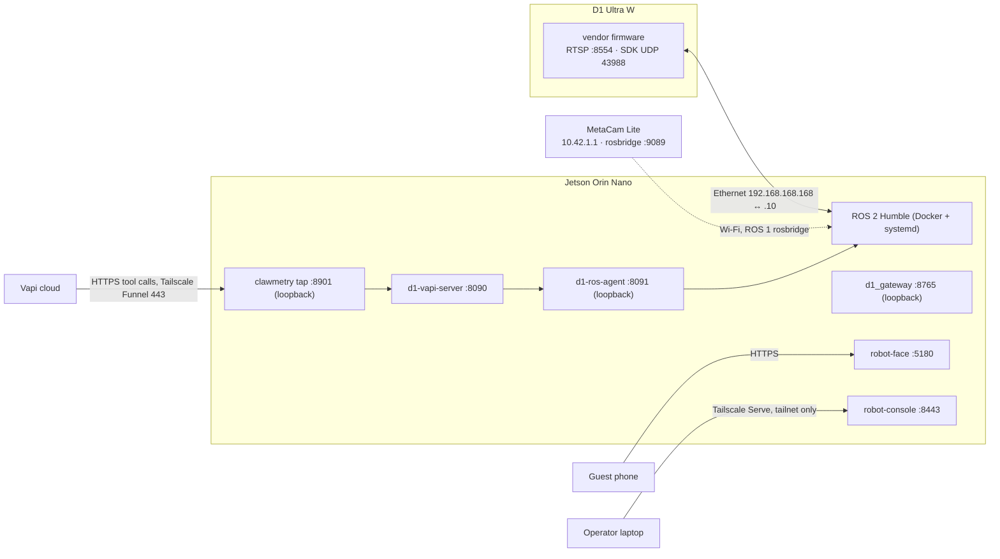

# 01 · System overview and hardware

[← index](../README.md) · next: [02 Jetson and ROS](02-jetson-and-ros.md)

---

## 1. What the thing is

A quadruped robot dog stands outside the entrance of Leukerbad Therme. It
greets people walking past, tells them what is inside, answers questions in
their own language, sells them a ticket, and walks them towards the door.

Four computers are involved and it matters which is which, because the trust
boundary runs between them:

| # | Machine | Owns | Trust |
|---|---|---|---|
| 1 | **AgiBot D1 Ultra W** | balance, joints, gait, camera ISP, H.264 encode | vendor firmware, closed |
| 2 | **Jetson Orin Nano** | ROS 2, perception, navigation, the HTTP edge, the control plane | ours, ground truth |
| 3 | **Vapi cloud** | speech-to-text, the LLM, text-to-speech | someone else's, self-reported |
| 4 | **A laptop and two phones** | the voice session, the face, the guest's consent | browsers, see [04](04-guest-journey-qr.md) and [05](05-audio-bluetooth-mic.md) |

Everything from (3) is a **claim**. Everything measured at (1) and (2) is
**ground truth**. [Chapter 09](09-clawmetry-control-plane.md) is entirely about
reconciling the two.

---

## 2. The robot, and what it cannot do

AgiBot D1 Ultra W, SDK model `zsl-1w`, wheel-foot variant.

| | |
|---|---|
| Size / mass | 630 × 360 × 420 mm standing, ~16 kg, 5 kg rated payload |
| Speed | 3.7 m/s rated maximum (we cap it two orders of magnitude below that — see §5) |
| Endurance | 1–2 h, and **the Orin is powered from the same battery** |
| Compute onboard | RK3588-class aarch64, 7.9 GB RAM, RT kernel. Observed load average ~7.4 while idle (video encoding + `mc_ctrl` pinned to core 7). Little headroom |
| Camera | **one** wide-angle monocular. DFOV 122°, HFOV 122°, VFOV 70°. 1920×1080, lens-corrected by the robot ISP, H.264 over RTSP |
| IMU | standard, vendor describes it as "limited accuracy"; 50 Hz untimestamped over UDP off-board. A 1 kHz IMU exists only in on-robot shared memory (`/imu_shm`) |
| Expansion | 1× GbE RJ45, 2× USB-A, 12 V (≤36 W) and BAT (≤100 W) XT30U, SBUS, UART |
| **Not present** | **no LiDAR, no depth camera, no stereo, no ultrasonic, no ToF, no bumper** |

That last row is the defining constraint of the whole project. The SDK
(`highlevel.h`) exposes motion, joints, attitude and battery. There is **no
obstacle API to call**. Searching the vendor documentation for 避障 / 跟随 /
建图 / 导航 (avoidance, following, mapping, navigation) returns zero hits.

> Autonomy here is not a feature being switched on. It is a feature being
> added, on top of one camera and an IMU.

Everything in [chapter 06](06-perception-and-guard.md) — ground-plane ranging,
the blind spot, the latch — exists because of that table.

### Control modes it actually emits

The SDK documents control modes `0 / 1 / 3`. The robot emits `0 / 1 / 18 / 21 /
51`. `d1_dashboard`'s name map has no entry for `21` and calls `18` "moving".

The operator console therefore prints `unknown (21)` rather than inventing a
reassuring word. Anything that speaks a mode name **aloud to a guest** needs a
map covering what the robot really emits plus an explicit unknown fallback —
this is a small thing that produces a confidently false statement about a
physical machine, which is this project's recurring failure mode.

---

## 3. The companion computer

Jetson Orin Nano, JetPack 6 / L4T r36.4.

| | |
|---|---|
| CPU / GPU | 6-core Arm A78AE, Ampere GPU |
| RAM | **8 GB shared between CPU and GPU** — the binding budget |
| Video | hardware **decode** (NVDEC). **No hardware encoder (NVENC)** on Orin Nano: any re-encode is CPU |
| Power | from the robot battery |
| Mount | on the robot, wired to it by Ethernet |

The missing NVENC is why the anonymized camera topic is JPEG-encoded on the CPU
and throttled for remote viewers rather than re-streamed as video
([13](13-privacy-and-compliance.md)).

### Compute budget (targets, not yet all measured)

| Workload | Budget |
|---|---|
| Camera decode 1080p30 H.264 | NVDEC, < 10 % of one core |
| Person detection (YOLO26n, TensorRT FP16, 640 px) | ≥ 15 Hz |
| Face anonymization | ≥ 10 Hz |
| Depth Anything V2 small (when enabled) | 3–5 Hz |
| Nav2 + localization | ≤ 2 CPU cores |
| **Total RAM** | ≤ 6 GB, leaving headroom in the shared 8 GB |

---

## 4. Network



| Link | Address | Measured |
|---|---|---|
| Robot ↔ Orin | `192.168.168.168` ↔ `192.168.168.10`, direct cable | RTSP steady **15 fps, 0 read failures** |
| Robot's own AP | `192.168.234.1` | Wi-Fi to a PC dropped frames, ~1.35 s video latency |
| Event Wi-Fi example | `172.24.1.41` | assume unreliable |
| Camera | `rtsp://<robot>:8554/test` | robot script `/opt/app_launch/stream_4cams_rtsp.sh`, patched to 15 fps / 5 Mbit/s. **Firmware updates reset it** |
| SDK | UDP `43988` | **one client only** |

**Nothing latency-critical crosses Wi-Fi.** That is not a preference; Nav2 or a
safety override on a 1.35 s link is worse than none.

### The port map, and what is exposed

| Port | Service | Binding | Exposure |
|---|---|---|---|
| 8090 | `d1-vapi-server` (public edge, Node) | `0.0.0.0` | Tailscale **Funnel** (public), bearer token |
| 8091 | `d1-ros-agent` (rclpy, owns the robot) | `127.0.0.1` | loopback only, **no token** (and that is why state polling works — see [08](08-adversarial-agents.md)) |
| 8901 | ClawMetry tap | `127.0.0.1` | Funnel when governing the live path |
| 8765 | `d1_gateway` WebSocket | `127.0.0.1` | token required if exposed |
| 8443 | operator console | `127.0.0.1` | Tailscale **Serve** (tailnet only) — **never Funnel** |
| 8080 | developer dashboard | configurable | LAN / dev only |
| 5180 | robot-face | `127.0.0.1` | Funnel with `FACE_KEY` |

> ⚠️ **Serve is tailnet-only; Funnel is public, and funnelling is a
> *port-level* property, not a path-level one.** Port 443 is funnel-enabled as a
> whole, so anything mounted beneath it — `/console` included — inherits public
> reachability. The console lives on 8443 under Serve for exactly this reason,
> and `tailscale funnel 8443` would silently put an unauthenticated
> robot-driving page on the public internet.

---

## 5. Where each computation runs, and why

| Function | Where | Why there |
|---|---|---|
| Motion control, balance, camera ISP + H.264 | D1 firmware | vendor, closed |
| SDK bridge, odometry, gestures | Orin | one SDK client; low latency over Ethernet |
| Camera decode → ROS image | Orin | hardware decode; no video over Wi-Fi |
| Person detection, anonymization, depth | Orin GPU | **privacy: raw frames never leave the Orin** |
| Localization, Nav2 | Orin | closed loop with the robot |
| Prediction, gating, ledger | Orin | the gate must be upstream of the robot and on hardware we own |
| STT / LLM / TTS | Vapi cloud | demo choice; an open GDPR question, see [13](13-privacy-and-compliance.md) |
| Visitor UI | Orin / static hosting | the phone only speaks HTTPS |

---

## 6. Speed, and the gap between rated and allowed

| Layer | Limit | Set in |
|---|---|---|
| Robot rated maximum | 3.7 m/s | vendor |
| SDK per-gait limits | `move` vx 0.05–3.7, vy 0.1–1.0, wz 0.1–3.0 m/s | firmware |
| Bridge user caps (defaults) | vx 1.0, vy 0.5, wz 1.5 m/s | `cmd_vel_bridge.py` parameters |
| Venue hard ceiling | **0.4 m/s** | `venue/leukerbad_therme.yaml → limits.max_speed` |
| Unverified / unsigned venue speed | **0.15 m/s** | same file, and currently in force for every zone |
| Measured steady walk | **0.1373 m/s** | `clawmetry/baseline.json`, 5 walks on the robot |

The robot is therefore running at roughly **3.7 % of its rated speed**, and the
venue file can only ever lower that further — a configuration file in this
system can tighten and can never loosen past the ceiling above it
([09](09-clawmetry-control-plane.md) §6).

Raising `SAFE_LIMIT` or the Nav2 maximum velocity is explicitly a human
decision requiring a request, not something any agent or script does
([AGENTS.md](../../AGENTS.md)). Guests are close and the floors may be wet.

---

## 7. Safety layering, hardest to softest

1. **Vendor firmware** — balance, joint limits; the SDK refuses commands below
   20 % battery.
2. **Bridge** — per-axis velocity cap, 0.5 s `cmd_vel` watchdog, exits and
   respawns if the SDK link dies; the robot damps ~3 s after link loss while
   standing.
3. **ClawMetry gate** — kinematic prediction refuses an action that would leave
   the allowed envelope, *before it starts*. [09](09-clawmetry-control-plane.md)
4. **Camera people-guard** — ground-plane ranging → `GO / SLOW / HOLD / FREEZE`,
   and an override that sends `stop_robot` every tick while unsafe, interrupting
   a walk already in flight. [06](06-perception-and-guard.md), [07](07-child-safety.md)
5. **Nav2** — speed limits, costmap inflation, keepout zones *(planned)*,
   collision monitor *(planned; needs a range sensor)*. [11](11-navigation-localization.md)
6. **Gateway** — goals and named intents only, never raw velocities; goals
   refused while lying, damped, link down, or Nav2 absent.
7. **Humans** — operator E-STOP (damp) on console and dashboard, and the guest's
   own Stop button on their phone.

### The hole in that list, stated plainly

**There is no `/cmd_vel` arbitration.** Nav2, the dashboard pad, keyboard teleop
and the ROS agent can all publish to `/cmd_vel` with nothing ranking them.
`twist_mux` with priorities `estop/stop > operator teleop > Nav2 > behaviours`
is designed and not built. Until it exists:

- do not run a voice walk while Nav2 is navigating;
- ClawMetry's flagship detector, `unattributed_motion`, is **weaker than it
  looks**, because with four unranked writers nothing can attribute motion to a
  source. It still catches *that* the robot moved unexplained; it cannot say
  *who*.

That is the single highest-value piece of unbuilt work in the repository.

---

## 8. Frames

```
map → odom → base_link → camera_link → camera_optical_frame
                ↘ base_footprint   (what Nav2 uses)
```

Camera mount is an **estimate**, not a measurement: x 0.28 m, z 0.02 m, pitch
−0.28 rad. MetaCam adds `map → mapping_init` (identity; the map origin is where
the scan started).

An estimated extrinsic is a confidently-wrong constant, which is the same class
of error as an uncalibrated camera height in [chapter 06](06-perception-and-guard.md).
Measuring it is on the list in [15](15-gaps-and-roadmap.md).

---

## 9. Repository map

| Path | What |
|---|---|
| `ros2_ws/src/agibot_d1_bridge` | ROS 2 ↔ D1 SDK: `/cmd_vel`, posture services, integrated `/odom`, `/imu`, `/battery`, TF, `d1w_gestures` |
| `ros2_ws/src/d1_camera` | RTSP H.264 → `/camera/image_raw` + `camera_info` |
| `ros2_ws/src/human_perception` | YOLO26 person detection → `/perception/humans/*` |
| `ros2_ws/src/d1_follow` | Lock onto one guest (IoU tracker + OSNet re-ID), dry-run `/follow/cmd_vel` |
| `ros2_ws/src/d1_depth` | Depth Anything V2 monocular metric depth |
| `ros2_ws/src/d1_slam` | RTAB-Map launch files, **off by default** |
| `ros2_ws/src/d1_localization` | `map_server` + `initial_pose_localizer` on MetaCam maps |
| `ros2_ws/src/d1_nav` | Nav2 (MPPI) + costmap configs |
| `ros2_ws/src/d1_gateway` | ROS 2 ↔ WebSocket `:8765` — goals and intents, never velocities |
| `ros2_ws/src/d1_dashboard` | Developer web UI `:8080` |
| `clawmetry/` | The control plane: tap, ledger, correlator, predictor, venue guardrails, dashboard |
| `tools/robot-guard/` | Camera people-guard and escort logic |
| `tools/robot-face/` | The robot's screen, the guest's phone, the QR |
| `tools/robot-console/` | Operator console behind Tailscale Serve |
| `tools/robot-sim/` | A fake D1 that refuses the way the real one does |
| `frontend/` | Visitor web app (React 19) and the Vapi assistant definitions |
| `maps/` | 2D occupancy grids from MetaCam Lite scans |
| `deploy/jetson/` | systemd units, watchdog, install scripts |
| `third_party/agibot_D1_Edu-Ultra` | Vendor SDK submodule — **do not edit** |

---

[← index](../README.md) · next: [02 Jetson and ROS](02-jetson-and-ros.md)
