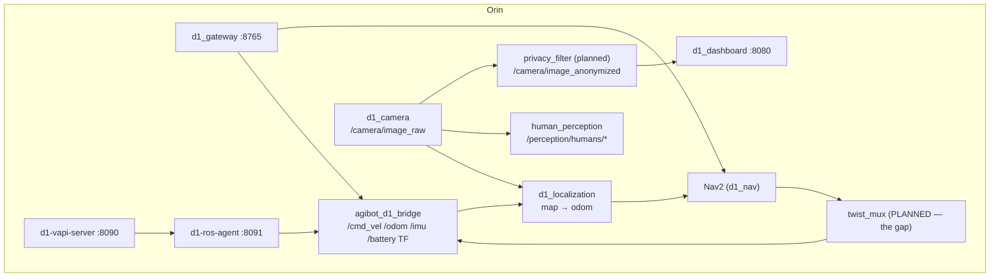

# 02 · The Jetson Orin and the ROS 2 stack

[← 01 Hardware](01-system-and-hardware.md) · [index](../README.md) · next: [03 Voice / Vapi](03-voice-vapi.md)

---

## 1. Why there is a companion computer at all

The robot's own RK3588 runs the vendor's motion stack with an idle load average
around 7.4 and one core pinned to video encoding. It is not a place to add
perception. The SDK also permits **exactly one client**, so whatever holds that
client is the only process that can talk to the robot — which makes it the
natural home for everything else.

The Orin sits on the robot, wired to it over Ethernet, and holds:

- the single SDK client (`agibot_d1_bridge`),
- camera decode and all perception,
- localization and Nav2,
- the HTTP edge that Vapi calls,
- the ClawMetry control plane,
- the web pages the guest and the robot's own screen load.

---

## 2. The image

ROS 2 **Humble** on Ubuntu 22.04, in Docker, on JetPack 6 / L4T r36.4.

```bash
git clone --branch develop <repo> ~/d1_stack && cd ~/d1_stack
git submodule update --init third_party/agibot_D1_Edu-Ultra     # aarch64 SDK libs
sudo docker build -t d1-stack:humble-jp6 docker/d1-jetson       # ~30 min: Humble, Nav2, RTAB-Map, PyTorch (JP6.1 wheel), transformers
docker/d1-jetson/run.sh bash -c \
  "source /opt/ros/humble/setup.bash && cd /ws/ros2_ws && colcon build --symlink-install"
```

**The image carries no CUDA.** `run.sh` mounts the host's `/usr/local/cuda-12.6`
plus cuDNN and TensorRT and uses the NVIDIA runtime. Check:

```bash
docker/d1-jetson/run.sh /opt/d1_depth_venv/bin/python -c "import torch;print(torch.cuda.is_available())"
# -> True
```

### Gotchas that cost real time

| Thing | Why |
|---|---|
| `transformers==4.46.3` is pinned | works with torch 2.5 on JP6; the PC side uses newer |
| The Orin is shared | another session ran `apt-get upgrade`, restarted Docker and killed a build. BuildKit cache mounts make the retry cheap |
| First depth run downloads a model | into `~/.d1_hf_cache`; the Ethernet has no internet, so it goes over Wi-Fi |
| `~/.local` NumPy 2.x breaks ROS's OpenCV | nodes strip user site-packages; launch files set `PYTHONNOUSERSITE=1` |
| Use a private `ROS_DOMAIN_ID` | the box is shared and DDS discovers everything on the subnet |

---

## 3. The bridge: `agibot_d1_bridge`

One ROS 2 node, one SDK client, and the only thing in the system that touches
the robot.

| Interface | Type | Notes |
|---|---|---|
| `/cmd_vel` | `geometry_msgs/Twist` | clamped to user caps **and** SDK per-gait limits |
| `/odom` | `nav_msgs/Odometry` | its own integration of body velocity + IMU yaw |
| `/imu`, `/battery`, `/connected`, `/ctrl_mode` | std types | |
| TF | `odom → base_link`, `odom → base_footprint` | 50 Hz integration |
| `/d1_cmd_vel_bridge/{stand_up,lie_down,damp,shake_hand}` | `std_srvs/Trigger` | posture services |
| `d1w_gestures` | — | the ten-gesture library, see [07](07-child-safety.md) |

Key parameters and their defaults:

```
cmd_timeout      0.5 s     # no cmd_vel/attitude for this long -> stop
rate             20 Hz     # command send rate to the SDK
state_rate       10 Hz     # sensor publish rate
odom_rate        50 Hz     # odometry integration
vel_deadband     0.02 m/s  # body-velocity noise below this reads as zero
max_vx/vy/wz     1.0 / 0.5 / 1.5   # our caps; SDK per-gait limits apply on top
```

**SDK minimum command speeds matter.** The SDK needs exactly `0` below
0.05 m/s (vx), 0.1 m/s (vy) and 0.1 rad/s (wz) — the bridge zeroes them. A
planner that asks for 0.03 m/s does not produce a slow robot, it produces a
stationary one, which is a tuning note for Nav2's velocity smoother
([11](11-navigation-localization.md)).

### One SDK client, enforced socially and by error

Starting a second bridge fails with `bind: Address already in use`. On the Orin
the bridge is the `d1-bridge` systemd unit; the developer dashboard must be
launched with `external_robot:=true` so it uses the running bridge's topics
instead of starting its own.

---

## 4. The three processes between a voice call and a leg

| Process | Port | systemd | Source in this repo |
|---|---|---|---|
| `d1-vapi-server` (Node, public edge) | `0.0.0.0:8090` | yes | **no** — lives in `~/vapi-robot/` on the Jetson |
| `d1-ros-agent` (rclpy, owns the robot) | `127.0.0.1:8091` | yes | **no** — same place |
| `agibot_d1_bridge` (ROS 2) | — | **added by `deploy/jetson/`** | yes |

The two Node/rclpy services being outside the repository is a real
reproducibility gap and is listed as such in
[15](15-gaps-and-roadmap.md). Everything that *can* be versioned here is.

---

## 5. Surviving a power cycle

The Jetson is powered from the robot battery, so it loses power whenever the
robot runs flat. Before `deploy/jetson/`, the bridge was hand-started in a
terminal and simply did not come back.

**That failure was quiet, which is what made it expensive.** With the bridge
down, the public endpoint still answered `200`, and before the agent's
`link_ok` fix it served the last plausible-looking posture. The voice agent
then told a guest the robot was "stationary" while it was lying on the floor,
unreachable.

`deploy/jetson/install.sh` adds:

- **`d1-bridge.service`** — the bridge as a unit, `Restart=always`, enabled at boot
- **`ordering.conf`** — a drop-in so `d1-ros-agent` starts *after* the bridge
- **`d1-bridge-watchdog.{sh,service,timer}`** — a self-heal check every 20 s

### Why the watchdog restarts the bridge and never the agent

There is a **DDS matching-order bug**: if the agent starts first, its
subscriptions match (`count_publishers` returns 1) but **callbacks never fire**.
QoS is identical on both ends, so it is not QoS.

Measured: restarting the *agent* does **not** fix it. Restarting the *bridge*
while the agent is live fixes it instantly.

Ordering alone is not enough either, because systemd calls the bridge "started"
the moment the process execs — long before it publishes anything. The watchdog
closes that gap.

### Why it waits, and why it has a cooldown

While the watchdog was being written, `/status` sampled once a second read:

```
T F F F F T F F F T
```

on a robot that was standing and completely healthy. That looked like a flaky
link. It was not. `/connected` was publishing at **19.98 Hz in a repeating
`false,false,true` pattern** — 218 false to 76 true over ten seconds — because
`cmd_vel_bridge` polled the SDK's `checkConnect()` faster than the robot's
heartbeat updated. Every sampler in the system was aliasing against a 2:1
square wave.

Fixed at the source: `connected` is now latched over a 10 s window (the raw
value stays available as `connected_raw`) and callbacks run on their own
executor thread. Fourteen consecutive samples then read true.

The watchdog still requires **3 consecutive failures** and holds a **5-minute
cooldown**, as defence in depth. Deployed against the *old* signal it would
have struck out within seconds and restarted the bridge every five minutes
forever — and a restart loop is strictly worse than a hand-started process,
because a bridge that is always restarting is never up long enough to re-pair.

It reads `link_ok` from the agent's own `:8091/status` rather than doing a TCP
check, because **a TCP check passes happily while the bridge serves nulls**.

> ⚠️ Known caveat: the `connected` latch fix is described in
> `deploy/jetson/README.md` but the merged `cmd_vel_bridge.py` in this
> repository has no `connected_raw`. The fix probably exists **only on the
> Jetson**. Committing it is in [15](15-gaps-and-roadmap.md); otherwise the
> next deploy from this tree loses it.

### Not fixed here

- **`networkmanager-cleanup.service` is enabled** and wipes saved Wi-Fi on every
  boot. `wlan0` then has no IP when `mc_ctrl` starts, so it fails to bind the
  SDK port. This recurs on every reboot.
- **The battery.** Nothing in the unit files helps if the robot runs flat; that
  is what takes the Jetson down in the first place.

---

## 6. The ROS graph



### Topic contract

| Topic / service | Type | QoS |
|---|---|---|
| `/camera/image_raw` | `sensor_msgs/Image` bgr8 | BEST_EFFORT, KEEP_LAST 2 |
| `/camera/camera_info` | `sensor_msgs/CameraInfo` | BEST_EFFORT |
| `/perception/humans/detections` | `vision_msgs/Detection2DArray` | RELIABLE 10 |
| `/perception/humans/present`, `/count` | `Bool`, `Int32` | RELIABLE 10 |
| `/cmd_vel` | `geometry_msgs/Twist` | — (needs the mux) |
| `/map` | `nav_msgs/OccupancyGrid` | transient local |
| `navigate_to_pose` | `nav2_msgs/action/NavigateToPose` | — |
| `/say` | `std_msgs/String` | for a TTS node |
| `/diagnostics` | `diagnostic_msgs/DiagnosticArray` | all nodes (target) |

> **A RELIABLE subscriber will not match a BEST_EFFORT publisher.** Image topics
> use sensor-data QoS; getting this wrong produces a node that is up, healthy,
> subscribed and receiving nothing — another silent failure.
>
> There is a measured counter-case: with stock kernel buffers, best-effort lost
> **100 %** of frames ≥ 0.5 MB in testing, which is why the detector's shipped
> YAML sets `input_reliability: RELIABLE` even though the code default is
> sensor-data. See [perception.md](../perception.md).

---

## 7. Build and test

```bash
source /opt/ros/humble/setup.bash
cd ros2_ws && colcon build --symlink-install && source install/setup.bash
colcon test --packages-select human_perception d1_gateway && colcon test-result --verbose

# gateway protocol tests, no ROS needed (requires: pip install websockets)
pytest -p no:anyio ros2_ws/src/d1_gateway/test
```

Running the whole thing on the Orin:

```bash
docker/d1-jetson/run.sh          # host network, /ws = the repo, ~/d1_maps shared
source /opt/ros/humble/setup.bash && source /ws/ros2_ws/install/setup.bash
ros2 launch d1_dashboard dashboard.launch.py \
     robot_ip:=192.168.168.168 local_ip:=192.168.168.10 host:=0.0.0.0 external_robot:=true
```

`external_robot:=true` is not optional when the `d1-bridge` unit is running —
see §3.

---

## 8. Design rules this stack follows

From [AGENTS.md](../../AGENTS.md), and visible throughout the code:

- **ROS-free logic lives in plain modules.** `human_perception` and
  `d1_gateway` keep every testable decision outside the node, so the whole
  detector set and the whole protocol can be tested on a laptop while the robot
  is flat — which is most of the time.
- **Every package change updates its doc**, and anything not run on the robot
  is marked *unverified*.
- **Code that commands the robot has a mock path.** `d1_gateway mock:=true`,
  `tools/fake_d1_odom.py`, `tools/robot-sim/server.mjs`.
- **Comments say *why*, not *what*.** Most of the sharpest engineering notes in
  this documentation were lifted from code comments, which is the intended
  direction of flow.

---

[← 01 Hardware](01-system-and-hardware.md) · [index](../README.md) · next: [03 Voice / Vapi](03-voice-vapi.md)
