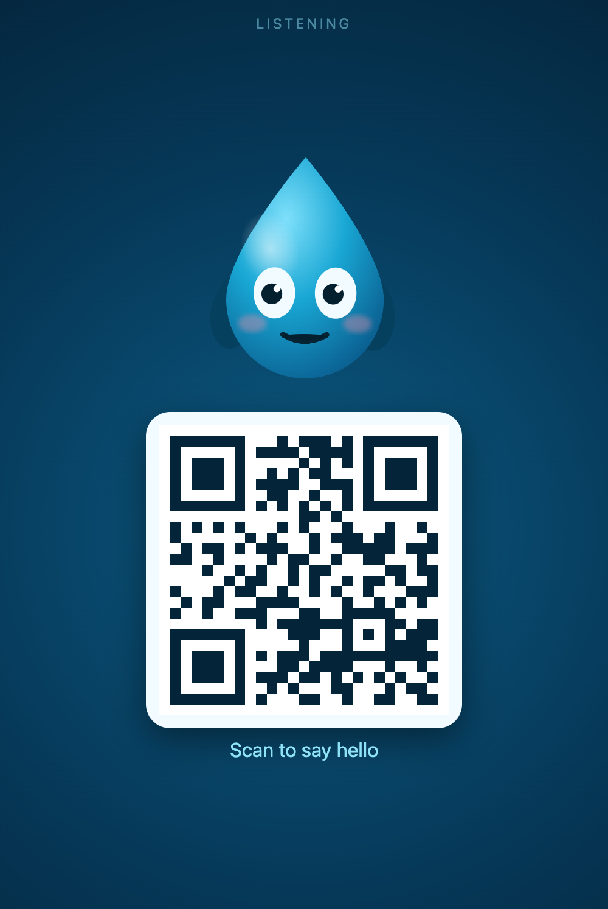
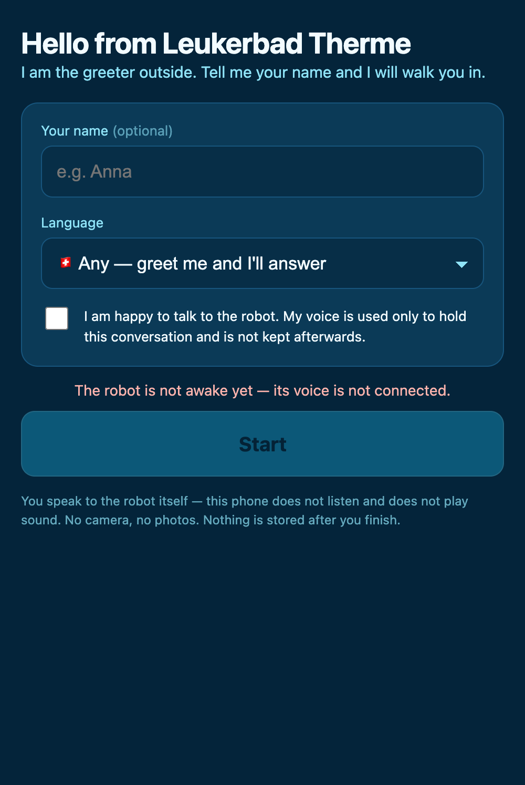
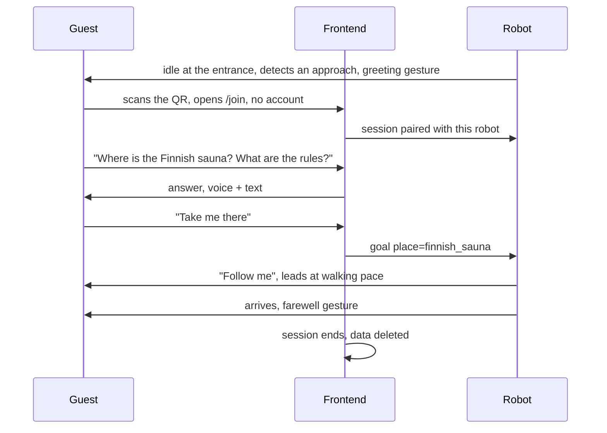

# 04 · The guest journey: QR, two screens, sessions

[← 03 Voice / Vapi](03-voice-vapi.md) · [index](../README.md) · next: [05 Audio and Bluetooth](05-audio-bluetooth-mic.md)

Source: `tools/robot-face/` (`server.mjs`, `index.html`, `join.html`, `debug.html`),
`frontend/scripts/generate-qr.mjs`.

---

## 1. Three screens, and what each is for

| Where | URL | Job | Audio |
|---|---|---|---|
| **Laptop** | `/face?brain=1&k=…` | **the voice.** Holds the DJI lapel mic and the speaker, runs the Vapi call. Tapped once to arm | mic **and** speaker |
| **Phone strapped to the robot** | `/face?k=…` | **the look.** A blinking face, and the QR every so often | none |
| **Guest's phone** | scans the QR → `/join?k=…` | consent, Start, Stop, tap-shortcuts | none |
| *(Jetson)* | hosts all three | the server and the robot-state source | no audio hardware |

The split is forced by hardware and is explained in
[chapter 05](05-audio-bluetooth-mic.md). The important product consequence is
the third row: **the guest's phone has no microphone role and no playback
role.**

> Like any humanoid robot: **you talk to the dog.**

That is not a simplification. It is the correct engineering choice, for echo
cancellation and for lip sync, and it also happens to be the right interaction
design: the guest should be looking at the dog, not at a screen. Every control
added to their phone is a reason to look down.

---

## 2. What the QR actually encodes

```js
const joinUrl = `${PUBLIC_URL}/join${KEY ? `?k=${encodeURIComponent(KEY)}` : ''}`
```

A single URL: the public address of the face server, path `/join`, with the
access key as a query parameter.

**The key is baked into the QR, and the guest never meets it.** That is the
whole trick:

> This is not a page that merely shows information: anyone who opens `/join`
> can start a billable call to an assistant whose tools move a real robot. A
> tunnel hostname is obscure, not secret, so it is not a control.
>
> The guest never meets the key — it is baked into the QR — so the cost of
> having it is zero and the cost of not having it is a stranger walking the dog.

On first load the server hands the browser an `fkey` cookie so the key stops
appearing in every later URL:

```js
const authed = (req, url) => !KEY || url.searchParams.get('k') === KEY || cookieOf(req) === KEY
```

With `FACE_KEY` unset everything is open, which is the right default on a laptop
bound to loopback and the wrong one the moment a tunnel exists. `BIND` defaults
to `127.0.0.1` for the same reason: *a service is exposed through a tunnel, not
by listening on every interface.*

### Static or rotating?

Open question FR-S6 in [product_requirements.md](../product_requirements.md).
Today it is **shown on a screen**, not printed, which means it can be rotated
per session later without changing anything physical. A printed QR on the robot
is cheaper and permanently leaks whatever key it carries.

---

## 3. The face, and the QR as an interruption

Commit `feat(robot-face): the face is the default, the QR is the interruption`.

> Nobody crosses a foyer to look at a barcode. They cross it to look at
> something with eyes.

So the face — a water drop with floppy dog ears, because the robot is a dog and
the venue is thermal water, and one shape should say both — is on screen all
the time, blinking, glancing around, ears lagging behind the sway. **Every 18
seconds the QR slides over it for 7**, then hands back to the face.

It opens *on* the QR, so whoever is setting the robot up can scan it
immediately.



*`/face?demo=1` — the whole face driven off a synthetic speech envelope with no
network, no microphone and no Vapi. That is how the animation was reviewed, and
it is how the screenshot above was taken.*

### The screen is decoration, on purpose

It syncs with nothing. An earlier version mirrored the conversation so the
mouth moved in time with the voice — lovely when the audio is on the same
device, and *a standing risk of a face that lies about what the robot is doing*
once the audio is a network away.

One visible consequence: **the QR can appear mid-conversation**, because the
screen does not know one is happening. That is the stated trade. The fix, if it
grates, is a two-second poll of `/api/state` to pause the cycle while `live` is
true — a few lines, and the only sync worth having.

*(Partially addressed: commit `feat(robot-face): hide the QR while a guest is
talking`.)*

---

## 4. The guest's phone



Four controls and one sentence. Name (optional), language, a consent checkbox,
Start. Underneath:

> *You speak to the robot itself — this phone does not listen and does not play
> sound. No camera, no photos. Nothing is stored after you finish.*

The red line in the screenshot — *"The robot is not awake yet — its voice is
not connected"* — is the honest state when no laptop brain is polling. It is
not an error dialog; it is the Start button refusing to lie about a robot that
cannot talk.

### Consent is checked on the server

```js
if (body.consent !== true)
  return json(res, 400, { error: 'consent is required before starting' })
```

> A consent control that can be skipped by replaying a request is not a consent
> control, and this one covers recording a stranger's voice.

### Why the shortcut buttons are sentences

Each tap-shortcut sends **the exact words a guest would have said** —
`"Can you take me to the sauna world?"` — injected into the conversation as
their turn via Vapi's `add-message` with `triggerResponseEnabled`.

The assistant then answers in character and reaches for its own tools. So:

- a tap and a spoken request behave **identically**;
- there is no second command path to keep in step with the persona;
- adding a shortcut is adding a string;
- and — the governance point — **there is no second door into the robot**. A
  button that called `do_gesture` directly would be a command path the gate and
  the ledger would have to learn about separately. See [08](08-adversarial-agents.md).

Server-side, `action: "say"` is the only thing a guest's phone can send besides
start and stop, it is capped at 200 characters, and it requires the session
`owner` token:

```js
if (body.owner !== session.owner) return json(res, 403, { error: 'this is not your session' })
```

---

## 5. Sessions: one robot, one guest

```js
let session = { live: false, name: '', consent: false, startedAt: 0, owner: '', lang: 'any' }
```

A session map keyed by token would be the honest thing for a fleet, and the
wrong thing for a hackathon: it adds a pairing failure mode to a demo whose
whole risk is failing in front of people.

### The newest scan wins

This used to refuse a second guest while someone else was talking. At a queue —
a hackathon stand, a spa doorway — that is the wrong way round: **nobody
presses Finish, they walk off, and the next person finds a robot owned by a
stranger who left.**

So a new scan takes the robot, every earlier session is void from that instant,
and the old call is torn down *before* the new one opens, so the robot does not
greet the new guest in the old guest's language.

The cost is stated rather than hidden: *someone can be cut off mid-sentence; the
alternative is a robot nobody else can use.*

### Anyone may stop

```js
if (body.action === 'stop') { /* no owner check */ }
```

> A Stop that checks credentials is a Stop that fails when it is most needed,
> and the worst case here is a session ending early next to a machine that can
> walk.

This is the same principle as `stop_robot` being ungated in the ClawMetry gate
and `Esc`/`Space` being STOP in the operator console even while a text field has
focus. **Stopping is never behind a check.**

### Timeouts and leases

| Thing | Default | Why |
|---|---|---|
| `SESSION_MAX_MS` | 8 min | a guest who walks away without pressing Finish must not keep the robot |
| `LEASE_MS` | 8 s, floor 6 s | the brain lease; must be ≥ 2× the 3 s heartbeat or a lease expiring between beats hands the robot to a second voice while the first is still talking |

`endSession(how, owner)` takes the owner **explicitly**. Reading it off
`session` was wrong: by the time a takeover calls it, `session` has already been
replaced by the new guest, so it closed the wrong row — or none at all.

### What the session log records

`sessions[]` keeps up to 200 rows: name, language, owner, start, end, and
`endedBy`.

> `endedBy` is the interesting column — a lot of `superseded` means the queue is
> pushing, a lot of `timeout` means people walk away without finishing.

Plus `scans`, a count of `/join` loads: someone pointed a camera at the QR.
Together they are the only honest funnel metric a robot at a stand produces.

---

## 6. The target journey, and where it stops today



| Step | Status |
|---|---|
| QR join, no app, no account (FR-S1) | **working** (`tools/robot-face`) |
| Consent, server-checked | **working** |
| One session per robot (FR-S2) | **working**, newest-scan-wins |
| Session expiry, nothing kept (FR-S3) | **working**, 8 min |
| Voice Q&A in 13 languages (FR-I1/I2) | **working** |
| Text alternative (FR-I3) | working in `frontend/`, demo mode |
| "Take me there" (FR-X1) | **leads one metre and points.** No map on real hardware; `guide_to` exists only in simulation |
| Progress / arrival on the phone (FR-X5) | gateway emits it; the guest page is not wired to it |
| Follow-check — is the guest still behind? (FR-X4) | **missing.** The front camera cannot see behind |
| Staff can end any session (FR-S4) | missing |

The honest summary: **pairing, consent, conversation and a short physical lead
work. Full escort to a named place does not,** because the robot has no map
([10](10-mapping-lidar-spike.md), [11](11-navigation-localization.md)) and no
rear-facing sensor.

`frontend/` — the React visitor app — is still **demo mode only**, with
`connect-src 'none'` in its CSP. The working guest surface at the venue is
`tools/robot-face`'s `/join`, which is deliberately 320 lines of HTML with no
build step, because it has to come up on conference Wi-Fi.

---

## 7. There is deliberately no camera in the guest flow

`tools/robot-face` has no camera at all. From its README:

> `docs/feature_privacy_anonymization.md` is explicit that face images processed
> to *identify* people are biometric special-category data under Art. 9, and the
> guests here are in swimwear. If face capture is ever added, the only
> defensible version is a transient re-ID embedding held in RAM for the session,
> never stored, never uploaded, and said plainly on screen.

See [13](13-privacy-and-compliance.md).

---

## 8. Serving it

```bash
node tools/robot-face/server.mjs              # :5180, binds 127.0.0.1
# robot phone  -> https://<host>/face         (tap once to arm)
# guest phone  -> https://<host>/join         (what the QR encodes)
# operator     -> https://<host>/debug
```

Environment: `VAPI_PUBLIC_KEY`, `VAPI_ASSISTANT_ID` (defaults to the greeter),
`PORT`, `PUBLIC_URL`, `FACE_KEY`, `BIND`, `AGENT_URL`, `SESSION_MAX_MS`,
`LEASE_MS`.

**It must be HTTPS.** A browser will not give the microphone to an `http://`
page on a LAN address — it is not a secure context — and the failure reads like
a permissions bug rather than a protocol one.

**It must be tapped once.** Browsers refuse a page the microphone, and refuse
to play sound, until somebody has tapped it. An unattended screen that was
never tapped is silent and gives no clue why, so the tap is the **first**
screen, not a mystery later. One tap during setup covers the session.

### Robot state comes from `:8091`, not `:8090`

```js
const AGENT = process.env.AGENT_URL ?? 'http://127.0.0.1:8091'
```

> `:8091` answers `/status` with no token and is the honest source — the edge on
> `:8090` runs auth before routing and 401s a GET **even with the right token**.

Polled rather than asked on demand, so a slow or dead agent delays nothing a
guest is waiting on; `reachable: false` *is* the answer in that case. The same
quirk bit the ClawMetry collector and produced a whole session of silent 401s
([09](09-clawmetry-control-plane.md) §10).

---

## 9. Tests

```bash
PORT=5180 node tools/robot-face/server.mjs &
node tools/robot-face/test-flow.mjs
```

15 assertions across both screens: arming, the QR, **server-side consent
enforcement**, start/stop, and that a tapped shortcut arrives as a user turn.

> The Vapi SDK is **stubbed** — the real one would place a billable call to an
> assistant whose robot tools point at the live Jetson, and **a test must not be
> able to move a robot.**

---

[← 03 Voice / Vapi](03-voice-vapi.md) · [index](../README.md) · next: [05 Audio and Bluetooth](05-audio-bluetooth-mic.md)
