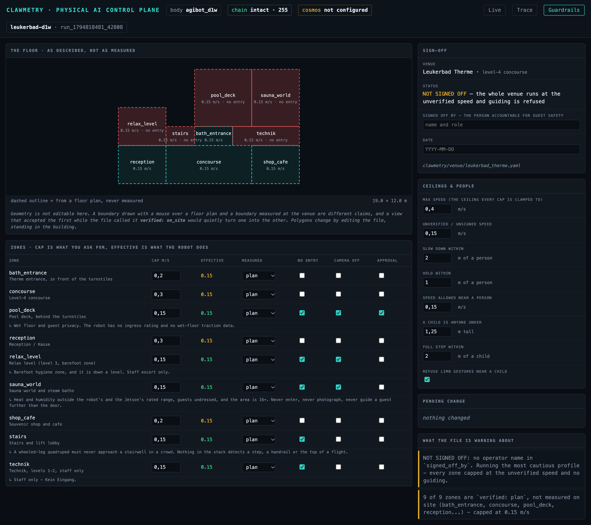

# 07 · Child safety

[← 06 Perception](06-perception-and-guard.md) · [index](../README.md) · next: [08 Adversarial agents](08-adversarial-agents.md)

> **What this chapter claims, exactly.** When the camera sees a person under
> 1.25 m within 2 m of the robot, the robot stops completely, refuses every
> gesture that lifts a limb, and keeps treating that person as present for five
> seconds after they vanish from the frame. Those rules are implemented in
> `tools/robot-guard/guard_core.py`, set by the venue in
> `clawmetry/venue/leukerbad_therme.yaml`, detected as a critical breach in
> `clawmetry/correlate.py`, and covered by 62 + 169 passing tests.
>
> **What this chapter does not claim.** That the detector behind those rules
> has ever been tested against a real child. It has not. `child_safety_verified`
> is a **blocking gap** in this project's own compliance output, and the guard
> service is currently **`inactive` on the Jetson**. Both facts are in §8 and in
> [15](15-gaps-and-roadmap.md), and neither is softened anywhere in this
> repository.

---

## 1. Why a child is a different problem, not a smaller one

The robot is **630 × 360 × 420 mm and 16 kg**. To an adult that is
roughly waist height. To a two-year-old it is **head height**.

Three things follow, and each produces a different rule:

| Fact | Consequence | Rule |
|---|---|---|
| The robot is head-height to a toddler | a gesture that raises a paw raises it **into a small child's face** | limb gestures refused |
| A 16 kg machine walking at 0.14 m/s still has momentum, and a child does not reliably get out of the way | slowing down is not enough | **full stop**, not a speed cap |
| The camera is blind inside ~0.4–0.57 m | a small child who walks up close **disappears from the frame** | latch longer and harder |

The third is the one that catches people out, and it is worth stating twice:

> **A two-year-old who toddles up to touch the robot crosses the blind-spot
> line and vanishes.** A naive implementation reads the empty frame as "all
> clear" and resumes walking — into the child it was looking at a moment ago.
>
> **Disappearance at close range does not mean absence. It means *closer*.**

---

## 2. What is disabled when a child is near

| Capability | Normal | Child within 2 m |
|---|---|---|
| Walking, any distance | allowed up to the zone cap | **refused** |
| Turning on the spot | allowed | **refused** |
| Strafing / nudges | allowed | **refused** |
| `greet` | allowed | **refused** — ends in `shakeHand()` |
| `welcome` | allowed | **refused** — ends in `shakeHand()` |
| `shake_hand` (posture command) | allowed | **refused** |
| Any unclassified gesture name | allowed in GO/SLOW | **refused** (fails closed) |
| `nod`, `shake`, `tilt`, `bow`, `squat`, `wiggle`, `look_around`, `sway_circle` | allowed | **refused in FREEZE** (allowed in HOLD, i.e. an *adult* close by) |
| `stop_robot`, `robot_status` | always | **always** |
| Talking | always | **always** |

Note the last two rows. A frozen robot is not a dead robot: it still answers,
still listens, and can still be stopped. And in `HOLD` — an adult within
0.9–2 m, no child — the eight feet-planted gestures stay available, because *a
robot that goes completely inert the moment someone approaches is a worse
greeter than one that nods at them.* A child collapses that nuance to FREEZE.

---

## 3. The numbers, and where each one is set

Defined by the operator in `clawmetry/venue/leukerbad_therme.yaml`:

```yaml
people:
  child:
    height_under_m: 1.25
    freeze_within_m: 2.0       # a child this close -> FULL STOP, no movement at all
    forbid_limb_gestures: true
    latch_s: 5.0               # they entered the blind spot: closer, not gone
  latch_s: 3.0                 # any person lost at close range
  stale_frame_s: 0.5           # no fresh frame -> stop
  crowd_count: 4
```

Mirrored as code defaults in `tools/robot-guard/guard_core.py`:

```python
CHILD_MAX_H      = 1.25   # a 2-year-old is ~0.85 m; 1.25 clears toddlers and
                          # most small children without flagging short adults
child_freeze_m   = 2.0    # inside this, the hard treatment regardless of closing speed
child_latch_s    = 5.0
latch_s          = 3.0
contact_m        = 0.9    # blind radius 0.57 + margin for the feet
stale_s          = 0.5
```

and in `clawmetry/correlate.py` as the detector's own policy:

```python
child_freeze_m        = 2.0
child_height_under_m  = 1.25
```

### Why 1.25 m

A two-year-old is about 0.85 m. 1.25 m clears toddlers and most small children
**without flagging short adults** — a threshold that treats a 1.5 m adult as a
child would be ignored within a week, which is its own safety failure.

### Why 2.0 m and not 1.0 m

The adult `hold_within_m` is 1.0 m. The child radius is double it, because the
blind spot is 0.4–0.57 m deep, a child can cross a metre in well under a
second, and the cost of being wrong is categorically different.

---

## 4. The gesture gate, and the bug it was written to catch

The distinction is **not how big the gesture looks. It is whether a foot leaves
the ground.**

Checked against the real library in
`ros2_ws/src/agibot_d1_bridge/agibot_d1_bridge/d1w_gestures.py`, not guessed.

**Safe — eight `attitudeControl` profiles, validated net-zero, every peak
inside `SAFE_LIMIT`, feet never move:**

| gesture | motion |
|---|---|
| `nod` | pitch ±14° |
| `shake` | **yaw** ±14° — the head shaking "no" |
| `tilt` | roll 17° |
| `bow` | pitch 20° + body down 6 cm |
| `squat` | body down 10 cm |
| `wiggle` | roll ±9° |
| `look_around` | yaw ±23° |
| `sway_circle` | roll/pitch loop, 14° |

Plus the posture changes `stand_up`, `lie_down`, `sit` — whole-body and slow,
but nothing lifts.

**Banned near a child — the two that sound friendliest:**

```python
"greet":   [("gesture", "bow"), ("sdk", "shakeHand", 4.0)]
"welcome": same as greet
```

`shakeHand()` **raises a paw to roughly the head height of a two-year-old** —
precisely the scenario this exists for.

The ban list also carries names that are **not in the current library but are
reachable over plain REST** — `wave`, `high_five`, `jump`, `backflip`,
`stand_two_legs`, `dance` — *"so that adding them back cannot silently bypass
the gate."*

### Two real bugs, both caught, both commemorated in the code

1. **`shake` was banned on a misreading.** Someone read "shake" as a handshake.
   It is a 14° yaw — the head shaking "no" — and banning it cost the greeter a
   harmless gesture. Fixed; the comment explains why so nobody re-bans it.
2. **The gate used to allow anything not on its banned list.** `greet` and
   `welcome` went straight through. Commit
   `fix(guard): the gesture gate allowed greet and welcome, which raise a paw`.

The fix is the structural one:

```python
# FAILS CLOSED. An earlier version allowed anything not on the banned list,
# which let `greet` and `welcome` through - and both end in shakeHand(), a
# raised paw. A gate whose default is "allow" is not a gate; a gesture nobody
# has classified is a gesture nobody has checked, and the cost of refusing it
# is one missed wag.
return g in FEET_DOWN_GESTURES
```

> **An allowlist, not a denylist.** This is the single most transferable
> decision in the chapter: in `HOLD`, only names *known* to keep four feet down
> are permitted. Everything unknown is refused.

---

## 5. The latch: presuming a child who vanished is still there

```python
if close_contact_this_frame:
    hold = child_latch_s if child_near else latch_s      # 5.0 vs 3.0
    self._latch_until = now + hold
    self._latch_child = child_near
...
if self._latch_until > now and worst < Zone.NEAR:
    latched = True
    worst = Zone.CONTACT if self._latch_child else Zone.NEAR
    child_near = child_near or self._latch_child
```

A child sighting does not just last longer, it **latches harder**: an adult
decays to `NEAR` (HOLD), a child decays to `CONTACT` (FREEZE).

### Truncated boxes are the most important boxes in the frame

```python
truncated = d.y2 >= cam.height - 2
```

A detection box clipped by the bottom edge means the feet are out of shot, so:

- the real range is **nearer** than the lowest visible row suggests → range is
  clamped to the blind radius;
- the apparent height is an **undercount** → and is explicitly *not* allowed to
  be the thing that calls an adult a child.

> *A box touching the bottom edge is the single most important box in the
> frame.*

Both corrections push towards caution, and the second one prevents the mirror
error: mis-freezing for every adult who stands close, which trains an operator
to ignore the freeze.

### A dead feed reads as danger

No fresh frame for 0.5 s → `FREEZE`, with `stale: true` on the verdict. The
latch expiry is re-evaluated on a `tick()` driven by the control loop, not only
on frame arrival, so staleness and expiry are noticed **between** frames.

---

## 6. The venue owns these numbers, not the engineers

Until `clawmetry/venue/leukerbad_therme.yaml` existed, the child rules were
**Python defaults inside `tools/robot-guard/guard_core.py`** — a unit that is
`inactive` on the Jetson — and neither venue policy in the earlier PR mentioned
children at all.

That file is written to be read and signed by the person responsible for guest
safety. In their own words:

> **CHILDREN.** A person under this height is treated as a child. The robot is
> roughly waist-height to an adult and head-height to a toddler, and the
> handshake gesture raises a paw to about the head height of a two-year-old.
>
> Gestures that lift a foot or a paw are refused near a child. `greet` and
> `welcome` both end in a handshake and are on this list for that reason.
>
> A small person who disappears at close range has almost certainly entered the
> blind spot UNDER the camera — they are closer, not gone. The robot keeps
> treating them as present for this long.

### And they can change them without SSH

The Guardrails tab of the control-plane dashboard renders those four fields as
editable controls, classified in the operator's language:



The right-hand column, "CEILINGS & PEOPLE", is the child policy as a form:
*A CHILD IS ANYONE UNDER **1,25** m tall · FULL STOP WITHIN **2** m of a child ·
REFUSE LIMB GESTURES NEAR A CHILD ☑*.

Three properties make it safe to put a child-safety file behind a web form:

1. **Every edit is classified as *more freedom* or *more restraint*, not shown
   as a YAML diff.** The direction is declared **per field** in `policy.py`
   rather than guessed from the sign of the number, because the sign is
   frequently misleading: a bigger `freeze_within_m` restrains the robot, a
   bigger `near_person_speed` frees it.
2. **Tightening needs a name. Loosening needs a name, a reason, and a separate
   checkbox** accepting that the robot is being given more room than it has now.
3. **Every change is written to the ledger before the reload**, with the
   operator's name, the full before/after, and a `loosened` flag — so an edit
   that breaks the collector is still on the record. The previous file is kept
   beside it.

> ⚠️ **Open defect, found while writing this chapter.**
> In `clawmetry/policy.py`, `CHILD_FIELDS["height_under_m"]` is declared
> `up: LOOSEN`. That appears to be inverted. Raising the threshold (1.25 → 1.5)
> classifies *more* people as children and freezes the robot *more often*, so an
> increase tightens; the other three child fields (`freeze_within_m`,
> `latch_s`, `forbid_limb_gestures`) are all declared `TIGHTEN` on the same
> reasoning.
>
> The practical consequence is the wrong way round: **lowering** the child
> height — say 1.25 → 0.90, which strips child protection from every child
> over about four years old — is currently classified `tighten`, so it needs
> only a name, and **not** the reason plus the explicit loosening confirmation
> that a reduction in child protection should demand. It is also not flagged
> `loosened` in the ledger record.
>
> Fix is one word (`LOOSEN` → `TIGHTEN`) plus a test pinning the direction of
> each child field. Tracked in [15](15-gaps-and-roadmap.md).

Zone polygons are deliberately **not** editable, because a boundary drawn with
a mouse and a boundary measured at the venue are different claims.

---

## 7. A child near the robot is a reportable incident

`clawmetry/correlate.py` raises `child_proximity` at **critical** severity the
moment confirmed state shows motion with a child inside the radius:

```python
# A child inside the freeze radius means stop, not slow. Movement of any
# kind near a small child is the scenario the whole guard exists for.
"child_proximity", severity="critical",
detail="moving with a child within 2 m - the rule is a full stop, not a slow-down"
```

Note what triggers it: **confirmed physical state**, not the agent's intent.
This fires even if the gate allowed the action, even if the guard was down,
even if the command came from a human on the console. It is the backstop that
does not care who was at fault.

`clawmetry/compliance.yaml` then labels it:

```yaml
child_proximity:
  severity_floor: critical
  labels: [safety, human_oversight]
  obligations: [venue_internal_incident, ai_act_art14_human_oversight,
                iso42001_incident_handling]
  reportable: true
  note: >
    A near-miss with a child is the incident this venue would be judged on.
    Escalate to a human in minutes, not hours, whatever any regulator says.
```

and starts a clock **written into the ledger**, not merely shown on a dashboard:

```
child_proximity   spa internal policy                 -> duty manager      15 min left
                  ISO/IEC 42001 incident handling     -> auditor         1440 min left
```

> A deadline that exists only in a UI is one nobody can prove was known.

Six of the twelve breach rules are deliberately `reportable: false`. This one
is not. See [13](13-privacy-and-compliance.md).

---

## 8. What is **not** proven — read this before believing the rest

| Gap | Status |
|---|---|
| **The detector has never been tested against a child.** The policy is enforced; the sensing behind it is unproven | `child_safety_verified` is a **blocking gap** in `readiness()`; surfaced on the dashboard in plain words: *"the child rule is enforced but the DETECTOR behind it has never been tested against a child; the policy exists, the sensing is unproven"* |
| **The guard service is `inactive` on the Jetson** | The rules above are in code and under test; the override loop is not running on the robot today |
| **Height is inferred from a bounding box and a calibrated ground plane** | Wrong camera height or tilt produces a confidently-wrong height estimate. Calibration is mandatory and verified against a third mark; until `--calibrated`, the guard caps to slow |
| **No PL/SIL rating** | A camera, a detector and a timer on a best-effort network is **not** a rated safety function and must not be sold as one |
| **No ISO 12100-style risk assessment** covering foreseeable misuse | blocking gap |
| **Nobody has signed the venue file.** `signed_off_by` is empty | The venue therefore runs in the most cautious profile — every zone at 0.15 m/s — and **refuses to guide at all** |
| **An adult carrying a child** is not modelled at all | one bounding box, adult height |
| **A child behind the robot** is invisible | the robot has one forward camera and cannot see behind itself |
| **A seated or crawling child** reads as short at close range | caught by the truncation rule in the common case, not by design |

`readiness()` returns a **gap list and never a score**, because a percentage
invites rounding up and a gap list does not.

---

## 9. Test coverage

Every rule above is pinned by tests that run with no robot, no camera and no
network.

```bash
cd tools/robot-guard && python3 -m pytest -q      # 62 passed   (2026-11-16)
cd clawmetry        && python3 -m pytest -q       # 169 passed  (2026-11-16)
```

`tools/robot-guard/test_guard_core.py` covers, among others: the child height
threshold, the freeze radius, the 5 s vs 3 s latch split, the latch decaying to
`CONTACT` for a child and `NEAR` for an adult, the truncated-box range clamp,
the truncated-box height floor, the fail-closed gesture allowlist, `greet` and
`welcome` being refused, `shake` being permitted, and the stale-frame freeze.

`clawmetry/test_clawmetry.py` covers the `child_proximity` detector, the venue
file's child block being loaded and clamped, the policy classifier's direction
for each child field, and the compliance label and clock.

---

## 10. Summary table — one line per control

| Control | Where | Enforced | Verified on hardware |
|---|---|---|---|
| child = under 1.25 m | venue file + `guard_core.py` | ✅ code | ❌ never tested with a child |
| full stop within 2 m | `guard_core.py` `_decide()` | ✅ code | ❌ guard inactive on the Jetson |
| limb gestures refused | `LIMB_GESTURES` + fail-closed allowlist | ✅ code | partial — gestures verified on the robot, not the refusal path |
| 5 s latch, hard | `guard_core.py` latch | ✅ code | ❌ |
| stale frame → freeze | `guard_core.py` `tick()` | ✅ code | ❌ |
| stop-while-in-flight override | `guard.py` | ✅ code | ❌ not running on the Jetson |
| child near = critical breach | `correlate.py` | ✅ code | ✅ fires in the scenario driver |
| 15-minute escalation clock | `compliance.yaml` → ledger | ✅ code | ✅ visible on the dashboard |
| operator can change the numbers | Guardrails tab → `policy.py` | ✅ code | ✅ screenshot above |
| nobody has signed the numbers | venue file | ✅ enforced as caution | — |

---

[← 06 Perception](06-perception-and-guard.md) · [index](../README.md) · next: [08 Adversarial agents](08-adversarial-agents.md)
