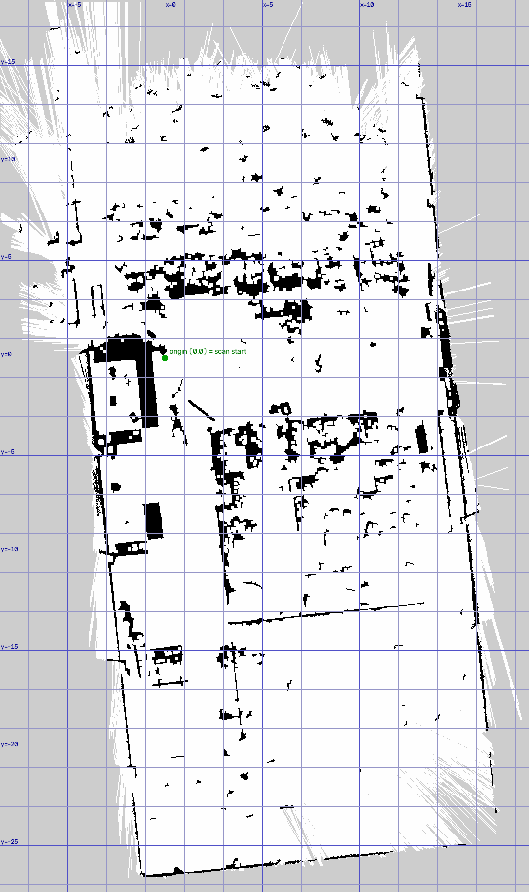
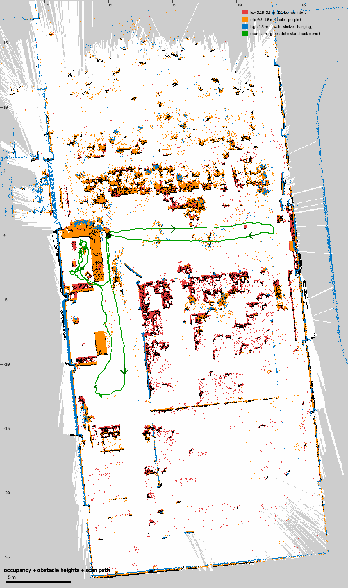

# 10 · Mapping, and the LiDAR exploration spike

[← 09 ClawMetry](09-clawmetry-control-plane.md) · [index](../README.md) · next: [11 Navigation](11-navigation-localization.md)

Working docs: [slam_nav2_study.md](../slam_nav2_study.md) (the desk study),
[feature_slam_localization.md](../feature_slam_localization.md) (the two
tracks), [map_localization.md](../map_localization.md) (using a map),
[mono_slam.md](../mono_slam.md) (the visual experiment),
[maps/README.md](../../maps/README.md) (the scans).

---

## 1. The spike, and why it happened

The robot cannot map. It has one wide-angle camera and a weak IMU
([01](01-system-and-hardware.md) §2), and the vendor documentation contains no
mention of avoidance, following, mapping or navigation.

So before building anything, a **desk study** was run: what would it actually
take to give this machine a map and a pose in it? The output
([slam_nav2_study.md](../slam_nav2_study.md), 2026-11-14) is a buy/build
recommendation, and it is one of the more useful artefacts in the repository
because it is an argument against most of its own options.

### Bottom line of the study

1. **The robot cannot map today.** Real mapping needs **a sensor we add**. A
   cheap 2D LiDAR is the minimum; a 3D LiDAR with a built-in IMU is the best.
2. **Recommended stack:** 3D LiDAR (Livox Mid-360) → FAST-LIO2-class
   LiDAR-inertial SLAM → 3D `.pcd` + 2D occupancy grid → Nav2 (Humble) with
   MPPI (Omni model) + collision monitor → `/cmd_vel` → our bridge.
3. **Start from the OEM's open-source stack**
   ([`zsibot/genisom_roamerx_open`](https://github.com/zsibot/genisom_roamerx_open),
   BSD-3) as a reference — but expect to adapt it: its README lists hardware
   deployment as "TODO" and it is only demonstrated in simulation.
4. **Run it on a computer mounted on the robot and wired to it**, not over
   Wi-Fi from a laptop. Measured: 100 ms to 1.5 s latency and an SDK link that
   dropped. Nav2 on top of that is unsafe.
5. **Before buying anything**, power the robot on and read-only inspect its
   onboard nav scripts. It may already support a LiDAR —
   `/opt/app_launch/` contains `start_navigation.sh`, `start_zenoh_route.sh`,
   `start_lcm.sh`, `start_imu_daemon.sh`, `start_linuxptp.sh`,
   `start_gpsd_chrony.sh`. **Not yet inspected.**

Point 5 is the kind of recommendation that saves a thousand francs and is
usually skipped.

---

## 2. What the built-in sensors can actually support

Constraints, from the SDK docs and our own tests:

- **IMU:** vendor calls it "limited accuracy" and suggests buying a better one.
  Off-board it arrives at **50 Hz over UDP, untimestamped**. A 1 kHz IMU exists
  only in on-robot shared memory (`/imu_shm`), so only a program running *on*
  the robot can use it.
- **Camera:** one wide-angle 122° **H.264 RTSP** stream — compressed, latent,
  no depth, no hardware timestamp, no published intrinsics.
- **Odometry:** SDK state estimate at 50 Hz. Quality untested; in one test
  `odom.x` read `0.0` after a move, so it is untrusted.

> Camera and IMU **cannot be tightly time-synchronised off-board**, which is
> exactly what visual-inertial SLAM needs. Monocular vision alone has no metric
> scale.

| Tier | Approach | Needs | Realism |
|---|---|---|---|
| 0 | **Dead reckoning** — SDK odometry + IMU, relative goals, no map | nothing new | works for short moves, drifts. First step regardless: measure drift over a known distance |
| 1 | **Camera obstacle avoidance** — monocular metric depth → pseudo-laser scan → Nav2 local costmap | GPU | plausible at low speed; model errors on glass and featureless walls. Research-grade |
| 2 | **Tag-based localisation** — AprilTags on walls + `robot_localization` fusing SDK odom → `map→odom`, Nav2 on a hand-drawn static map | calibration, printed tags, a drawn map | **most robust camera-only metric option.** Needs tags in view often; the 122° FOV helps |
| 3 | **Visual-inertial SLAM** (ORB-SLAM3 mono-inertial, OpenVINS, VINS) | on-robot run for the 1 kHz IMU, camera-IMU calibration and sync | fragile here. **Not recommended** |
| 4 | **Learned image-goal navigation** (ViNT / NoMaD-style) — drive a route once, replay | GPU | experimental, no metric map; fits our teleop well |

> **Cheapest path to a real map: add a 2D LiDAR** on a USB-A port (USD 100–300
> class), run `slam_toolbox` + Nav2 with the SDK odometry. Far less compute than
> 3D SLAM and it removes the dependence on the weak camera and IMU. Upgrade to
> 3D only if ramps or 3D obstacles matter.

---

## 3. Sensor comparison

| | **Livox Mid-360** | Unitree L1 | 2D LiDAR (RPLIDAR/Hokuyo class) |
|---|---|---|---|
| FOV | 360° × ~59° | 360° × 90° | 360° × 1 plane |
| Weight | ~265 g | ~230 g | ~200–300 g |
| Range | ~40 m @10 %, 70 m @80 % | 20–30 m | 12–40 m |
| IMU | **built in** | built in | none |
| Power | ~6.5 W, 9–27 V | — | ~2–5 W |
| Price | ~USD 900–1100 | from ~USD 349 | low |
| Fit | **best** — the OEM stack and FAST-LIO2 configs assume Livox | cheaper, shorter range; verify ROS 2 driver | flat indoor 2D only; poor on ramps |

Evidence quoted for the LiDAR-inertial recommendation: on Mid-360 data,
LiDAR-inertial beats LiDAR-only — FAST-LIO2 0.060 m vs KISS-ICP 0.124 m APE on
one indoor set; DLIO 0.096 m vs FAST-LIO2 0.112 m on UAV flights. The study is
explicit that this is **aerial data, not a legged robot, so re-test on ours.**

A Mid-360 needs GbE and 9–27 V. The robot's 12 V port (≤ 36 W) and its one
RJ45 can power and host it — but the RJ45 is already the link to the Orin, so
a second link is needed.

---

## 4. The MetaCam Lite question, and the honest answer

The team already had a **SkylandX MetaCam Lite**, so the obvious question was:
mount it on the robot.

| Item | Finding |
|---|---|
| LiDAR | 360° × 65° (−20 to +45), 216 000 pts/s, 10 Hz, 0.05–40 m @10 % / 70 m @80 % |
| Cameras | two ~200° wide cameras for colourised clouds |
| Mass | ~0.76 kg, ~1.12 kg with battery; < 20 W |
| Workflow | on-device SLAM, app preview over Wi-Fi, post-processing, multi-format export |
| Robot interface | **No ROS 2 driver, no real-time topics, no Ethernet/USB streaming found.** Mounting on a quadruped not documented |

**Assessment, as written in the study:**

> **As the robot's navigation sensor: not recommended** unless SkylandX confirm
> a real-time ROS 2 output (cloud + pose at ≥ 10 Hz), external 12 V power and a
> mount. Nav2 needs live data; a scanner built for offline capture may not
> provide it. A Livox Mid-360 has similar LiDAR specs, ~6.5 W, a ROS 2 driver,
> and costs far less.
>
> **Good use if you already own one: offline mapping.** Walk the site, export
> the cloud, convert to a 2D occupancy grid for Nav2 and as a digital twin for
> simulation. **The robot still needs its own live sensor to localise in that
> map.**

That second paragraph is exactly what was built, and it is why the project has
good maps and no live localisation.

---

## 5. Track L: what was actually built with the MetaCam

```
handheld scan → MCAP → tools/mcap_to_2d_map.py
                     → tools/make_feature_map.py
                     → maps/<scan>/{map.yaml, map.pgm, map_grid.png, …}
                     → d1_localization (map_server + initial_pose_localizer)
                     → Nav2
```

**Status: working.** The robot is placed at the scan origin (or given `x y
yaw`) and then moves by bridge odometry only — **no drift correction.**

### The four scans

| Folder | Scan | Walked | Grid | Notes |
|---|---|---|---|---|
| `metacam_lite_2026-11-14/` | 84 s | 28 m | 0.05 m/cell | first map; built with the old 0.15–0.5 m band, so low obstacles are weak |
| `metacam_2026-11-14_22-32_test/` | 111 s | 18.1 m | 40.4 × 22.4 m | same hall, longer walk |
| `metacam_2026-11-14_22-35-test2/` | 55 s | 11.0 m | 40.1 × 22.0 m | boxes near the origin |
| `metacam_2026-11-14_22-25-20/` | 235 s | **78.0 m** | 27.2 × 45.8 m | most complete |



*`maps/metacam_2026-11-14_22-25-20/map_grid.png` — 0.05 m/cell, origin
`[-8.458, -27.345, 0]`. White free, black wall, grey unknown. The 1 m grid is
there so a human can read a start pose off the picture.*



*`features_overlay.png` — obstacles coloured by height (red low, orange mid,
blue high) plus the trajectory walked during the scan. This is the view that
makes a bad map obvious.*

### The pipeline detail that mattered

The three newer maps use an improved `mcap_to_2d_map.py`:

- **Free space from ray-casting** the raw LiDAR scans and the device
  trajectory, where *rays only clear cells when the ray itself is low* — so low
  obstacles are not erased by a beam passing over them.
- **Obstacles from the raw scans plus the registered point cloud**, in a
  **0.15–1.2 m band** above the floor, so box sides and tops are both counted
  and tables are solid. Things above 1.2 m are ignored.

The first map used a 0.15–0.5 m band only, and boxes came out weak. That is a
one-parameter change that decides whether a robot plans through a table.

### Frame and origin

**`(0, 0)` is where the MetaCam started its scan**, with the axes the scanner
faced at that moment. To use a map, the robot must start at that same physical
spot facing the same way — or be given its real pose (`x`, `y`, `yaw`) at
launch or via RViz "2D Pose Estimate".

### Known limits of these maps

- Short walks in a large hall: **far edges are streaky and outer walls are only
  partly seen.**
- One height band; ceilings and overhangs are not represented.
- These are scans of a **hall, not the spa.** Scanning the venue's operating
  area is step L5 and has not happened (LOC-5, LOC-6).

### The live relay, built and not merged

`tools/metacam_live_relay.py` bridges the device's ROS 1 topics via rosbridge
into ROS 2 — `/metacam/odom`, `/metacam/cloud`, static `map → mapping_init`.
Branch `lidar-live` uses it for live localisation and is **not merged**.

> **The device clock is wrong**, so everything is re-stamped on receive. A
> scanner that reports confident, wrong timestamps into a TF tree is the same
> class of problem as an uncalibrated camera height.

Remaining steps: define how the MetaCam pose corrects `map → odom` (L1); mount
it and measure `base_link → metacam` (L2); measure relay latency (L3);
relocalise in an existing map at start (L4); scan the spa (L5).

---

## 6. Track V: monocular visual SLAM, and why it is off by default

`d1_slam` runs RTAB-Map in **RGB-only** mode on the bridge's `/odom`, with an
optional RGB-D mode fed by `d1_depth` (Depth Anything V2 + floor calibration,
reliable ≤ 3 m).

### What RGB-only RTAB-Map can and cannot do

- **Can:** build a pose graph of image nodes, detect visual loop closures,
  save and reload a database for place recognition.
- **Cannot:** build a metric 3D or occupancy map. RTAB-Map needs depth, stereo
  or LiDAR for that. **A pure monocular map is not supported.**

### The result

> Offline replays, 2026-11-14: **0 accepted loop closures in all variants.**

Deactivated on 2026-11-15. The dashboard no longer starts *Start map*, *Save
map*, the camera obstacle layer or rosbag recording, and the API refuses them.
`mono_slam:=true` brings them back.

All the monocular code stays in the repository and works. It was turned off
because navigation moved to the LiDAR maps, not because it broke.

### Why it failed, honestly

Most failures trace back to the camera inputs, not the algorithm: **1.35 s
Wi-Fi latency, 3–5 Hz frames, estimated intrinsics, an estimated camera
mount.** The re-run plan is specific — re-record on the Orin over Ethernet
after the camera work, re-run the variants offline with `tools/offline_eval/`,
compare against the MetaCam map with `compare_maps.py`.

**The value of track V was never metric mapping.** It is relocalisation and
place recognition, and not depending on an extra sensor.

---

## 7. Open problems the spike surfaced

These are worth reading even by someone who does not care about SLAM, because
two of them are safety-blocking:

- **🚩 No emergency remote while on our Wi-Fi.** The robot's hotspot — which
  the physical remote controller uses — is **off while the robot is on our
  Wi-Fi**, so there is no hardware stop. With a wired setup the hotspot can
  stay on. *"This must be solved before any autonomous motion."*
- **🚩 Control authority is exclusive.** The SDK and the remote controller
  cannot both control the robot, and **low battery hands control to the remote
  automatically.**
- **Battery.** Observed 15 % and the robot shut down. Autonomy adds payload and
  compute; endurance will drop below the quoted 1–2 h.
- **Mounting.** The vendor's back-mount documentation is empty in the repo. No
  CAD, no measured extrinsics.
- **Wheel-foot terrain limits** (stairs, gaps) are not modelled by 2D costmaps.
  Keep to flat floors — and note the venue file already forbids the stairwell
  for exactly this reason ([09](09-clawmetry-control-plane.md) §6).
- **SDK minimum speeds.** Nav2 output must respect them or the robot stalls
  near goals.

---

## 8. Decisions still open

1. **Sensor:** Mid-360 (recommended), Unitree L1, or 2D only?
2. **Compute:** add-on Jetson-class (recommended) or try the onboard RK3588?
3. **Stack:** start from the OEM stack, or the standard stack borrowing OEM
   pieces (recommended)?
4. **Environment:** flat indoor only, or ramps and uneven ground?
5. Is the MetaCam meant to stay on the robot, or is it a mapping tool only?
6. Can MetaCam's on-device SLAM run localisation-only against a saved map?
7. **Spa floors: glass, mirrors and water surfaces affect both LiDAR and
   camera.** Which areas are affected?

Question 7 is the one most likely to be underestimated. A thermal spa is close
to a worst case for both sensing modalities.

---

## 9. Acceptance test, when a live sensor exists

1. Place the robot at the home spot; start the stack from boot.
2. Escort route: home → 3 named places → home, ≥ 50 m, at 0.3 m/s, with people
   walking around.
3. Record the pose in `map` at each place against tape-measured truth: target
   **≤ 0.3 m position, ≤ 5° yaw after 50 m** (LOC-2).
4. **Cover the camera / unplug the MetaCam mid-route**: localisation must
   report degraded, the robot must stop, and the gateway must send
   `goal_failed`.

Step 4 is the one that matters. A localisation system that fails loudly is
usable; one that fails confidently is not.

---

[← 09 ClawMetry](09-clawmetry-control-plane.md) · [index](../README.md) · next: [11 Navigation](11-navigation-localization.md)
