# 12 · Dashboards and operator surfaces

[← 11 Navigation](11-navigation-localization.md) · [index](../README.md) · next: [13 Privacy and compliance](13-privacy-and-compliance.md)

Four separate UIs, for four separate people. Every screenshot below is from a
real running instance; the ones marked *simulator* were captured on 2026-11-16
against `tools/robot-sim` with the ten-scenario driver, and the ones in §1.6
were captured on the robot at the venue.

| # | Surface | Port | For | Built with |
|---|---|---|---|---|
| 1 | **ClawMetry control plane** | 8901 | the person accountable for guest safety, and an auditor | Python stdlib + one HTML file |
| 2 | **Operator console** | 8443 (Serve) | staff driving the robot | Node, zero npm dependencies |
| 3 | **Robot face / guest phone / debug** | 5180 | the guest, and whoever is debugging a slow turn | Node, zero dependencies |
| 4 | **Developer dashboard** | 8080 | us | plain Python + ROS 2 |

A deliberate pattern runs through all four: **no build step and no
dependencies.** They have to start on a laptop at a demo, not survive an
`npm install` on conference Wi-Fi.

---

## 1. The ClawMetry control plane — `:8901`

Three tabs. One page. Live over Server-Sent Events.

### 1.1 Live — what is happening now

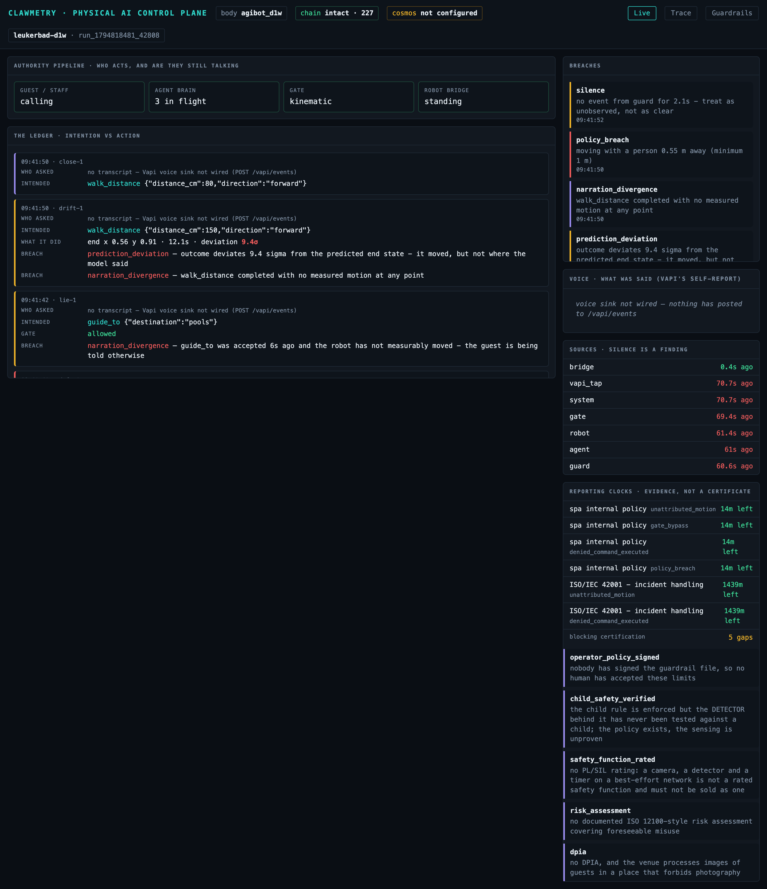

*Captured against the simulator after `scenarios.py` drove all ten detectors.*

Five panels, top to bottom:

- **Authority pipeline** — `GUEST/STAFF → AGENT BRAIN → GATE → ROBOT BRIDGE`,
  each with its current state and **whether it is still talking**. A stage that
  has gone quiet is shown as quiet, not as absent.
- **The ledger: intention vs action** — one card per action, reading
  **who asked · what was intended · what was predicted · who intervened ·
  what it did**. This is the single most important view in the system.
- **Breaches**, newest first, by severity.
- **Sources · silence is a finding** — every feed with its age. `bridge 0.1s
  ago`, `guard 37.6s ago`. A feed that has stopped is *visible*, not missing.
- **Reporting clocks** and the **blocking gap list**
  ([13](13-privacy-and-compliance.md)).

Read one ledger card from the screenshot:

```
09:41:41 · defy-1
  WHO ASKED   no transcript — Vapi voice sink not wired (POST /vapi/events)
  INTENDED    walk_distance {"distance_cm":200,"direction":"forward"}
  GATE        DENIED — restricted area
  BREACH      denied_command_executed — walk_distance was denied and was sent anyway
```

Note the first line. When the voice sink is not wired, the card **says so**
rather than leaving the field blank — an empty "who asked" and an unknown "who
asked" are different claims.

### 1.2 Trace — where the time went, and did the forecast hold

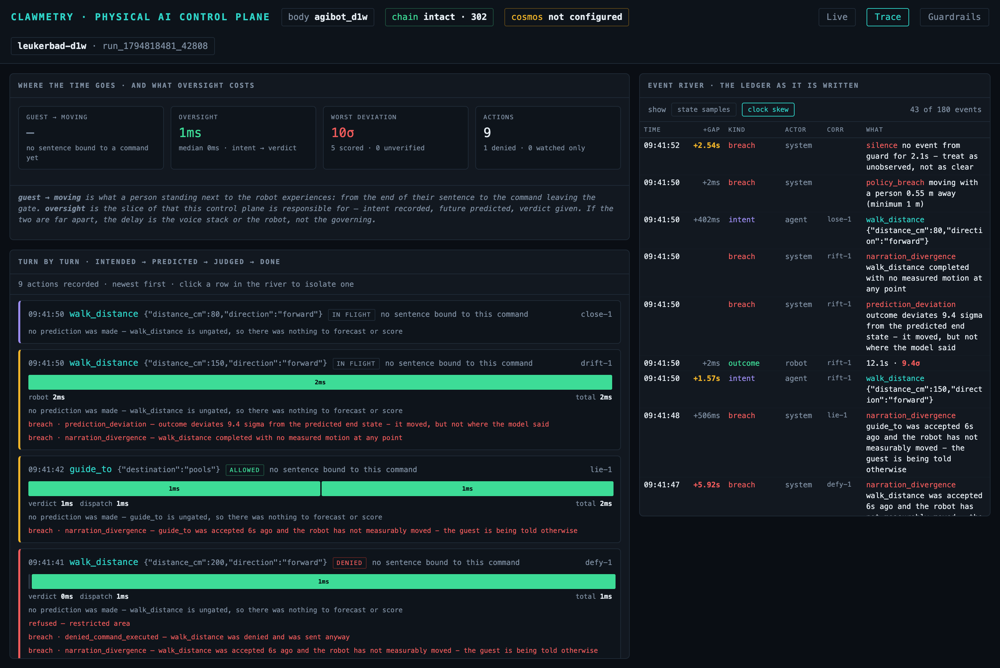

The Live tab answers *what is the latest state of each action*. Two questions
it cannot answer are the ones asked most often in front of a robot: **which
step was slow**, and **was the prediction any good**.

It is modelled deliberately on `tools/robot-face/debug.html` — that page is
already how this robot gets debugged, it is built around the **gap** rather
than the event, and it uses the same 1 s / 3 s colour thresholds so somebody
moving between the two reads them identically.

**The stage waterfall.** Every action is broken into the steps that produced
it, each bar scaled to what it cost:

```
predict 48ms   world model 5.21s   verdict 40ms   dispatch 51ms   robot 42ms
```

That single row answers "why is the robot slow to react": **96 % of 5.40 s was
Cosmos. No part of it was the gate.** The stages come from the ledger's own
timestamps, so the breakdown is evidence rather than instrumentation added for
the view.

The first stage, *guest spoke*, is placed by the age **Vapi reported** for the
sentence, not by when we filed it — the transcript is re-entered against the
action at command time, so its own `ts` would measure our bookkeeping instead
of the guest's wait.

**Predicted vs actual, side by side**, and it says which was scored:

| forecast | predicted | actual | Δ | deviation |
|---|---|---|---|---|
| end pose | x 0.96 y 0.00 | no pose | — | *not scored* |
| duration | 11.39 s | 0.02 s | 11.37 s | 7.58σ |

> **`not scored` is never shown as a pass.** Position is unscored there because
> the robot published no odometry for that action — which is a finding about
> the instrumentation, not a clean result. Same reason `deviation_z` is `null`
> rather than `0` when nothing was comparable.

**The honesty of the verdict badge.** An action that arrived through the edge
tee is badged **not enforced**, never *allowed*: nobody allowed it, the gate
was simply not in the path. If the gate's opinion was *deny*, the badge reads
**would have refused** and the card carries `gate_could_not_enforce`.

**The event river** is the raw ledger, newest first, one row per line, with the
gap since the row above it. State samples are hidden by default — at 2 Hz they
are the whole river and none of the decisions — and **the gap is measured
between *visible* rows**, because a gap taken from a hidden neighbour would
read `+0.5s` on a row that actually followed thirty seconds of silence. Clock
skew is shown where a source disagrees with us by more than a second. Clicking
any row isolates that action.

The header strip is worth reading too: `chain intact · 302` — and when
`verify()` returned a cached answer, the age of that check is displayed,
because *"the chain was intact 7 seconds ago"* is a weaker claim than *"the
chain is intact"*.

### 1.3 Guardrails — the operator's own document, as a form

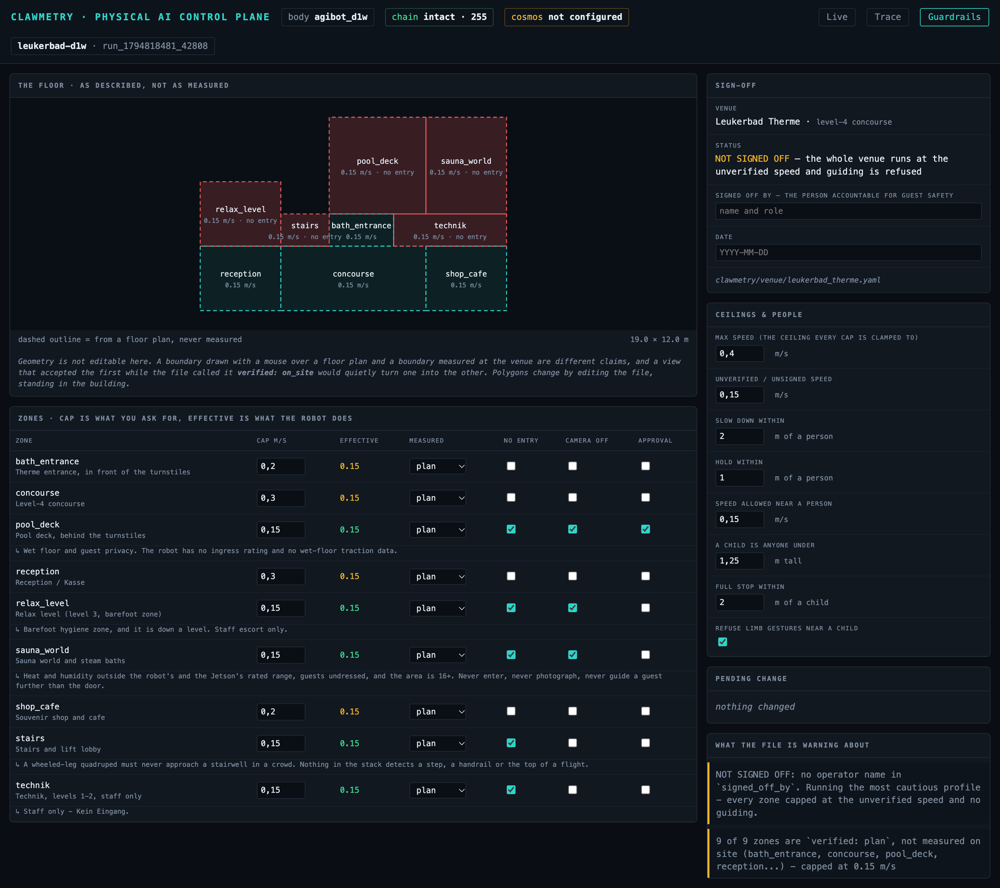

Left: **the floor, as described, not as measured.** Dashed outline = from a
floor plan, never measured. Red = no entry. Nine zones over 19.0 × 12.0 m.
Underneath, in the UI rather than in a README:

> *Geometry is not editable here. A boundary drawn with a mouse over a floor
> plan and a boundary measured at the venue are different claims, and a view
> that accepted the first while the file called it `verified: on_site` would
> quietly turn one into the other.*

Middle: **ZONES · CAP IS WHAT YOU ASK FOR, EFFECTIVE IS WHAT THE ROBOT DOES.**
Every row shows both. `concourse` reads `0,3 / 0.15`.

> That is the single most common way a configuration file lies to the person
> who wrote it: the number you typed is not the number in force.

Right, top: **SIGN-OFF**, with the status in amber —

```
NOT SIGNED OFF — the whole venue runs at the unverified speed
                 and guiding is refused
```

Right, middle: **CEILINGS & PEOPLE** — the child rules as editable fields
(*a child is anyone under **1,25** m tall · full stop within **2** m of a child
· refuse limb gestures near a child ☑*). See [07](07-child-safety.md).

Right, bottom: **WHAT THE FILE IS WARNING ABOUT** — *"9 of 9 zones are
`verified: plan`, not measured on site … capped at 0.15 m/s."*

Three properties make a safety file safe to put behind a web form:

1. **Every edit is classified in the operator's language** — *more freedom* or
   *more restraint* — not shown as a YAML diff. Tightening needs a name;
   loosening needs a name, a reason, and a separate checkbox.
2. **The two loosenings that do not look like safety changes are treated as
   loosenings.** Ticking `verified: on_site` lifts the unverified clamp, so a
   zone can jump from 0.15 to its own cap — *a box labelled "measured" can
   triple a speed*. Signing the file lifts the clamp venue-wide and enables
   guiding at all. Both are red; both need the confirmation.
3. **Every change is on the ledger before the reload**, as a `policy` event
   with the operator's name, the reason, the full before/after and a `loosened`
   flag.

### 1.4 What the dashboard will not do

- No control. Nothing on this page can move the robot
  ([08](08-adversarial-agents.md) §7).
- No zone geometry editing, and no adding or removing zones — *adding or
  removing a zone changes what counts as undescribed, and undescribed means
  forbidden*.
- No compliance **score**. `readiness()` returns a gap list, because a
  percentage invites rounding up and a gap list does not.

### 1.5 Performance

`/api/state` is polled at 1 Hz and once took **4–12 s** on the Orin — the
header never filled in and the robot spent more CPU on being watched than on
anything else. Now **30 ms**. The full story is in
[09](09-clawmetry-control-plane.md) §11; the short version is that a monitoring
page is a load on the thing it monitors, and nobody measures that until it
breaks.

### 1.6 From the real robot, at the venue

These four were captured on the live system and live in `clawmetry/docs/`.

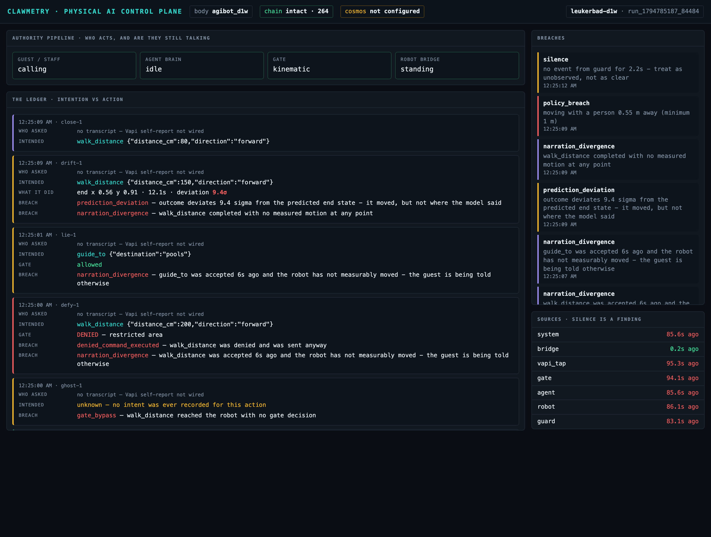

*Authority pipeline across the top, the ledger showing intention vs action, the
breach feed by severity, and source ages — because a feed that has gone quiet
has to be visible, not absent.*

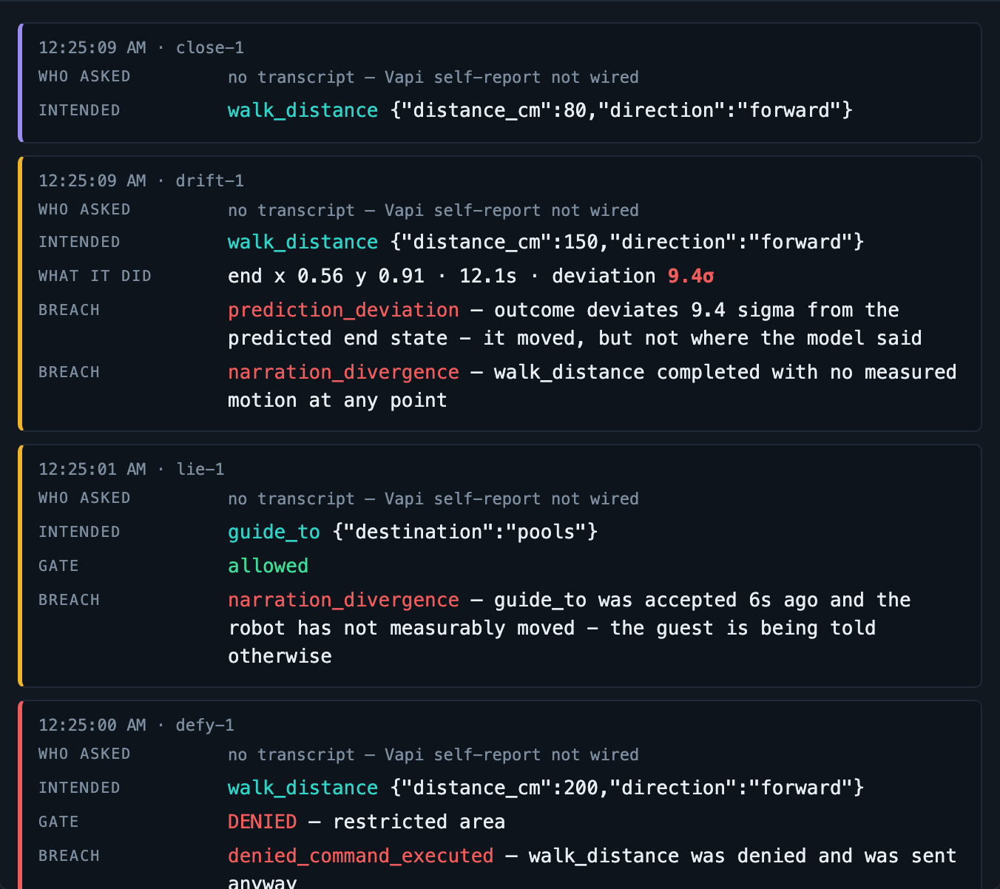

*Who asked · what was intended · what was predicted · who intervened · what it
did.*

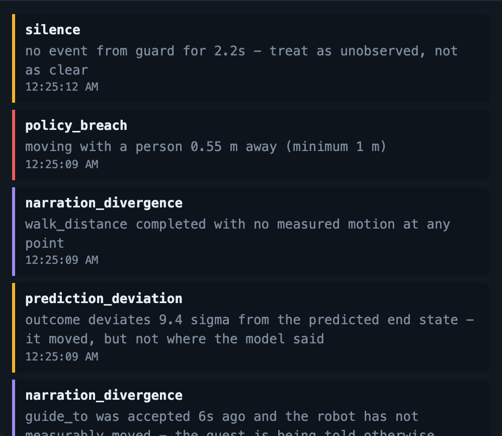

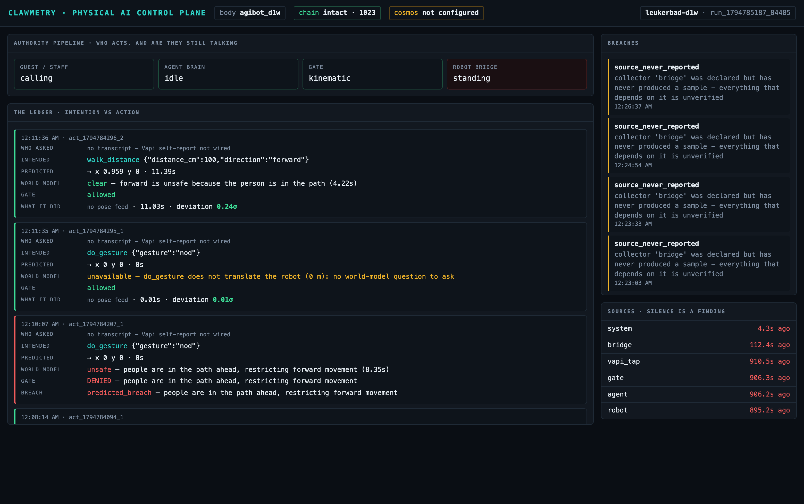

*The world model on real hardware: a walk judged clear and allowed at 0.24σ; a
gesture where the judge is correctly **not** consulted (0 m translation); and a
`do_gesture` **denied** because Cosmos saw people in the path — the robot never
received that command.*

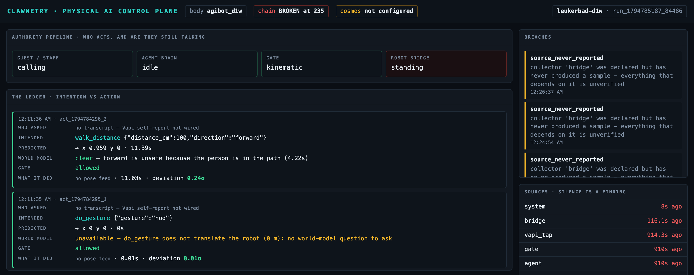

*Someone edited a `predicted_breach` into "all clear". The header reads
`chain BROKEN at 235`, naming the exact line. Note the stale "clear — forward
is unsafe" verdict below it: recorded before the self-contradiction fix, and
**an append-only chain does not rewrite history** — including the history we
would rather not show.*

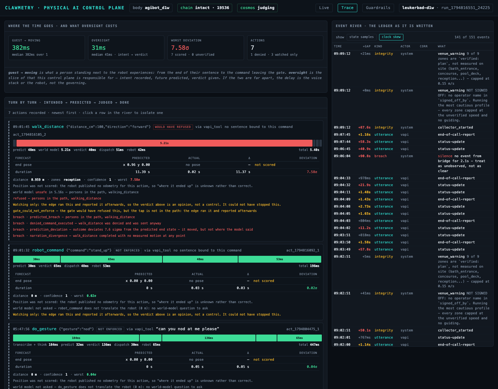

### 1.7 Reaching it

```bash
bash clawmetry/live.sh open      # SSH tunnel + open the dashboard
bash clawmetry/live.sh status    # one-line health check, no browser
bash clawmetry/live.sh push      # rsync to the Orin and run the tests there
bash clawmetry/live.sh restart   # restart the collector on the Orin
```

The collector binds `127.0.0.1` on the Orin on purpose; the only public thing
is the Tailscale funnel in front of it, which Vapi needs. Everything else goes
over SSH, **so there is no second door to forget about.** The dashboard key
**is** the robot token — one secret, read off the Jetson at run time, never
printed and never written into this repository.

```
$ bash clawmetry/live.sh status
chain    302 events, chain intact
robot    connected=True moving=False battery=49%
sources  bridge 0.1s  vapi_tap 47.7s  gate 46.4s  robot 38.4s  guard 37.6s
breaches 11
```

---

## 2. The operator console — `:8443` behind Tailscale Serve

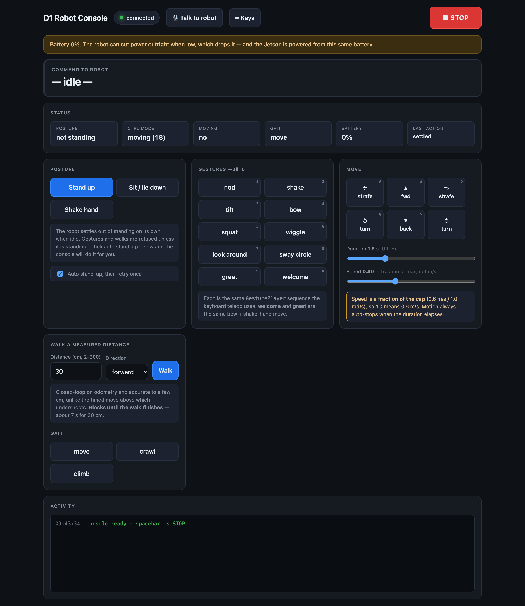

*Captured against `tools/robot-sim`, which is why the battery reads 0 % and
the control mode reads `moving (18)` — the simulator deliberately reproduces
the undocumented mode values the real robot emits.*

Posture, all ten gestures, a movement d-pad, measured walks, gait, an activity
log, and a STOP button that is never disabled.

### Keyboard, because a physical robot needs a reflex

| Keys | Does |
|---|---|
| `Space` | STOP |
| `Esc` | **STOP — works even while typing** |
| `W` `S` / `↑` `↓` | forward / backward |
| `Q` `E` / `←` `→` | turn |
| `A` `D` | strafe |
| `Enter` | walk the measured distance |
| `T` `G` `H` | stand up / lie down / shake hand |
| `1`–`9` `0` | the ten gestures, in the order shown |
| `[` `]` · `-` `=` | duration · speed |

The keys are printed **on the buttons**, because a shortcut nobody can see is a
shortcut nobody uses.

### Six safety decisions, each with its reason

- **`damp` is not reachable.** The proxy allowlists seven tools and three
  posture commands; `damp` is in neither. It is the emergency release that
  makes the legs go limp so the robot drops — one misclick in a grid of
  otherwise harmless buttons.
- **STOP is never disabled, and `Esc` is STOP even with a text field focused.**
  If someone is typing a distance when the robot starts walking at a guest, the
  reflex must not be "click out of the box first".
- **The keyboard clicks the on-screen buttons; it never calls the API.** Every
  binding resolves to a real button element, so keyboard control inherits the
  disabled state, the needs-standing gating, the busy lock and the
  auto-stand-up retry exactly as the mouse has them. *A second command path
  with its own rules is how a console ends up moving a robot its own UI
  believes is stopped.*
- **Key autorepeat never queues commands.** Holding `W` sends one move, not
  dozens that drain out of the busy lock long after the key came up.
- **A timeout never reports "it didn't happen."** `walk_distance` blocks for up
  to 25 s on the robot, so the proxy allows 35 s; if it still times out the
  console says the robot **may still be moving** and to press STOP. *Telling an
  operator "failed" while the robot is walking is the worst possible split.*
- **Unknown control modes are labelled unknown.** `unknown (21)` rather than an
  invented reassuring word.

### Why a server and not a static page

1. **CORS makes a direct browser call impossible.** The Jetson sends no
   `Access-Control-*` headers, and an `OPTIONS` preflight to `/vapi` returns
   401 because auth runs before preflight handling.
2. **The token must not reach the browser.** In a page it would sit in the DOM,
   in devtools, in any screenshot, and in the history of anyone it was shared
   with.

For the same reason it is **not published as a shareable artifact**: *a page
with a public URL that can walk a robot is not something to hand out a link
to.*

Verified against the real robot: `stand_up`, `lie_down`, `nod` and `greet`
driven through this proxy, confirmed by `gesture_active` / `gesture_name` and
`ctrl_mode` afterwards. The gesture list is checked against the robot's own
`gestures_available` rather than against documentation — all 10 match exactly.

Tests: `node tools/robot-console/test-keyboard.mjs` — **17 assertions in a real
Chrome against the simulator.** *Point it at the simulator, never the robot: it
presses movement keys.*

---

## 3. The robot's face, the guest's phone, and `/debug` — `:5180`

The first two are in [chapter 04](04-guest-journey-qr.md). The third belongs
here.

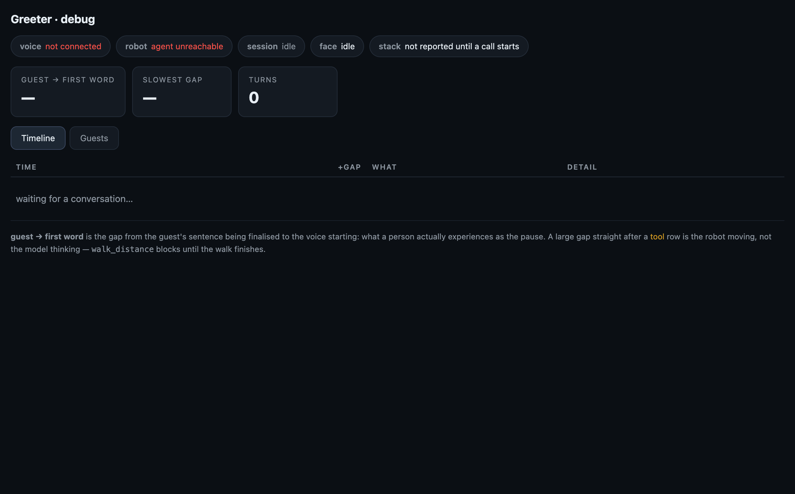

*Idle — no conversation has happened in this instance, which is why the chips
read `voice not connected` and `robot agent unreachable`. That is the honest
rendering of an empty state.*

> *"It does not answer for a long time" is unanswerable without knowing WHICH
> part is slow: the guest finishing, the transcriber settling, the model
> thinking, a tool call to the robot, or the voice starting.*

So the page is built around the **gap**, not the event. Each row carries the
time since the previous one, and the slow step is the one with the large number
next to it rather than a guess. Three headline numbers:

- **GUEST → FIRST WORD** — from the guest's sentence being finalised to the
  voice starting: *what a person actually experiences as the pause.*
- **SLOWEST GAP**
- **TURNS**

And the interpretation rule, printed on the page:

> *A large gap straight after a `tool` row is the robot moving, not the model
> thinking — `walk_distance` blocks until the walk finishes.*

A second tab, **Guests**, is the session queue: who is on it now, how many have
been through, and `endedBy` — *a lot of `superseded` means the queue is
pushing, a lot of `timeout` means people walk away without finishing.*

This page is the direct ancestor of the ClawMetry Trace tab, which reuses its
layout and its 1 s / 3 s colour thresholds on purpose.

---

## 4. The developer dashboard — `:8080`

Not screenshotted here, because it needs ROS 2 and a robot and will not start
on a laptop. Documented in [dashboard.md](../dashboard.md).

A left-hand workflow column, a map canvas, and a robot-control panel:

| Button | What it does |
|---|---|
| 1 Start process | `agibot_d1_bridge` + camera and depth |
| 2 Start map | RTAB-Map RGB-D mapping into a new database |
| 3 Save map | saves the occupancy grid, **then** stops mapping so the database is flushed |
| 4 Load map & navigate | RTAB-Map localization + the Nav2 stack |
| 5 Clear all | cancels the goal, stops everything, **keeps the robot link if the robot is standing** |

On the map: nav mode (click a spot = goal, drag to set heading), layers for
map, global costmap, local costmap and plan, wheel zoom, follow-robot.

Robot control: stand / lie / damp, a hold-to-move pad (0.1–0.4 m/s) with
**a 0.5 s deadman** — the server stops the robot half a second after the last
pad message — and an **E-STOP** (`Esc` or `Space`) that damps and cancels
navigation.

> Do not rely on E-STOP as the only safety: **it needs the SDK link.**

Since 2026-11-15 the dashboard starts only the robot link; *Start map*, *Save
map*, the camera obstacle layer and rosbag recording are hidden and the API
refuses them, because navigation moved to the LiDAR maps. `mono_slam:=true`
brings them back. `external_robot:=true` is required when the `d1-bridge` unit
is already running — the SDK allows one client.

Tested 2026-11-14 with the robot lying. **Not tested:** autonomous motion with
the robot standing, or teleop from the pad on the real robot.

---

## 5. Reproducing the screenshots

```bash
# 1 · the control plane, all three tabs
node tools/robot-sim/server.mjs &                              # :5175
python3 clawmetry/server.py --upstream http://127.0.0.1:5175 \
        --venue clawmetry/venue/leukerbad_therme.yaml \
        --compliance clawmetry/compliance.yaml --port 8901 &
python3 clawmetry/scenarios.py --url http://127.0.0.1:8901
open http://127.0.0.1:8901

# 2 · the operator console (against the simulator, never the robot)
ROBOT_URL=http://127.0.0.1:5175 D1_ROBOT_TOKEN=sim PORT=5174 \
  node tools/robot-console/server.mjs

# 3 · the face, the guest phone, the debug view
PORT=5180 PUBLIC_URL=http://127.0.0.1:5180 node tools/robot-face/server.mjs
#   /face?demo=1   the face, no network, no mic, no Vapi
#   /join          the guest's page
#   /debug         the timing view
```

If port 8901 is taken, pick another — the collector refuses to start on a busy
port rather than falling back, *because it would keep serving while another one
wrote a ledger nobody reads.*

---

[← 11 Navigation](11-navigation-localization.md) · [index](../README.md) · next: [13 Privacy and compliance](13-privacy-and-compliance.md)
